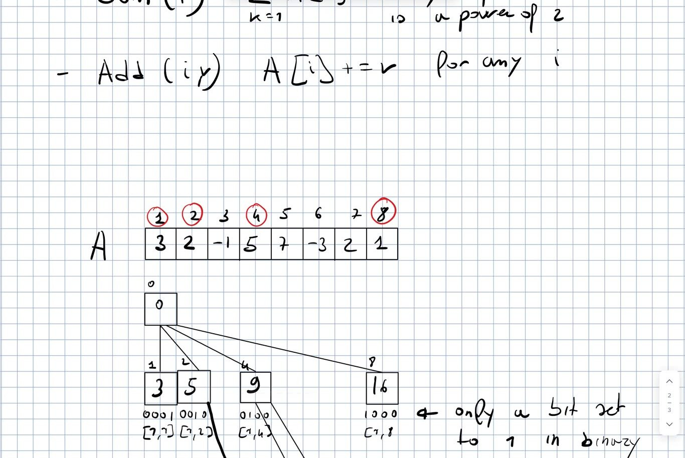
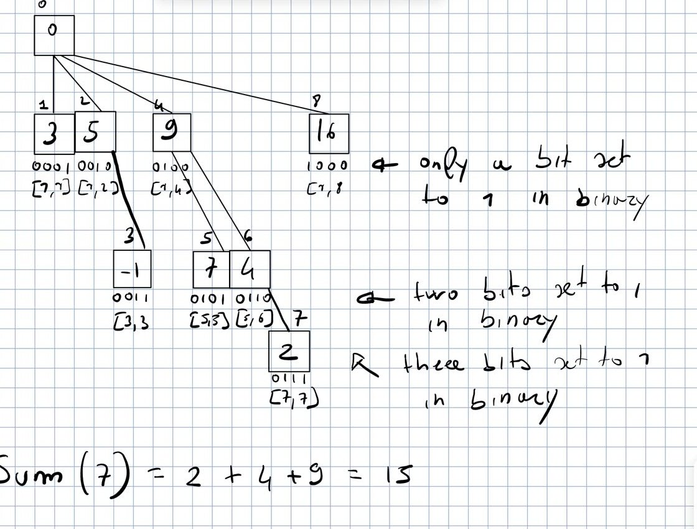
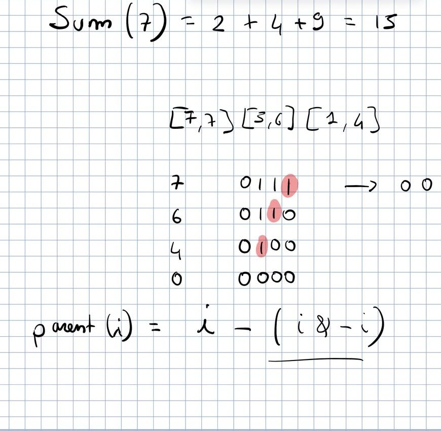
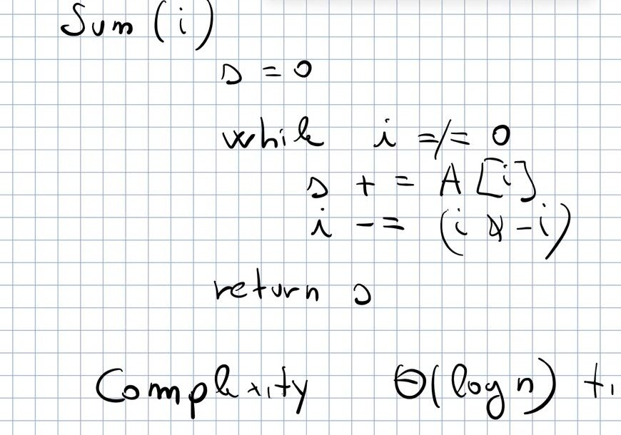
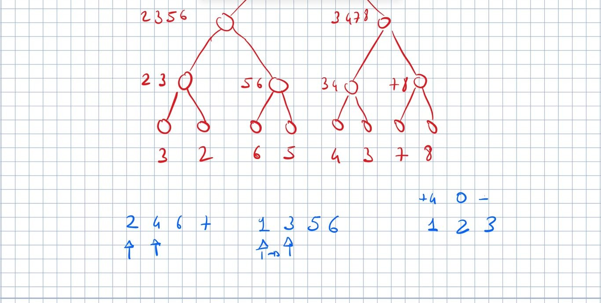

# **CPC — Lecture 11** — Fenwick tree: levels, <span class="sans-serif">Sum</span> and <span class="sans-serif">Add</span> with bit tricks $\cdot$ Counting inversions

Competitive Programming and Contests — Wednesday 21/10/2026

<div class="keybox">

**Sources.** Recording `Lessons/L11/L_11.MP4` (91 min) and its automatic transcript `L11_transcript.txt` (not revised); the prof’s handwritten board (frames of the recording, `board/l11_*.jpg`); the prof’s 2025 notes `Lessons/L11/FenwickTree_2025.pdf` (p. 1–6 cover this lecture, p. 7–15 the next one); the prof’s blog post *Dynamic Prefix Sums with Fenwick Tree* (<https://pages.di.unipi.it/rossano/blog/2023/fenwick>); your notes `Lessons/L11/notes.md` (they match the recording: **they stop exactly where the lecture stops**). Everything marked <sup>\[extra\]</sup> was *not* said or written in the lecture (my explanations, examples, code). **This replaces the provisional version of 21/10**: the parts it had marked “not in your notes” (inversions with a Fenwick tree, Nested Segments, Update the Array, range updates) were indeed *not* done on 21/10 and have moved to `Lessons/L12/L12.pdf`.

Code: `Lessons/L11/src` (`cargo test -p l11`). Exercises: `Lessons/L11/practice`, E47–E49 (`cargo test -p practice_l11`).

**Highlights:** **general / to remember** **good: works, efficient, correct** **bad: pitfalls, wrong ideas, costs** **definitions and key results**

</div>

<div class="keybox">

**Where we are.** L10 (19/10) introduced the Fenwick tree, but **its recording stops at 84:54**: the end of L10 was reconstructed from your notes (`L10.pdf` §3.4). Today the prof **recaps it from the start** (relaxed version, recursion on the uncovered subarrays, fake root), so this PDF also confirms that reconstruction. Then <span class="sans-serif">Sum</span>, <span class="sans-serif">Add</span>, their complexity, and the start of **counting inversions**.

</div>

# Fenwick tree: recap and levels

**Problem** (dynamic prefix sums). Given $A[1,n]$ support **$\textsf{Sum}(i)=\sum_{k\le i}A[k]$** and **$\textsf{Add}(i,v)$: $A[i]\mathrel{+}=v$**, both in **logarithmic time**. Running example (from L10): $A=[3,2,-1,5,7,-3,2,1]$; the tree stored as an array is $H=[0\,|\,3,5,-1,9,7,4,2,16]$.

**Recap of L10** (0:00–7:30). *Relaxed version*: $\textsf{Add}$ on any position, but $\textsf{Sum}$ only on positions that are a power of two. Following the footnote of our checklist (“**if there are few possible queries, precompute all the answers**”), we store the $\log n$ answers: the nodes $1,2,4,8$ under a *fake root* 0, labelled with their position and the range they cover ($[1,1]=3$, $[1,2]=5$, $[1,4]=9$, $[1,8]=16$). **The labels (ranges, binary representations) are for our understanding only: the data structure is just the array $H$.** The ranges that are not covered ($[3,3]$ and $[5,7]$ here; in general $2^k+1..2^{k+1}-1$) are handled **recursively with exactly the same approach**, using positions *relative to the subarray*: their nodes become children of the power of two just before the subarray. 

*Board, 8:20: the relaxed version, first level of the tree*

## Levels and height

- **Level 1: positions with one bit set to 1** (powers of two); level 2: two bits set (sums of two powers of two); level 3: three bits, … “the power of our data structure is improving level by level”.

- Node 7 $=\texttt{0111}$ covers $[7,7]$: **node $i$ covers $(i-\mathrm{lsb}(i),\,i]$**, where $\mathrm{lsb}(i)$ is the least significant bit set to 1.

- **Height.** The deepest node is $2^{\mathrm{msb}}-1$ (all ones), or: the last level has at most $\log n$ bits set to 1, so **the number of levels is at most $\log n$**. Not all levels need to be “full” (here the subtree of 8 is missing: “you need a bigger array”).

- **Children.** The children of a node set one more bit to 1 **in the trailing zeros** of the node: for $\texttt{0100}$ they are $\texttt{0101}$ and $\texttt{0110}$ (and $\texttt{0111}$ is a child of $\texttt{0110}$). **The position of the least significant bit tells you how many possibilities you have in the subtree.**



*Board, 15:40: the whole tree of the example, levels by number of bits set to 1, and $\textsf{Sum}(7)$*

# <span class="sans-serif">Sum</span>$(i)$ and the parent

<span class="sans-serif">Sum</span>(7): “on trees you are used to start from the root; here **we start from exactly the position we are querying**” (a leaf in this case, an internal node in general), and **use nodes that fully cover the interval $[1,7]$**: $[7,7]$, $[5,6]$, $[1,4]$, so $$\textsf{Sum}(7)=2+4+9=15 .$$ We go to the parent, the parent, the parent, … until we reach the root 0. The positions touched are $$7 = \texttt{0111}\ \to\ 6 = \texttt{0110}\ \to\ 4 = \texttt{0100}\ \to\ 0 = \texttt{0000}:$$ **at every step we cancel the least significant bit set to 1**. It is consistent with what we know: the parent is one level up, so it has one bit less set to 1; and a child sets one more bit to 1 in the trailing zeros of the parent, so to go back we remove the *lowest* one.

- **We do not need to store the structure of the tree.** With explicit pointers up we could climb anyway (and <span class="sans-serif">Add</span> would need even more pointers, as we will see); with this observation **we only store the array**.

- $\textsf{parent}(i)=i-\mathrm{lsb}(i)$: isolate the least significant bit ($\texttt{0111}\to\texttt{0001}$) and subtract it.



*Board, 37:20: the positions visited by $\textsf{Sum}(7)$ and the parent*

## How to isolate the least significant bit

- **The engineer’s trick** (“if you don’t care about elegance”): split the 32-bit number into **4 blocks of 8 bits** and precompute a **table with 256 entries** giving the least significant bit of every possible byte; a loop of 4 iterations finds the first non-zero byte and reads the table. A table for the whole 32-bit world would have $2^{32}$ entries: too big, so you split into pieces. **This table trick is popular and used in many cases**, but here it is not needed.

- **Count the trailing zeros** (there is a CPU instruction), then shift: $1\ll\mathrm{tz}(i)$. It works, **but it needs two steps and counting is more than what you need**: you do not need the position, only the isolated bit. (<sup>\[extra\]</sup> It is what the prof’s Rust code does: `1 << i.trailing_zeros()`.)

- **The elegant bit trick: two’s complement.** Negative numbers are stored in two’s complement: **$-i$ has every bit of $i$ flipped except the least significant 1 and the zeros after it**. Indeed, on $N$ bits, **$i+(-i)=2^N$**: in the sum the trailing zeros stay zero, the lowest 1 plus 1 gives 0 with carry 1, and every flipped pair plus the carry gives again 0 with carry 1, up to the extra bit $2^N$ we do not have. So $$\boxed{\mathrm{lsb}(i)=i\ \&\ (-i)}\qquad\Rightarrow\qquad \boxed{\textsf{parent}(i)=i-(i\,\&\,{-i})} .$$

<div class="center">

  
<span style="color: gray">Board, 25:00: blocks of 8 bits and a table of 256 entries</span>

  
<span style="color: gray">Board, 32:20: $i$, $-i$, $i+(-i)=2^N$ and $i\,\&\,{-i}$</span>

</div>

## The code of <span class="sans-serif">Sum</span>

``` 
Sum(i):
    s = 0
    while i != 0:            // 0 is the root
        s += H[i]            // the board says A[i]: it is the array where the tree is stored
        i -= (i & -i)        // go to the parent
    return s
```

Example: $7\,\&\,{-7}$: $-7=\texttt{1001}$ (on 4 bits), the AND leaves $\texttt{0001}$, $7-1=6$; then $6\,\&\,{-6}=\texttt{0010}$, $6-2=4$; then $4-4=0$. **Complexity $\Theta(\log n)$**: we climb one level per step and there are $\log n$ levels. 

*Board, 37:00* *\[Prof.’s 2025 notes, FenwickTree_2025.pdf p.3 and p.4\]*

# <span class="sans-serif">Add</span>$(i,v)$ and the right siblings

$\textsf{Add}(5,10)$: start from position 5 and add 10 there; then **add 10 to every node whose range contains position 5**.

- **Intuition “go up to the root” fails immediately**: the parent of 5 is 4, which covers $[1,4]$ and does not contain 5. The children of a power of two represent the subarray *after* it.

- The nodes containing $i$ are: **myself, my right siblings, the right siblings of my parent, of my grandparent**, … Left siblings are useless: they end before my position. “From a tree point of view this is quite complicated”: for 5 we touch 5, 6 and 8, which are not even connected to each other.

In binary: $5=\texttt{0101}\to 6=\texttt{0110}\to 8=\texttt{1000}$. Bigger example: a node $\texttt{101}\,\texttt{0000}$ has children $\texttt{101}\,\texttt{0001}$, $\texttt{101}\,\texttt{0010}$, $\texttt{101}\,\texttt{0100}$, $\texttt{101}\,\texttt{1000}$: same prefix, one bit set in the trailing zeros. **The right sibling moves the least significant bit one position to the left**, and this is obtained by **adding the isolated least significant bit** (1+1 gives 0 with carry 1 one position to the left).

- First idea: right sibling, right sibling, …, check every time whether we reached the last sibling, then move to the parent: **correct but “very much inelegant”**.

- Suggestion from a student: **just keep adding the least significant bit of the current position**. When we are at the last sibling ($\texttt{101}\,\texttt{1000}$), adding $\texttt{000}\,\texttt{1000}$ gives $\texttt{110}\,\texttt{0000}$: the carry moves the least significant bit *of the parent* one position to the left, “price surprise, this is the right sibling of my parent”. “Thanks to Fenwick that invented this.”

``` 
Add(i, v):
    while i <= n:            // the board says i < n; with 1-based positions it is <= n
        H[i] += v
        i += (i & -i)        // right sibling of me or of an ancestor
```

We stop when the next index is **out of range**: a power of two larger than the last one we have (5, 6, 8, then 16: out).

<div class="center">

  
<span style="color: gray">Board, 51:20: children of `1010000`, carry to the parent’s sibling</span>

  
<span style="color: gray">Board, 57:40</span>

</div>

**Complexity.** A “lazy” analysis: at most $\log n$ right siblings per level, $\log n$ levels, so **$O(\log^2 n)$**: **correct, it is an upper bound, but not the tightest**. Better: **in each iteration the least significant bit moves at least one position to the left** (sometimes many positions), and it can do so at most $\log n$ times: **$\Theta(\log n)$**.

**Why the $\log^2 n$ worst case never happens (discussion with the students, 59:00–70:40).** To pay $\log n\cdot\log n$ a node should be *both* very deep *and* far on the left. But **the tree is very unbalanced on the right**: the deep nodes are towards the end of the array (they have many bits set to 1), so once they climb they are close to the end and few right moves remain; the nodes on the left are shallow but pay more moves to the right. “You are amortizing the fact that you are low with not paying too much”: think of a $\log n\times\log n$ square that you cross along a diagonal, about $2\log n$ steps (a student’s picture, approved by the prof). A subtree of a power of two with 7 positions has *the same structure* as the tree of $[1,7]$, since the structure depends only on the number of positions.

<div class="keybox">

**Remark of the prof.** He knows many competition experts (e.g. IOI medallists) who use the Fenwick tree without knowing *why* it works: it is easy to remember. The intuition is the recursion: **a solution for an easier problem (answers at powers of two) leaves smaller subarrays, on which we apply the same solution again**, until nothing is left; “the other part is magic” until you reason about it. The prof’s notes (blog) are “quite complete” if something is not clear.

</div>

# Counting inversions

“Let me present a problem which can be solved with the Fenwick tree” (70:50).

**Problem.** Given $A[1,n]$ of positive numbers $\le n$, **count the number of inversions in $A$**: pairs of positions $(i,j)$ with **$i<j$ and $A[i]>A[j]$**. Why “inversions”? Because to sort the array you have to invert the relative position of the two.

- **The number of inversions is up to $n^2$** (every pair may be one; <sup>\[extra\]</sup> exactly $\binom n2=n(n-1)/2$ for a decreasing array) and **it is a measure of the sortedness of the array**: how many swaps you need to sort it.

- Example on the board: $A=[3,2,1,6,5,4]$: $(3,2),(3,1),(2,1),(6,5),(6,4),(5,4)$, **6 inversions**.

## Sorting algorithms and inversions

- **Insertion sort** runs in time proportional to the number of inversions: when it reaches an element, the elements before it are already in order, and it moves it backward by as many steps as the earlier elements greater than it. **Insertion sort can count the inversions**, in a number of steps equal to the number we are reporting, **which may be quadratic**: not efficient.

- **Bubble sort** also does exactly as many swaps as inversions (only adjacent swaps), but **its running time is always quadratic**: “bubble sort is always terrible, never use it”. (A student: if you only allow adjacent swaps, bubble sort is optimal in that model.)

- The “stupid sort” (<sup>\[extra\]</sup> usually called *bogosort*): draw a random permutation, apply it, check if the array is sorted; with distinct values only one permutation works, so **$n!$ expected time**.

- **Insertion sort is really used in practice**: it is the last step of many sorting algorithms in standard libraries (quicksort recurses until the subarrays are small, then switches to insertion sort): it is **more local, cache friendly on small arrays**, and after quicksort the array is almost sorted.

## Mergesort variant: $\Theta(n\log n)$

“One of them is based on the Fenwick tree. But can you think about another approach based on some sorting algorithm you are aware of?” A student: **a variant of mergesort**.

**Mergesort recap.** Split in the middle recursively down to single elements, then merge pairs of sorted subarrays: it is like a complete binary tree on top of the array, whose leaves are the elements. Board example: $[3,2,6,5,4,3,7,8]$ $\to$ $[2,3],[5,6],[3,4],[7,8]$ $\to$ $[2,3,5,6],[3,4,7,8]$ $\to$ sorted. $\log n$ levels, each touching all the elements in linear time: **$\Theta(n\log n)$**.

**Counting during the merge.** **Inversions inside each half have already been counted recursively**; in the merge we count only the inversions between an element of the right half and the elements of the left half. The merge compares the two pointers and outputs the smaller element:

- if it comes from the **left**: no inversion (it was already on the left and it is the smallest);

- if it comes from the **right**: it was on the right of all the left elements and is smaller than **all the elements still left on the left side**: add their number.

Board example: left $[2,4,6,7]$, right $[1,3,5,6]$: $1\to+4$; $2\to+0$; $3\to+3$ ($4,6,7$ remain); “and so on”. <sup>\[extra\]</sup> Continuing: $4\to0$, $5\to+2$, $6_L\to0$, $6_R\to+1$ (only 7 is left, equal values are not inversions), $7\to0$: total $10$. **Running time: the merge plus a check “am I advancing the right pointer? then add”: still $\Theta(n\log n)$.** 

*Board, 90:20: mergesort tree on $[3,2,6,5,4,3,7,8]$ and the merge of $[2,4,6,7]$ with $[1,3,5,6]$ (blue)*

<div class="warnbox">

**End of the lecture (90:44).** “Can we get the same running time using the Fenwick tree? … unfortunately it’s almost four o’clock.” **The Fenwick-tree solution was not given**: it is in `Lessons/L12/L12.pdf`, together with Nested Segments; the range updates are in `Lessons/L13/L13.pdf` (the topics of 21/10 on the course page, not reached today).

</div>

<sup>\[extra\]</sup> Code: `l11::inversions::merge_sort_inversions` and `insertion_sort_inversions`, tested against an $O(n^2)$ brute force. The prof’s 2025 notes on this lecture’s content: *\[Prof.’s 2025 notes, FenwickTree_2025.pdf p.5 and p.6\]*

# Exercises and deadlines (course page)

<div class="keybox">

- **Mandatory** (21/10): **Nested Segments**, <http://codeforces.com/problemset/problem/652/D> (needs the material of L12).

- Optional (21/10): *Pashmak and Parmida’s problem*, <http://codeforces.com/problemset/problem/459/D>.

- **Mandatory** (19/10): **Update the Array**, <http://www.spoj.com/problems/UPDATEIT/> (explained in L13).

- ****Hands-On 1: deadline 25/10/2026**** (course page).

- No homework given orally in this lecture.

- Practice: `Lessons/L11/practice`, E47–E49 (`cargo test -p practice_l11`).

</div>

# Corrections to your notes <sup>\[extra\]</sup>

- `i -= (i && -i)` and `i += (i && -1)`: it is the **bitwise** AND with $-i$, `i & -i` (`&&` is the logical AND, and `-1` is a typo).

- In <span class="sans-serif">Sum</span>: `s + A[i]` should be `s += H[i]` (the array storing the tree; the board also writes $A[i]$).

- In <span class="sans-serif">Add</span> with 1-based positions the loop is `while i <= n` (position $n$ must be updated too; the board and your notes say $i<n$; the blog uses `i < tree.len()` $=n+1$).

- “Complexity: $\Theta(\log n\cdot\log n)$”: the prof called it the lazy upper bound, correct but not tight; the answer is $\Theta(\log n)$ (you wrote it right after).

- “$[3,2,1]\Rightarrow(n-1)!$ inversions”: the count 3 is right, the formula is not; the maximum is $n(n-1)/2$ (for $n=3$: $3$, while $(n-1)!=2$).

# Next time

L12 (26/10, `Lessons/L12/L12.pdf`, from the recording): counting inversions with the Fenwick tree (the answer to the final question), remapping the values, Nested Segments. Update the Array and range updates were postponed again, to L13 (28/10).
