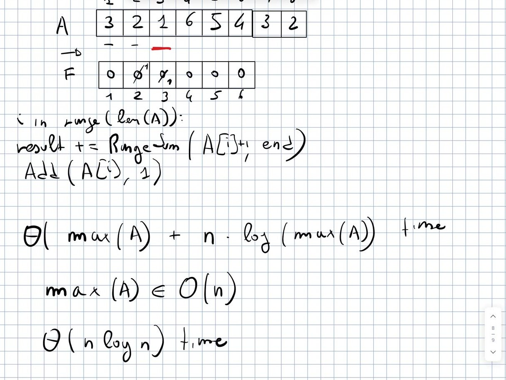
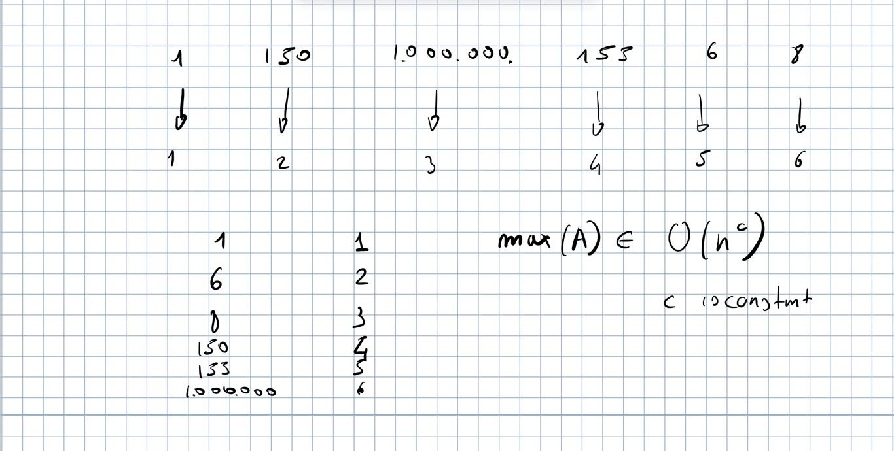
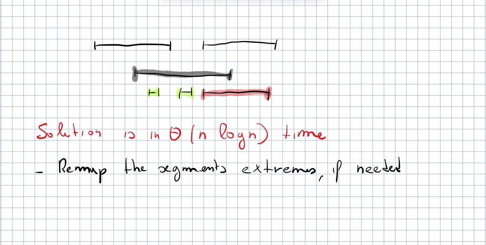
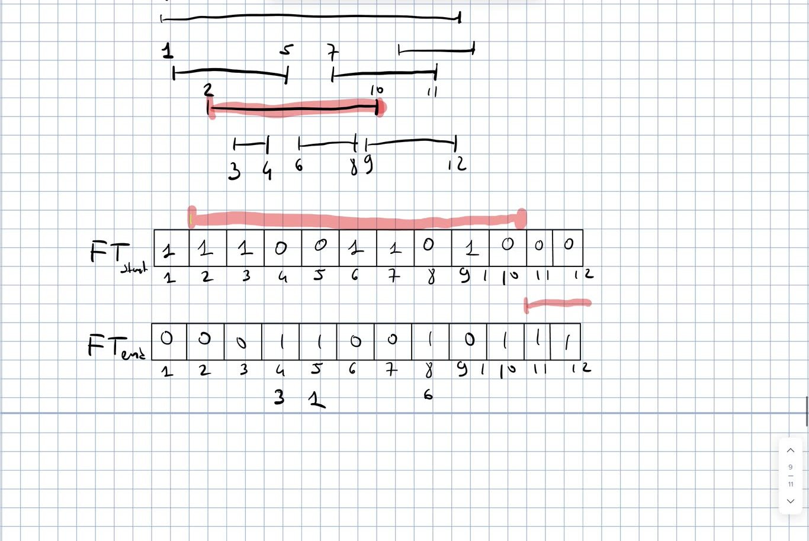
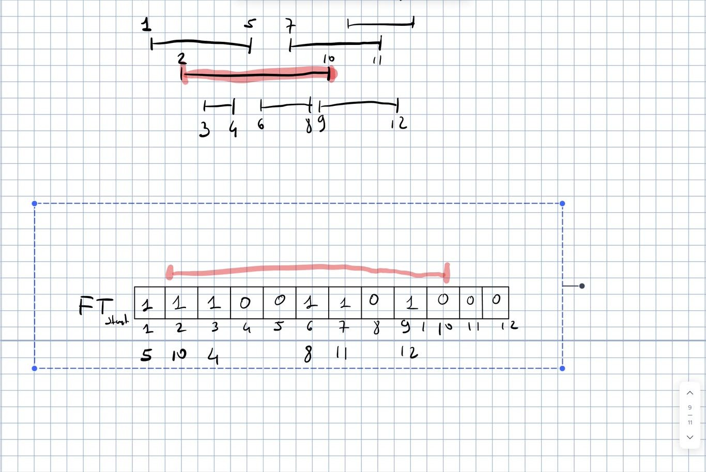
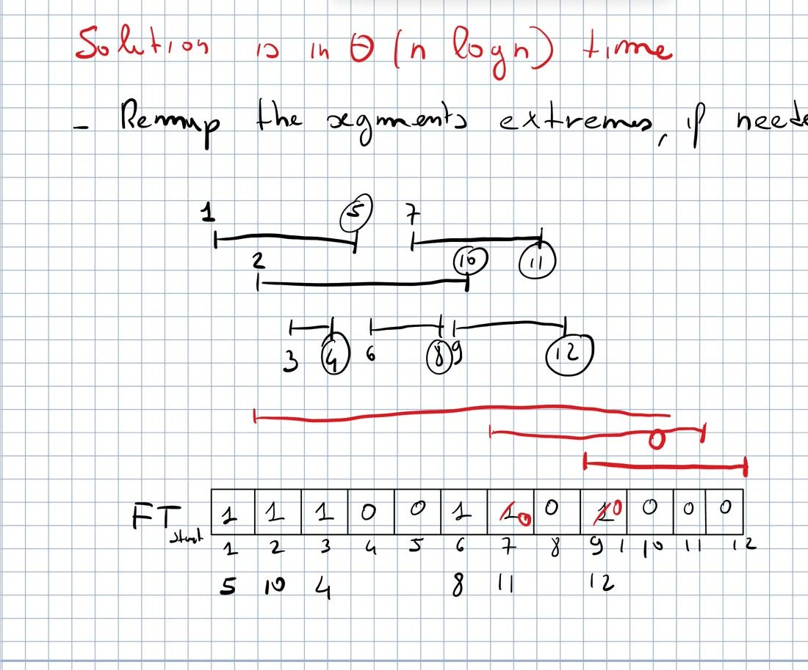

# **CPC — Lecture 12** — Counting inversions with a Fenwick tree $\cdot$ Remapping $\cdot$ Nested Segments

Competitive Programming and Contests — Monday 26/10/2026

<div class="keybox">

**Sources.** Recording `Lessons/L12/L_12.MP4` (91 min) and its automatic transcript `L12_transcript.txt` (not revised); the prof’s handwritten board (frames of the recording, `board/l12_*.jpg`); the prof’s 2025 notes `Lessons/L11/FenwickTree_2025.pdf` (p. 7–10 on today’s topics); the prof’s blog post *Dynamic Prefix Sums with Fenwick Tree* (<https://pages.di.unipi.it/rossano/blog/2023/fenwick>), code copied verbatim. No notes of yours for this lecture. Everything marked <sup>\[extra\]</sup> was *not* said or written in the lecture (my explanations, examples, code).

**This replaces the provisional version of 27/10**, which had guessed the content from the 2025 notes. The guess was half right: inversions with a Fenwick tree and Nested Segments **were done**, but with a **different solution of Nested Segments** (the one derived in class, §<a href="#sec:nested" data-reference-type="ref" data-reference="sec:nested">3</a>); **Update the Array and range updates were not done**: they were explained on 28/10, see `Lessons/L13/L13.pdf`.

Code: `Lessons/L12/src` (`cargo test -p l12`). Exercises: `Lessons/L12/practice`, E50–E52 (`cargo test -p practice_l12`).

**Highlights:** **general / to remember** **good: works, efficient, correct** **bad: pitfalls, wrong ideas, costs** **definitions and key results**

</div>

<div class="keybox">

**Where we are.** L11 (21/10) ended with counting inversions via mergesort and the question “can we get the same running time using the Fenwick tree?”. Today: the answer (0:00–14:00), the **remapping** trick and when it is worth it (14:00–40:00), then **Nested Segments**, solved together step by step (40:00–88:00).

</div>

# Counting inversions with a Fenwick tree

**Recap.** Count the pairs $i<j$ with $A[i]>A[j]$, $A[1,n]$ of positive numbers $\le n$. The number of inversions is quadratic in the worst case, and it is the number of steps of insertion sort. Mergesort variant (L11): every time the current minimum comes from the *right*, add the number of elements remaining on the *left*: **$\Theta(n\log n)$**.

**Idea** (4:40–11:40). **Process the array from left to right.** When we reach an element we want to know **how many elements to its left are greater**. Keep an array $F$ with the **frequency of every value** (values in $1..6$), stored in a Fenwick tree. The prof extends the example to $A=[3,2,1,6,5,4,3,2]$ (8 positions, values up to 6) “to make clear that the frequency is the frequency of the *value*, not of the position”.

- “On my left”: guaranteed because **we update the frequencies while moving from left to right**, so only elements on my left are in $F$.

- “Greater than me”: the frequencies to the right of my value in $F$: a **suffix sum**, i.e. $\textsf{RangeSum}(A[i]+1,\ \mathrm{end})$ (“$+1$ because I don’t want to count my value”).

``` 
for i in range(len(A)):
    result += RangeSum(A[i] + 1, end)
    Add(A[i], 1)
```



*Board, 14:40* **Running time.** $n$ iterations, each a range sum and an add: $n\log(\max A)$. **Another cost may become dominant**: initializing $F$, which has one position per possible value. So **$\Theta(\max(A)+n\log\max(A))$** and, **if $\max(A)\in O(n)$, $\Theta(n\log n)$**. <sup>\[extra\]</sup> With 8 elements the example has 14 inversions. **Prof’s code** \[blog\] (verbatim; `l12::inversions::counting_inversions`):

    pub fn counting_inversions(a: &[u64]) -> usize {
        if a.is_empty() {
            return 0;
        }

        let max = *a.iter().max().unwrap() as usize;
        let mut ft = FenwickTree::with_len(max + 1);

        let mut count: usize = 0;
        for &e in a {
            count += ft.range_sum((e + 1) as usize, max) as usize;
            ft.add(e as usize, 1);
        }

        count
    }

<sup>\[extra\]</sup> For $e=\max$ the call is `range_sum(max + 1, max)` $=\textsf{sum}(\max)-\textsf{sum}(\max)=0$: fine. Tested against an $O(n^2)$ brute force and the mergesort version on random arrays with duplicates and zeros.

# Remapping the values

**If $\max(A)$ is too big, $F$ is too large**: with $A=[1,\,150,\,10^6,\,155,\,6,\,8]$ we pay $10^6$ just to initialize the tree, then 6 elements in the loop.

- It is similar to **direct-access table vs hash map**: a direct-access table only when the maximum value is bounded and small, otherwise a hash map (and, as discussed before, **always check whether a direct-access table is enough**).

- A student suggests a hash map instead of $F$. **It solves only part of the problem**: it stores frequencies, but we need *cumulative* frequencies over a range, computed efficiently, which is what the Fenwick tree gives. Use the map instead to **map each value to a position** in $1..n$ (at most $n$ distinct values), and build the Fenwick tree on $1..n$.

- **Which mapping?** First attempt: a hash map and a counter, assigning ids in order of first appearance: $1\to1$, $150\to2$, $10^6\to3$, $155\to4$, $6\to5$, $8\to6$. **Wrong: it does not preserve the relative order of the values**, so the range sum “after my value” no longer contains the larger values (the elements greater than $10^6$ are not those mapped to $4..6$). “There are many cases in which this makes a lot of sense, but not in this case.”

- **Correct remapping: sort, then replace each value with its rank in the sorted order**: $1,6,8,150,155,10^6\ \to\ 1..6$, so $A$ becomes $[1,4,6,5,2,3]$.



*Board, 39:40: the values, their ranks after sorting, and $\max(A)\in O(n^c)$* **This and many other problems are insensitive to the actual values: the answer depends only on the relative order**, so remapping does not change it. “**From now on, if the values are too large, the first step is to remap them into a smaller range**.”

## Practical remarks

- Remapping with hash maps (value $\to$ rank) or with binary search on the sorted array (a student’s suggestion): a technical choice. **Hash maps can be very expensive in practice**, “pathologically slow in C” [^1]; faster in Rust. **Sorting is usually better than hash maps here** (locality, deterministic). **The only way to know which option is best for your case and language is to benchmark them** (“you usually have two or three options, test all of them”). Remapping happens a lot, not only in competitions.

- Mergesort and duplicates: no problem, when two equal values are compared during the merge, just do not count them as an inversion.

## Is remapping + Fenwick tree worth it, compared to mergesort?

A student’s question: if we must sort anyway to remap, mergesort already sorts *and* counts. The prof’s answer:

- **In practice**: we don’t know. Nobody uses mergesort in practice, but quicksort (asymptotically worse, faster in practice); a super-optimized quicksort followed by the Fenwick tree may beat a hand-written mergesort.

- **Asymptotically**, it depends on the values.

  - **Unbounded values**: the remapping needs a comparison-based sort, $\Theta(n\log n)$ like mergesort, plus the Fenwick tree: **not better than mergesort**.

  - **Bounded values, $\max(A)\in O(n^c)$ with $c$ constant** (e.g. $n=1000$ values up to $10^6$ or $10^9$): **radix sort sorts in linear time** (that is exactly the bound of radix sort). Still, the Fenwick tree costs $n\log n$: **not better** either.

  The mergesort solution is already “more than satisfactory”; having two solutions with the same running time is not an issue.

- **Why spend so much time on it?** **The remapping trick is worth in many other problems where there is no easy sorting-based solution.**

<sup>\[extra\]</sup> `l12::inversions::remap` sorts the pairs (value, position), as in the 2025 notes (equal values get increasing ranks, still no inversion between them); `counting_inversions_any` = remap + prof’s code. Exercise E51 uses dense ranks (equal values, equal rank): both are correct. *\[Prof.’s 2025 notes, FenwickTree_2025.pdf p.7 and p.8\]*

# Nested Segments (Codeforces 652D)

**Problem.** We are given $n$ segments $\langle l_1,r_1\rangle,\dots,\langle l_n,r_n\rangle$ (all endpoints distinct). **Report, for each segment, the number of segments it (fully) contains.** Target: **$\Theta(n\log n)$**: with a Fenwick tree this means **a range sum and possibly an add for each segment**. **First step: remap the segments’ extremes, if needed** (numbering them $1..2n$). 

*Board, 45:40: for the grey segment, the green ones are contained, the red one is not*

Running example on the board (already remapped): $[1,5],\ [2,10],\ [3,4],\ [6,8],\ [7,11],\ [9,12]$. <sup>\[extra\]</sup> Answers: $[1,5]\to1$, $[2,10]\to2$, all the others $0$. (The 2025 board had $[7,12],[9,11]$ instead.)

## The way to the solution (a discussion in class)

1.  **Two Fenwick trees**, $FT_{\text{start}}$ with a 1 at every beginning and $FT_{\text{end}}$ with a 1 at every end (a student). For $[2,10]$ the segments starting inside are $RangeSum$ on $FT_{\text{start}}$ over $(2,10]$: $3,6,7,9$, i.e. 4. **An overestimation**: $[7,11]$ and $[9,12]$ start inside but end after. Fixing it with $FT_{\text{end}}$ does not work: **the 1s of the two trees are not related to each other** (an end inside the segment may belong to a segment starting before). Counterexample: a segment with many segments starting inside and many ending inside, but none contained: the answer is 0.

2.  *Side remark.* The easier question “how many segments *intersect* me?” is $n$ minus those that start after my end and those that end before my start: **static prefix sums are enough**, no Fenwick tree.

3.  **Relate the two extremes** (another student): label every 1 in $FT_{\text{start}}$ with the end of its segment ($1\to5$, $2\to10$, $3\to4$, $6\to8$, $7\to11$, $9\to12$). Then the answer for $[2,10]$ is **the number of 1s in $[2,10]$ whose label is smaller than 10** (minus myself): 2. **But no data structure answers “how many values in this range are smaller than $x$” efficiently.** (Compacting the labels into an array $[5,10,4,8,11,12]$ maps a range of starts to a subarray, but does not answer the query.)



*Board, 61:00: $FT_{\text{start}}$ and $FT_{\text{end}}$; the range of $[2,10]$ (red) over-counts* **Two things we were not exploiting.**

- **We are free to process the segments in any order we want** (we were answering each segment independently).

- **The Fenwick tree can remove 1s** (“we were using the Fenwick tree without using its capabilities”: static prefix sums would have been enough).

“*If you are writing your letter to Santa Claus*”: for $[2,10]$ I would ask to **remove the 1s of the segments that end after 10**; then the 1s in $[2,10]$ are me plus segments starting inside and, thanks to Santa Claus, ending before 10. 

*Board, 78:20: the 1s of $FT_{\text{start}}$ labelled with the end of their segment*

## The solution: decreasing end, remove after use

“Let’s implement Santa Claus”: **process the segments in decreasing order of ending point**. When we reach the segment ending at 10, the segments ending at 12 and 11 have already been processed, and **each of them removed its own 1 from the Fenwick tree before leaving**.

``` 
FT = 1 at the start of every segment            // after remapping the 2n extremes to 1..2n
for each segment [l, r] in decreasing order of r:
    answer[l, r] = RangeSum(l, r) - 1            // -1: my own start
    Add(l, -1)                                   // remove my 1 before leaving
```

Example: $[9,12]$: $RangeSum(9,12)=1$, answer $0$, remove 9. $[7,11]$: $1-1=0$ (**without removing 9 it would be 2**, wrong), remove 7. $[2,10]$: $RangeSum(2,10)=3$ (2, 3, 6), **answer 2**, the correct one: the two segments that start inside but end after 10 were already removed. (Or remove before the range sum, then no $-1$.) **One Fenwick tree, $\Theta(n\log n)$**, “derived almost together”. 

*Board, 83:00: ends circled, processed right to left; the 1s at 7 and 9 already set to 0 when $[2,10]$ is processed*

**Three versions of the problem** (a student’s question, 83:30–87:30):

1.  this one: the segments are known, report the answer for each of them;

2.  **online**: build a data structure; given *any* segment, return how many segments it contains: **much harder**;

3.  **offline queries**: a set of segments and a set of query segments, known in advance, so they can be reordered: **easier**, as in a previous lecture (Ilya and Queries, L9). The Fenwick tree is built on the segments only; process segments and queries together by decreasing end point: for a query do only the range sum, for a segment only the update. The prof was “thinking about the solution while saying this” and invited questions by message. <sup>\[extra\]</sup> Details to fix if you implement it: a query does not subtract 1 (it is not in the tree), and ties between the end point of a query and of a segment need care.

**Code.** No code from the prof. <sup>\[extra\]</sup> `l12::nested::nested_segments_2026` is the lecture’s solution; `nested_segments_2025` (2025 notes p. 10: increasing ends, *insert* the starts) and `nested_segments` (blog: increasing starts, Fenwick tree on the ends) are the two equivalent alternatives; all tested on the board example, the Codeforces examples and against an $O(n^2)$ brute force. **On the course page it is the mandatory exercise of the 21/10/2026 row: try it yourself first (E52).** See §<a href="#sec:ex" data-reference-type="ref" data-reference="sec:ex">4</a>. *\[Prof.’s 2025 notes, FenwickTree_2025.pdf p.9 and p.10\]*

<div class="keybox">

**About the pace (88:00).** The prof is going about twice as slowly as last year because he spends more time **deriving the solutions together** instead of giving five minutes and then presenting his solution; he thinks it is better, “especially in a time in which it’s easy to get a solution almost for free”. If you disagree, tell him (also anonymously). “We need another lecture about this kind of stuff”: last year two lectures, this year three.

</div>

# Exercises and deadlines (course page)

<div class="keybox">

**For this lecture (26/10): nothing.** The 2026 table of the course page has **no row for 26/10** (checked on 29/10), and no homework was given orally.

**Still open, from earlier rows of this year’s table** (2026, not last year’s):

- **Nested Segments**, <http://codeforces.com/problemset/problem/652/D>: mandatory in the row of **21/10/2026**. The technique was explained only today (the prof is slower than the plan of the page), so now you can solve it: practice E52.

- *Pashmak and Parmida’s problem*, <http://codeforces.com/problemset/problem/459/D>: optional, row of 21/10/2026.

- **Update the Array**, <http://www.spoj.com/problems/UPDATEIT/>: mandatory in the row of **19/10/2026**; explained on 28/10 (`L13.pdf`, practice E53).

**The rows of the page are the prof’s plan, not what happened in class**: the 21/10 row (“Applications of Fenwick tree and Range update”) is being covered on 26/10 and later.

</div>

# Next time

L13 (28/10, `Lessons/L13/L13.pdf`): Update the Array, dynamic prefix sums with range update (two Fenwick trees), introduction to the segment tree.

[^1]: <sup>\[extra\]</sup> He presumably means C++’s `std::unordered_map`.
