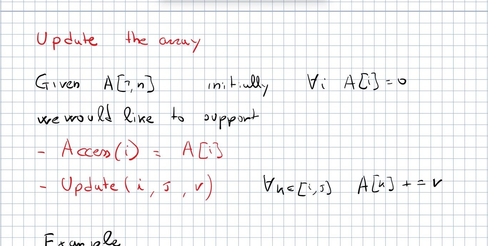
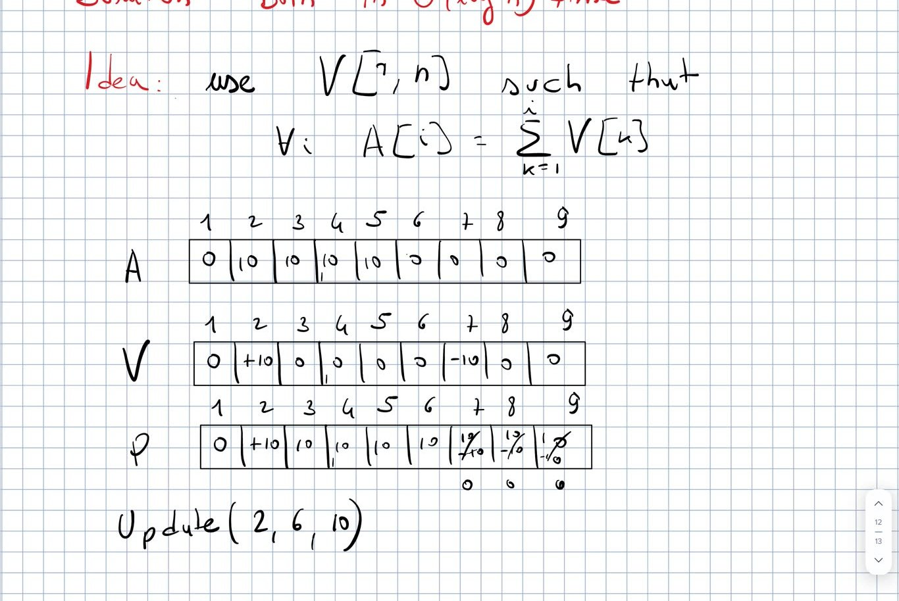
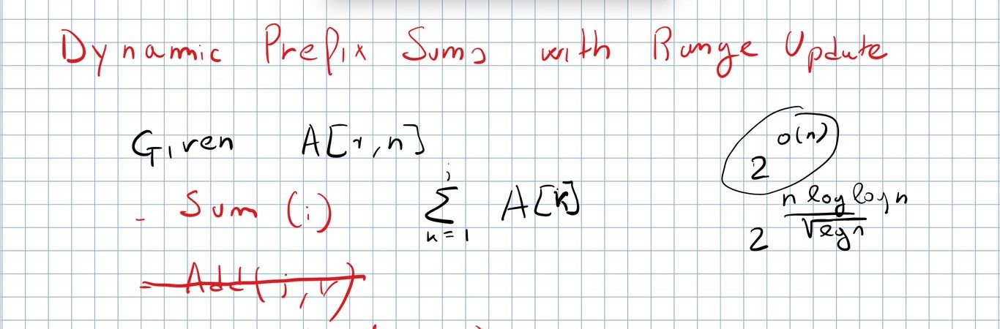
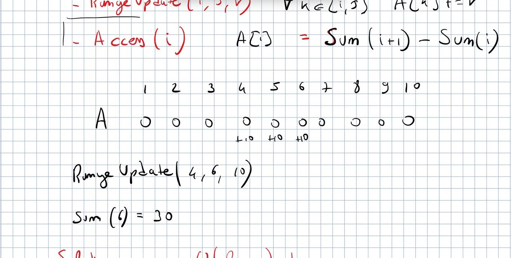
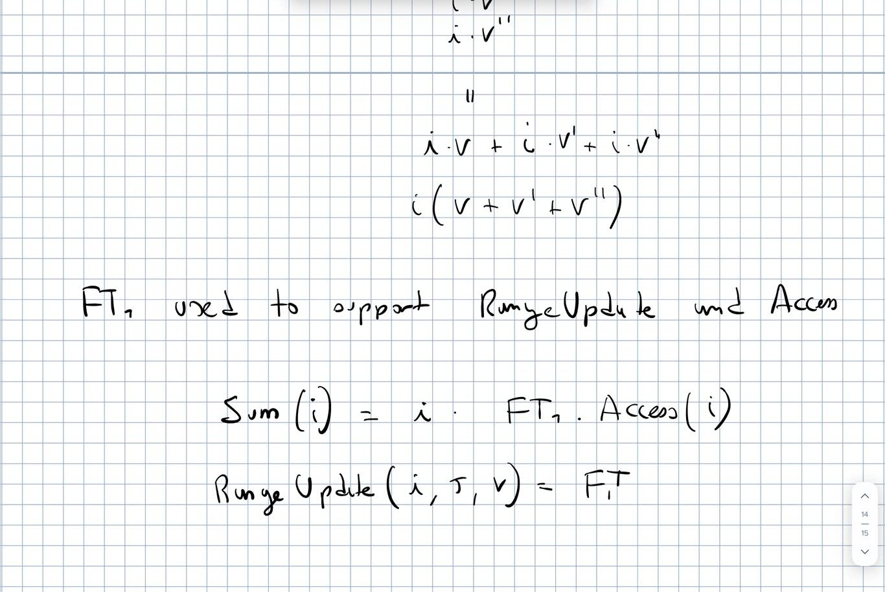
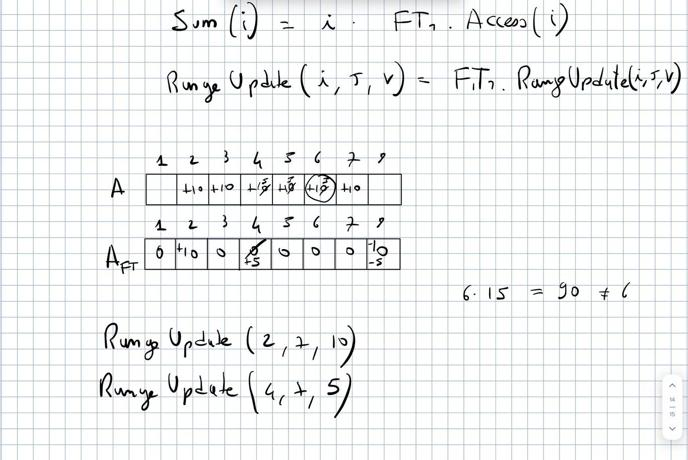
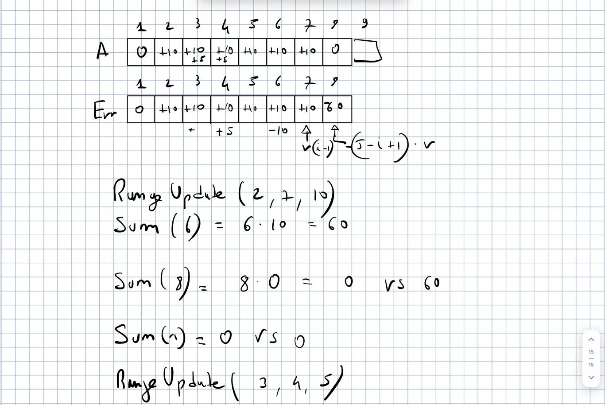
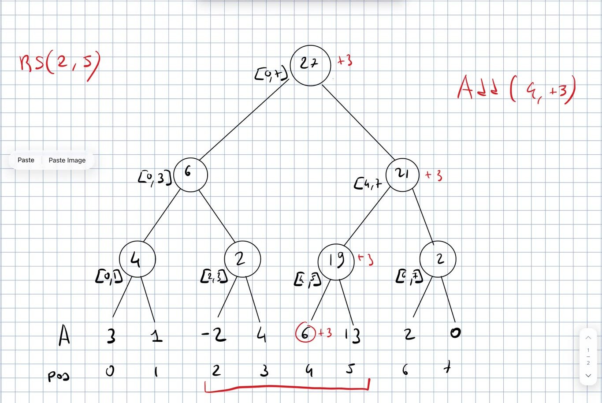

# **CPC — Lecture 13** — Update the Array $\cdot$ Range updates with two Fenwick trees $\cdot$ Segment tree (introduction)

Competitive Programming and Contests — Wednesday 28/10/2026

**Sources.** Recording `Lessons/L13/L_13.MP4` (97 min; **it starts a few seconds into the statement of the first problem**) and its automatic transcript `L13_transcript.txt` (not revised); the prof’s handwritten board (frames of the recording, `board/l13_*.jpg`); the prof’s 2025 notes `Lessons/L11/FenwickTree_2025.pdf` (p. 11–15) and `Lessons/L13/Segment_tree_2025.pdf` (p. 1–2); the prof’s blog post *Dynamic Prefix Sums with Fenwick Tree* (<https://pages.di.unipi.it/rossano/blog/2023/fenwick>), code copied verbatim. No notes of yours for this lecture. Everything marked \[extra\] was *not* said or written in the lecture.

Code: `Lessons/L13/src` (`cargo test -p l13`). Exercises: `Lessons/L13/practice`, E53–E55 (`cargo test -p practice_l13`).

**Highlights:** **general / to remember** **good: works, efficient, correct** **bad: pitfalls, wrong ideas, costs** **definitions and key results**

**Where we are.** L12 (26/10) did counting inversions with the Fenwick tree, remapping, Nested Segments, and the prof announced “another lecture about this kind of stuff”. Today: the two problems left from the 21/10 row of the course page, **Update the Array** (0:00–16:00) and **dynamic prefix sums with range update** (16:00–66:00, with a digression on ETH), then the **segment tree** (66:00–97:00). These two problems were in the Appendix of the provisional L12; now they are here.

# Update the Array (SPOJ UPDATEIT)

**Problem.** Given $A[1,n]$, initially $A[i]=0$ for all $i$, support **$\textsf{Access}(i)=A[i]$** and **$\textsf{Update}(i,j,v)$: $A[k]\mathrel{+}=v$ for all $k\in[i,j]$**. Example on the board: $\textsf{Update}(2,6,10)$, $\textsf{Update}(0,4,5)$, $\textsf{Access}(2)=15$. 

*Board, 9:00* **Trivial solution**: store $A$ and update by scanning: **Access $O(1)$**, **Update $\Theta(j-i+1)$: terribly slow for large ranges**. Target: **both in $\Theta(\log n)$**.

**Wrong directions from the class.**

- Store the prefix sums $P$ of $A$ (5, 20, 35, 50, 60, 70, 70, …) and access by difference of consecutive values.

- Store $A$ itself in a Fenwick tree and update every position of the range: **$\Theta((j-i+1)\log n)$, worse than the trivial solution**. “Your intuition was right, but you were doing the opposite: you were storing $A$ to get the prefix sums.”

**Idea** (a student, 10:00): **store $V[1,n]$ such that $A[i]=\sum_{k\le i}V[k]$**. **The same trick as the $+1/-1$ of Little Girl (L10)**: a value added at a position propagates to the right through the prefix sums, and $-v$ after the range cancels the propagation.

- $\textsf{Update}(2,6,10)$: $V[2]\mathrel{+}=10$, $V[7]\mathrel{-}=10$: the prefix sums give $10$ on positions $2..6$ and $0$ after.

- **Each update pays $\log n$ (two Add on a Fenwick tree on $V$) but propagates to any number of positions**; $\textsf{Access}(i)=\textsf{Sum}_V(i)$.

*Board, 15:40: $A$, $V$ and the prefix sums $P$ of $V$ after $\textsf{Update}(2,6,10)$*

**Prof’s code** \[blog\] (verbatim; in the crate only `pub` is added to the struct; `l13::range::UpdateArray`; 0-based):

    #[derive(Debug)]
    struct UpdateArray {
        ft: FenwickTree,
    }

    impl UpdateArray {
        pub fn with_len(n: usize) -> Self {
            Self {
                ft: FenwickTree::with_len(n),
            }
        }

        pub fn len(&self) -> usize {
            self.ft.len()
        }

        pub fn access(&self, i: usize) -> i64 {
            self.ft.sum(i)
        }

        pub fn range_update(&mut self, l: usize, r: usize, v: i64) {
            assert!(l <= r);
            assert!(r < self.ft.len());

            self.ft.add(l, v);
            if r + 1 < self.ft.len() {
                self.ft.add(r + 1, -v);
            }
        }
    }

*\[Prof.’s 2025 notes, FenwickTree_2025.pdf p.11 and p.12\]*

# Dynamic prefix sums with range update

**Problem.** Given $A[1,n]$ support **$\textsf{Sum}(i)=\sum_{k\le i}A[k]$** and **$\textsf{RangeUpdate}(i,j,v)$: $A[k]\mathrel{+}=v$ for all $k\in[i,j]$** (the Add of the Fenwick tree is crossed out: it is the special case $i=j$). “Apparently the same, but actually very different.”

## Which problem is harder? A reduction

Range update + Access (previous problem) vs range update + Sum (this one): **$\textsf{Access}(i)=\textsf{Sum}(i)-\textsf{Sum}(i-1)$**, so a solution for this problem also solves the previous one: **this one cannot be easier**. “Relationships between problems are usually described by proving that you can reduce one to the other.”

**Digression (20:20–24:00).** Speaking of reductions, the prof mentioned the news that **OpenAI** (in the lecture: “together with three very famous computer scientists”, including **Ryan Williams**) disproved the conjecture that SAT cannot be solved in $2^{o(n)}$ time, with an algorithm of about $2^{n\log\log n/\sqrt{\log n}}$: “better, but practically useless”. Its importance: a whole area of theoretical computer science proved lower bounds *assuming* the conjecture (e.g. edit distance not computable in less than quadratic time); some courses (e.g. Algorithm Design) have to change their programme. 

*Board, 23:40* \[extra\] What the press says (26–27/10/2026): the claim is about the *Exponential Time Hypothesis* (ETH); OpenAI announced it on 26/10 with a Lean proof; Ryan Williams, Russell Impagliazzo and Ramamohan Paturi were asked to organize an *independent examination*, which was in progress, and they stated that their involvement is not a certification ([The Next Web](https://thenextweb.com/news/openai-exponential-time-hypothesis-false-kakeya-yang-mills)). So, as of the lecture, not peer reviewed.

## Why it is harder

$\textsf{RangeUpdate}(4,6,10)$ on $A=0$: $\textsf{Sum}(6)=30$, not $10$. **The answer depends on where the query position is inside the updated range**, i.e. **on the beginning of the range**: with the range starting at 3 it would be 40. For Access instead the answer at 6 only depends on whether 6 belongs to the updated ranges. 

*Board, 29:20* **The running time is still $\Theta(\log n)$: the hardness is paid in space**, the data structure doubles.

## The easy case: every range starts at 1

A student: in the range the contributions are $1\cdot v,\ 2\cdot v,\ 3\cdot v,\dots$, factor out $v$. The multiplier depends on the distance from the beginning of the range, and changes if another range starts earlier. **Easiest case: every range starts at position 1**. Then the multiplier is the position itself: $$\textsf{Sum}(i)=i\cdot v+i\cdot v'+i\cdot v''=i\,(v+v'+v'') ,$$ where $v,v',v'',\dots$ are the values of the updates covering $i$. The sum $v+v'+v''$ is a value in an array that receives range updates: **a first structure $FT_1$ supporting RangeUpdate and Access** (the solution of Update the Array), and $$\textsf{Sum}(i)=i\cdot FT_1.\textsf{Access}(i),\qquad \textsf{RangeUpdate}(i,j,v)=FT_1.\textsf{RangeUpdate}(i,j,v).$$ 

*Board, 37:20*

**It is only an approximation** (40:00–46:00). Example on $1..8$: $\textsf{RangeUpdate}(2,7,10)$, $\textsf{RangeUpdate}(4,7,5)$: $FT_1.\textsf{Access}(6)=15$, so we report $6\cdot15=90$, **but the correct answer is $65$**. The error is 25 (“15 here, 5, 5”). 

*Board, 45:40: $6\cdot 15=90\neq 65$*

## Correcting the error

Consider one update $\textsf{RangeUpdate}(i,j,v)$; the approach is correct only if $i=1$. Example $\textsf{RangeUpdate}(2,7,10)$:

- **inside the range** ($i\le p\le j$): $\textsf{Sum}(6)=6\cdot10=60$ but the correct value is $50$; $\textsf{Sum}(5)$: $50$ vs $40$; $\textsf{Sum}(4)$: $40$ vs $30$: **the error is always $v\,(i-1)$**, the cells of the prefix that are *not* in the range: **it does not depend on the queried position, only on the update**;

- **after the range** ($p>j$): $FT_1$ gives $0$ (the $-v$ cancelled it), but the correct value is $60$: **the error is $v\,(j-i+1)$**, again independent of $p$;

- **before the range**: $0$, correct.

So keep a second array **Err** of the errors, **itself a “range update + access” structure**: for each update, $$\mathrm{Err}.\textsf{RangeUpdate}(i,j,\ v(i-1)),\qquad \mathrm{Err}.\textsf{RangeUpdate}(j+1,n,\ -v\,(j-i+1))$$ and $$\boxed{\textsf{Sum}(p)=p\cdot FT_1.\textsf{Access}(p)-\mathrm{Err}.\textsf{Access}(p)}$$ (The sign of the second correction was fixed in class by a student: **it depends on whether you add or subtract Err**; with “minus Err” the error after the range is *negative*.)

**Second update** $\textsf{RangeUpdate}(3,4,5)$ (another student caught that the board first updated the wrong cells): $A$ gets $+5$ on $3,4$; Err gets $+5\cdot2=10$ on $3,4$ and $-5\cdot2=-10$ from 5 on. $\textsf{Sum}(6)=10\cdot6-(10-10)=60$ **correct**; $\textsf{Sum}(4)=15\cdot4-(10+10)=40$ **correct** ($10+15+15$). 

*Board, 66:00: $A$ and Err after the two updates* **All operations $\Theta(\log n)$, with two Fenwick trees**: **twice the space**, same time. “There are very long notes” if you are not convinced.

\[extra\] The prof’s blog writes it as $\textsf{Sum}(i)=FT_1.\textsf{Sum}(i)\cdot i+FT_2.\textsf{Sum}(i)$ with $-v(l-1)$ at $l$ and $+v\,r$ at $r+1$: it is the same thing with $FT_2=-\mathrm{Err}$ (the two Err range updates combine into $+v(i-1)$ at $i$ and $-v(i-1)-v(j-i+1)=-v\,j$ at $j+1$). The board’s version is `l13::range::RangeUpdateLecture` (1-based), tested on the board examples and against a plain array.

**Prof’s code** \[blog\] (verbatim; only `pub` added to the struct; `l13::range::RangeUpdate`; 0-based):

    #[derive(Debug)]
    struct RangeUpdate {
        ft1: FenwickTree,
        ft2: FenwickTree,
    }

    impl RangeUpdate {
        pub fn with_len(n: usize) -> Self {
            Self {
                ft1: FenwickTree::with_len(n),
                ft2: FenwickTree::with_len(n),
            }
        }

        pub fn len(&self) -> usize {
            self.ft1.len()
        }

        pub fn sum(&self, i: usize) -> i64 {
            self.ft1.sum(i) * i as i64 + self.ft2.sum(i)
        }

        pub fn access(&self, i: usize) -> i64 {
            self.sum(i) - if i == 0 { 0 } else { self.sum(i - 1) }
        }

        pub fn add(&mut self, i: usize, v: i64) {
            self.range_update(i, i, v)
        }

        pub fn range_update(&mut self, l: usize, r: usize, v: i64) {
            self.ft1.add(l, v);

            self.ft2.add(l, -v * (l as i64 - 1));

            if r + 1 < self.len() {
                self.ft1.add(r + 1, -v);
                self.ft2.add(r + 1, v * r as i64);
            }
        }
    }

*\[Prof.’s 2025 notes, FenwickTree_2025.pdf p.13 and p.14\]*

**About the pace (58:20).** The prof changed two things this year: he sketches the solutions together with the class, and **he no longer looks at his notes before the lecture** (“I know the solution too well and I’m super fast presenting it”), so he reconstructs them live: **more mistakes on the board**, caught by students (“many bug finders”). After ten years of teaching the course “it’s boring to do always the same”.

# Segment tree (introduction)

“Something very popular.” **A data structure that solves dynamic prefix sums, dynamic prefix sums with range updates, and many other problems with range queries on an array.**

**Structure.** **A binary tree whose leaves are the elements of the array**; two consecutive leaves are merged into a node, their parent; then two nodes into their parent, and so on up to the root. Each node corresponds to a range of positions.

**The general recipe.** **The value in a node is the answer of the problem for the node’s range**; the query algorithm is always the same: **visit only nodes whose ranges together give the answer for the queried range**. “Super powerful, because it can be adapted to many problems” (by changing what is stored).

**Segment tree for dynamic prefix sums**: $\textsf{Add}(i,v)$ and $\textsf{RangeSum}(i,j)=\sum_{k=i}^jA[k]$. **Not better than the Fenwick tree for this problem: twice the space**; its virtue is that it can be adapted. (Sum or RangeSum: equivalent, $\textsf{RangeSum}(i,j)=\textsf{Sum}(j)-\textsf{Sum}(i-1)$; Sum is easier to present with the Fenwick tree, RangeSum with the segment tree.)

**Example.** $A=[3,1,-2,4,6,13,2,0]$, positions $0..7$ (“better to start from zero”). Nodes: $[0,1]=4$, $[2,3]=2$, $[4,5]=19$, $[6,7]=2$; $[0,3]=6$, $[4,7]=21$; root $[0,7]=27$. Here the tree is a perfect binary tree because $n$ is a power of two; otherwise part of the tree is incomplete. **How to split** (in the middle, or the largest power of two first) matters in practice: “search the net”, there are many tutorials and tricks. 

*Board, 96:20: the tree, $\textsf{Add}(4,+3)$ and the range of $\textsf{RS}(2,5)$*

## Building

- **Bottom-up: linear.** Leaves, then $n/2$ parents each in constant time (sum of the two children), then $n/4$, …: $n+n/2+n/4+\dots\le 2n$.

- **Top-down rescanning the array**: each level scans the whole array, $\log n$ levels: **$\Theta(n\log n)$** (same argument as mergesort), because it does not reuse the work already done.

- **Space**: we store $A$ *and* the tree, **at least twice the space**; a complete tree can be stored in an array with the shape of a tree. “It is never the case that an algorithm uses more space than time”: to fill $S$ cells you pay $S$ time.

## Add$(i,v)$: $\Theta(\log n)$

Update the path between the leaf and the root: $\textsf{Add}(4,+3)$ adds 3 to the leaf, to $[4,5]$, $[4,7]$, $[0,7]$. With parent pointers bottom-up; without them, **top-down from the root** (go towards the leaf): conceptually bottom-up is easier, **in practice top-down is better (no parent pointer)**.

## RangeSum$(i,j)$

Only one node if the range is exactly a node’s range. Otherwise, e.g. $\textsf{RS}(2,5)$: we need the pieces covering the range. Starting from the leaves and moving up works for some ranges but fails for others (a node that “looks down and finds nothing” but must go down again): **we need one strategy that always works**.

**Top-down from the root.** For each node compare its range with the query range:

1.  **disjoint** (the node’s answer is about something unrelated): **stop**;

2.  **the node’s range is fully contained in the query range**: **take its answer and stop**;

3.  **partial overlap** (e.g. the query range is contained in the node’s range): **go to both children**.

A student proposed to compute the middle point and go only left or only right when possible: **correct, but “as often happens with recursion” it is better to just go both ways and let cases 1 and 2 stop the recursion**. **“Algorithms that move both left and right on trees are dangerous, very dangerous”**: pay attention to the cost. $\textsf{RS}(2,5)$: root $[0,7]$ partial $\to$ $[0,3]$ partial $\to$ $[0,1]$ disjoint, $[2,3]$ inside: 2; $[4,7]$ partial $\to$ $[4,5]$ inside: 19, $[6,7]$ disjoint. Answer $21$. *\[Prof.’s 2025 notes, Segment_tree_2025.pdf p.1 and p.2\]*

**Question for the weekend (95:50)**: in the example we touched 7 nodes, and the array has 8 positions. **Is this RangeSum algorithm linear, or better than that?** \[extra\] Hint without the answer: count, level by level, how many nodes can be in case 3 (partial overlap). You can experiment with `l13::segment_tree::SegmentTree::range_sum_counting`, which returns the number of visited nodes. **Pages 3–4 of `Segment_tree_2025.pdf` contain the answer**: look at them only after thinking.

\[extra\] Code: `l13::segment_tree::SegmentTree` (build bottom-up, Add top-down, RangeSum with the three cases; no code from the prof), tested on the board example (tree values, $\textsf{RS}(2,5)=21$ visiting 7 nodes, $\textsf{Add}(4,+3)$) and against a plain array.

# Exercises and deadlines (course page)

**For this lecture (28/10): nothing new on the course page.** The 2026 table has **no row for 28/10** (checked on 29/10; the last row is 21/10).

**Given orally**: the question for the weekend above (is RangeSum on the segment tree linear or better?).

**Still open, from earlier rows of this year’s table** (2026):

- **Update the Array**, <http://www.spoj.com/problems/UPDATEIT/>: mandatory in the row of **19/10/2026**; explained today (practice E53).

- **Nested Segments**, <http://codeforces.com/problemset/problem/652/D>: mandatory in the row of **21/10/2026**; explained on 26/10 (L12, E52).

- *Pashmak and Parmida’s problem*, <http://codeforces.com/problemset/problem/459/D>: optional, row of 21/10/2026.

Recall (exam rules on the course page): mandatory exercises are required only for exam option 2 (three hands-on + all mandatory exercises, at a time that suits you).

# Next time

The segment tree continues (the answer to the weekend question and its uses). \[extra\] Following last year’s notes (`Segment_tree_2025.pdf`): RMQ, RMQ with occurrences, Search, lazy propagation, persistent segment trees; in 2025 Hands-On 2 was assigned at that point.
