# **CPC — Lecture 14** — Segment tree: cost of RangeSum · dynamic RMQ · RMQ with occurrences · Search · #occs (statement)

Competitive Programming and Contests — Monday 02/11/2026

> **Sources.** Recording `Lessons/L14/L_14.MP4` (90 min) and its automatic transcript `L14_transcript.txt` (not revised); the prof’s handwritten board (frames of the recording, `board/l14_*.jpg`); your notes taken in class (`Lessons/L14/notes.md`, marked \[your notes\] where quoted); the prof’s 2025 notes `Lessons/L13/Segment_tree_2025.pdf` p. 3–9 (always marked *last year*); course page (checked 11/11/2026); **the prof’s 2026 notes** *Segment Tree* (blog, published 14/11/2026, §<a href="#sec:blog" data-reference-type="ref" data-reference="sec:blog">7</a>). The prof has no blog post on segment trees. Everything marked \[extra\] was *not* said or written in the lecture.
>
> Code: `Lessons/L14/src` (`cargo test -p l14`): `prof_blog` = the prof’s code from the 2026 notes (verbatim); the rest is mine \[extra\]. Exercises: `Lessons/L14/practice`, E56–E58 (`cargo test -p practice_l14`).
>
> **Highlights:** **general / to remember** **good: works, efficient, correct** **bad: pitfalls, wrong ideas, costs** **definitions and key results**

> **Where we are.** L13 (28/10) introduced the segment tree for dynamic prefix sums and ended with the question *“is RangeSum linear, or better?”*. Today: recap of the segment tree and of the RangeSum visit (0:00–14:00), **the answer: $O(\log n)$ nodes** (14:00–49:00), then **the same recipe applied to other problems**: **dynamic RMQ** (50:00–60:00), **RMQ with occurrences** (60:00–69:00), **Search$(s)$** (70:00–87:40), and the **statement of \#occs** (88:00–90:00), left to think about. **Next week (09/11 and 11/11) there is no lecture**: the prof is at a conference (“See you on Wednesday. Next week, no lecture”).

# Recap: the segment tree and the golden rule

The idea (0:00–2:10): **group consecutive elements of the array** in pairs, pairs of pairs, and so on: a (perfect, if $n$ is a power of 2) binary tree on top of the array. Then the approach that segment trees always follow, the **golden rule**: **for every node, store the answer of the query for the node’s range**. **The structure of the tree is fixed and depends only on $n$; what goes in the nodes depends on the query**: here the sums, the root holds the sum of the whole array.

- Add$(i,v)$: change the leaf and **go up to the root** updating the nodes on the path: **$\Theta(\log n)$**, the height of the tree (board: $\textsf{Add}(4,+3)$).

- RangeSum$(i,j)$: from the root, compare the node’s range with the query range (“rescaled” to the part that falls in the subtree, e.g. $[2,5]$ becomes $[2,3]$ on the left and $[4,5]$ on the right): **no overlap** $\to$ stop, nothing to return; **total overlap** $\to$ stop and return the node’s value; **partial overlap** $\to$ recurse *both* left and right and **combine** the results (here: sum).

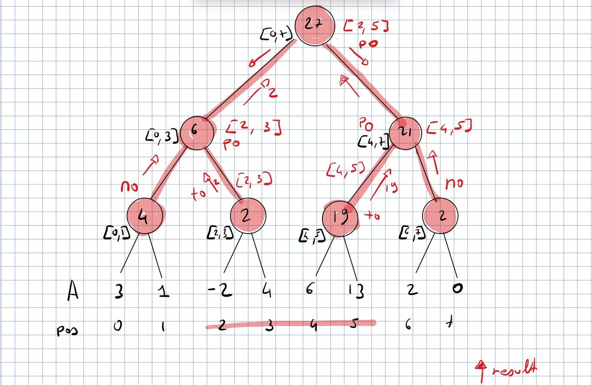  
*Board, 13:40: $\textsf{RS}(2,5)$ on $A=[3,1,-2,4,6,13,2,0]$; po/to/no = partial/total/no overlap; result $2+19=21$*

\[extra\] Test `range_sum::board_examples_2026`: $\textsf{RS}(2,5)=21$ visiting 7 nodes, $\textsf{Add}(4,+3)$ gives 24.

# The cost of RangeSum: $O(\log n)$ nodes

**The worry** (14:00). **A recursive algorithm that goes both left and right may traverse the whole tree**; in the small example it touches *all* the internal nodes. Is the algorithm inefficient, or is the example too small? With $n=8$ we cannot see the difference between “something like $8\log n$” and $n$: the constant in front of $\log n$ hides it. A student: **doubling $n$ adds a level, but the algorithm would prune many more nodes**. Another student: one can check the children before recursing (“anticipate the no overlap”): **this only moves the work** (you still check each child), it saves one recursive step, not the work.

**The right question** (20:00): **how many nodes do we process?** It is more general than “what is the running time”: **time = number of touched nodes $\times$ cost of processing one node**. For sums each node costs $O(1)$, but **there are segment-tree problems where processing a node is not constant time**.

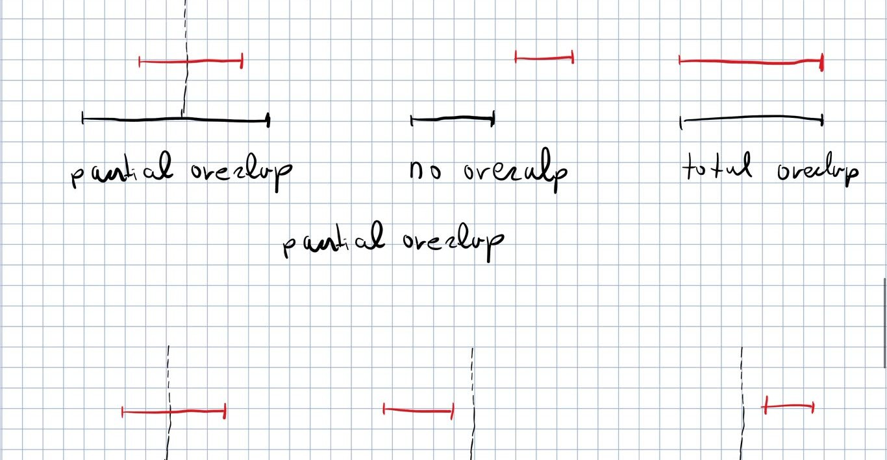  
*Board, 26:00: the three kinds of overlap, and the three kinds of partial overlap (dashed line = middle of the node)*

**Case analysis** (21:40–30:00).

- No overlap and total overlap are the **easy cases**: the recursion stops there.

- **Partial overlap is the problematic case**, because it always goes both left and right. It has three sub-cases (dashed line = the node’s middle): the query is **entirely left** of the middle, **entirely right**, or **split by the middle**.

- Left/right: **easy cases, because one of the two branches stops immediately** (no overlap). If there were only these, we would follow a single path: logarithmic.

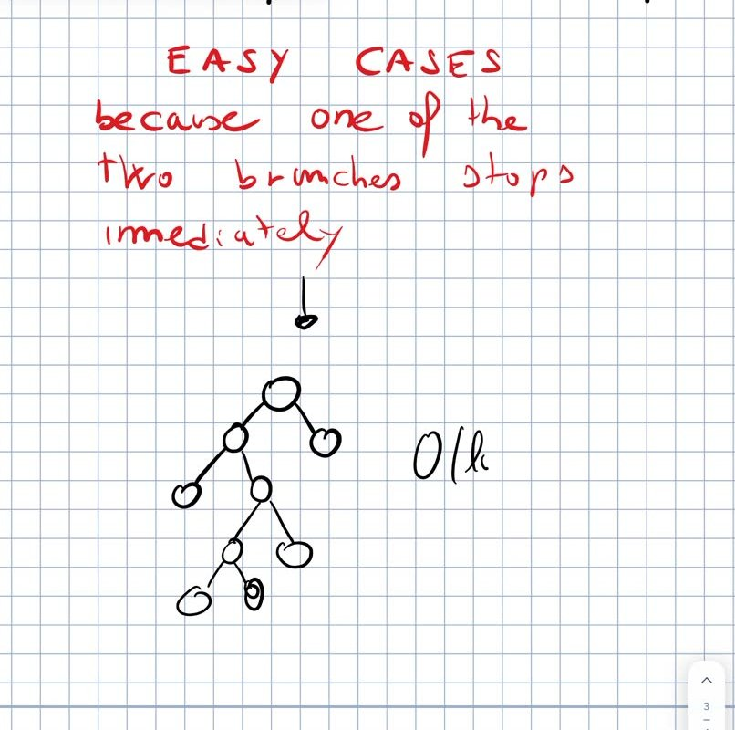  
*Board, 29:00*

**The only hard case** (30:00–38:50): the middle splits the query. Both children get a partial overlap... but **special ones**: since the split point lies inside the query, **the left child’s query part ends exactly at the child’s right extreme, and the right child’s part starts exactly at its left extreme**. With one extreme fixed, only the length can change, so in each of these “special” nodes, of the two grandchildren **one is a total overlap or a no overlap** (the easy one), and only the other one keeps going — again with the same extreme fixed.

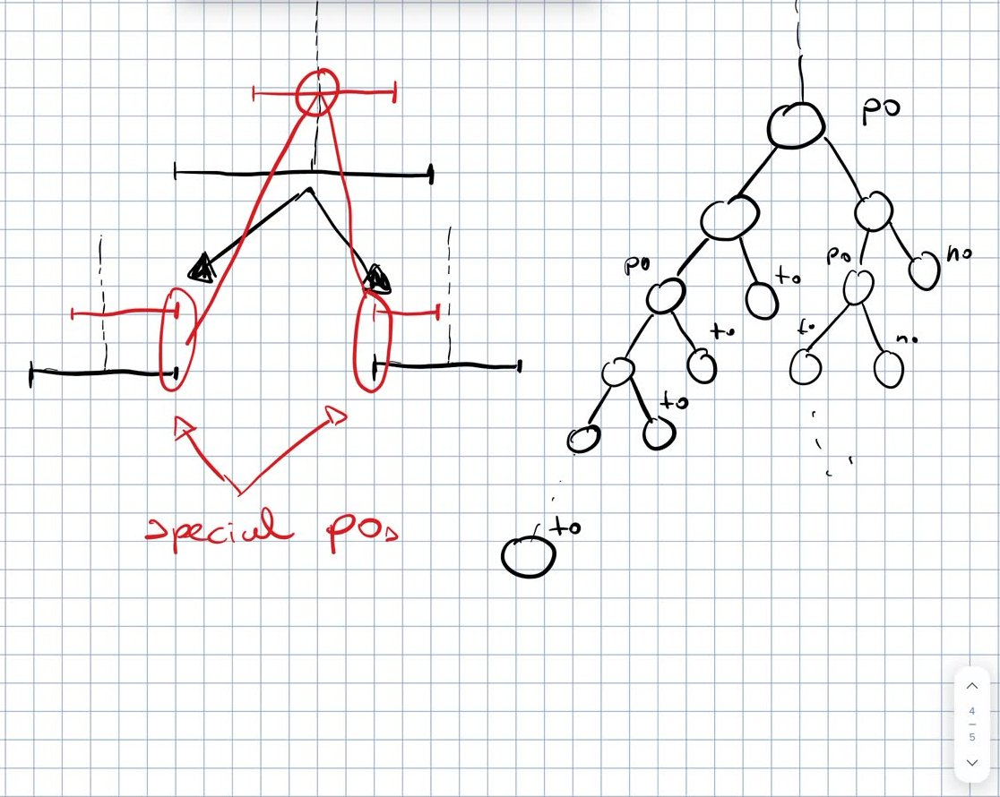  
*Board, 46:20: “special po” and the shape of the visit*

**Shape of the visit** (39:00–45:00): **one path from the root to the first node that splits the query**, then **two paths** (one per side) down to where the recursion stops, and along each path every node has one “easy” sibling that stops immediately. Splitting happens **just once in the whole search**.

- Worst case: the split node is the root and both paths reach the leaves: $2\log n$ path nodes, plus one easy sibling each: **$4\log n$ touched nodes**.

- With the student’s trick (never enter a child if not needed): $2\log n$ nodes, **saving a factor 2 in nodes but not in work**, since you still have to check.

- Prof’s example of a long visit with a tiny query (46:00): **two adjacent elements just around the root’s middle**: the shortest query with more than one element, but two full root-to-leaf paths.

**So every query touches $O(\log n)$ nodes; with $O(1)$ per node, RangeSum is $\Theta(\log n)$, not linear.** Recap (47:50–49:40): tree on top of the array, golden rule, update leaf$\to$root, query root$\to$down with the three cases, **the node combines the answers of its children**, **build bottom-up in linear time**, **both operations logarithmic**. *\[Prof.’s 2025 notes, Segment_tree_2025.pdf p. 3 and p. 4 — see the PDF\]* \[extra\] Brute-force check over all ranges (`l14::range_sum`, test `visited_nodes_at_most_4_per_level`; prof’s adjacent-pair case in `board_examples_2026`: 39 nodes for $n=1024$, i.e. $1+2+4\cdot 9$): *\[Figure figs/l14_visited.pdf — see the PDF\]*

# Dynamic Range Minimum Queries

**From now on: we know the structure and the idea; we solve problems by applying the approach.** **Easy problems** first (50:00).

**Problem.** Add$(i,v)$ and **$\textsf{RMQ}(i,j)=\arg\min A[i..j]$, the *position* of the minimum in $A[i..j]$**. “It seems an exotic query, but it is very, very useful in practice, for many problems.”

**Solution.** Same tree; by the golden rule **every node stores the minimum of its range**. To return the position, store the pair (min, position), or **just the position and use it to access $A$** (a student, 63:00); the prof writes the minimum values on the board “because it is easier for us humans”, but most applications use the arg min.

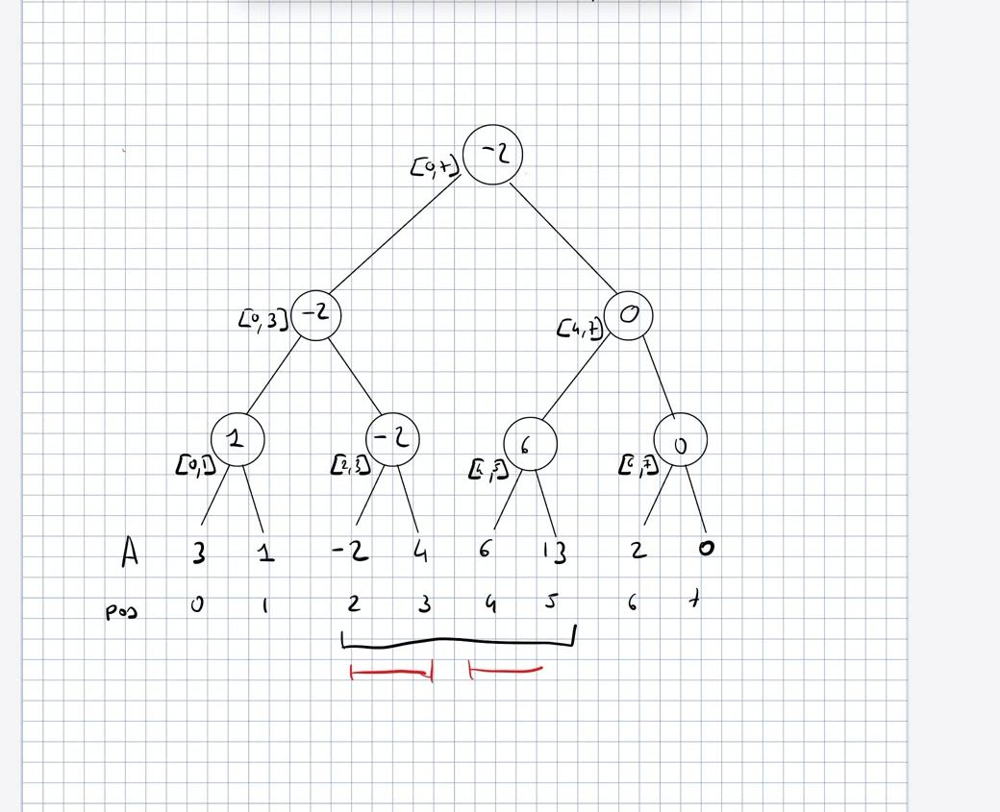  
*Board, 56:00: the minima; the query $[2,5]$ is split into $[2,3]$ and $[4,5]$*

- RMQ: **exactly the same visit**; the results of the total-overlap nodes are combined with $\min$: on $[2,5]$, $\min(-2,6)=-2$.

- **The visit splits the query range into sub-intervals**: from 1 up to $O(\log n)$ of them (not $n$, or the algorithm could not be logarithmic), and **they never overlap** (a node with total overlap stops the recursion, so nothing below it is reached). **For the sum non-overlapping is crucial (otherwise double counting); for the min it is not**: the min is correct even with overlaps. “This is going to be useful when we discuss other solutions for RMQ.”

- Add$(2,+7)$: $-2\to5$; node $[2,3]$: $\min(5,4)=4$; $[0,3]$: $\min(1,4)=1$; root: $\min(1,0)=0$. **At every node: the new min of one child, the old min of the other, take the min**: $\Theta(\log n)$. Early stopping (as soon as the changed position is no longer the parent’s minimum nothing changes above) **is a heuristic: it does not improve the worst case**.

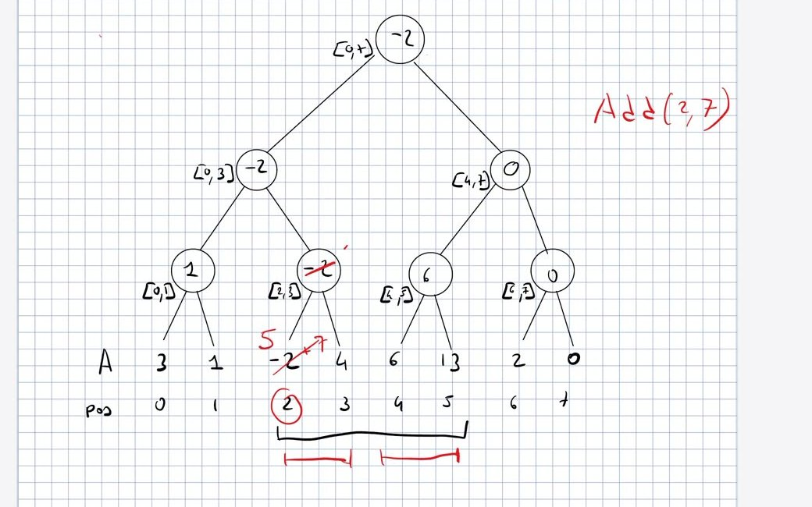  
*Board, 60:00: $\textsf{Add}(2,7)$*

Your notes: “with the prev. ex. we reach $-2$ and $6$ for query $[3,6]$” \[your notes\]: the query on the board was $[2,5]$ (nodes $[2,3]$ and $[4,5]$). \[extra\] `l14::rmq::RmqTree` (ties: leftmost position), test `board_example_2026` and against a linear scan.

# Range Minimum Queries with occurrences

**Problem** (60:20). Add$(i,v)$ and **$\textsf{query}(i,j)$: the minimum value in $A[i..j]$ with its number of occurrences in $A[i..j]$**. A student: **store also a counter**. Golden rule again: the problem asks for (min, \#occurrences), so **every node stores the pair (value, \#occs) for its range**.

**Why it works.** The query splits the range into sub-intervals; each returns its own (min, count). **Sum the counts of the sub-intervals whose min equals the overall minimum**; a sub-interval with a different (so larger) min does not contain the overall minimum at all, and its count is discarded. Example $A=[3,0,0,4,0,13,2,0]$: root $(0,4)$; $\textsf{query}(2,5)$: $(0,1)$ and $(0,1)$ $\to$ $(0,2)$. After $\textsf{Add}(4,13)$ ($0\to13$): $[4,5]=(13,2)$, $[4,7]=(0,1)$, root $(0,3)$; now $\textsf{query}(2,5)$ combines $(0,1)$ and $(13,2)$ $\to$ **$(0,1)$, not $(0,2)$**. Updates touch only the $\log n$ nodes on the path.

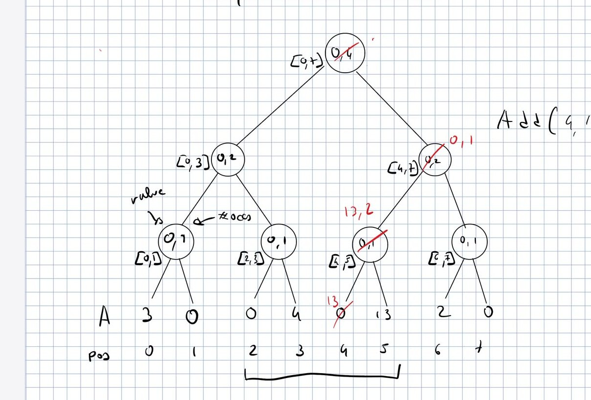  
*Board, 69:20: (value, \#occs) in every node, then $\textsf{Add}(4,13)$*

The prof’s comment (68:30): for easy problems the approach is “almost trivial”: draw the tree and put the answer in each node. **A segment tree uses more space than a Fenwick tree**, but **it is much more general**; for harder problems the recipe is the same, **but storing the answer may be much more complicated**. *\[Prof.’s 2025 notes, Segment_tree_2025.pdf p. 5 and p. 6 — see the PDF\]* \[extra\] `l14::rmq_occ::MinCountTree`, test `board_example_2026` (this example) and `example_2025_notes` (last year’s: $A[7]\colon 0\to-2$).

# Search$(s)$: smallest $i$ with prefix sum $\ge s$

**Problem** (70:00). $A[1,n]$ of **non-negative** integers (positions from 0 on the board); Add$(i,v)$, RangeSum$(i,j)$ and **$\textsf{Search}(s)$: the smallest position $i$ such that $\sum_{k=0}^{i}A[k]\ge s$** (the board first says “the position of the shortest prefix of $A$”, then rewrites it this way). **Non-negative values: the prefix sums never decrease**, so from the answer on they are always $\ge s$.

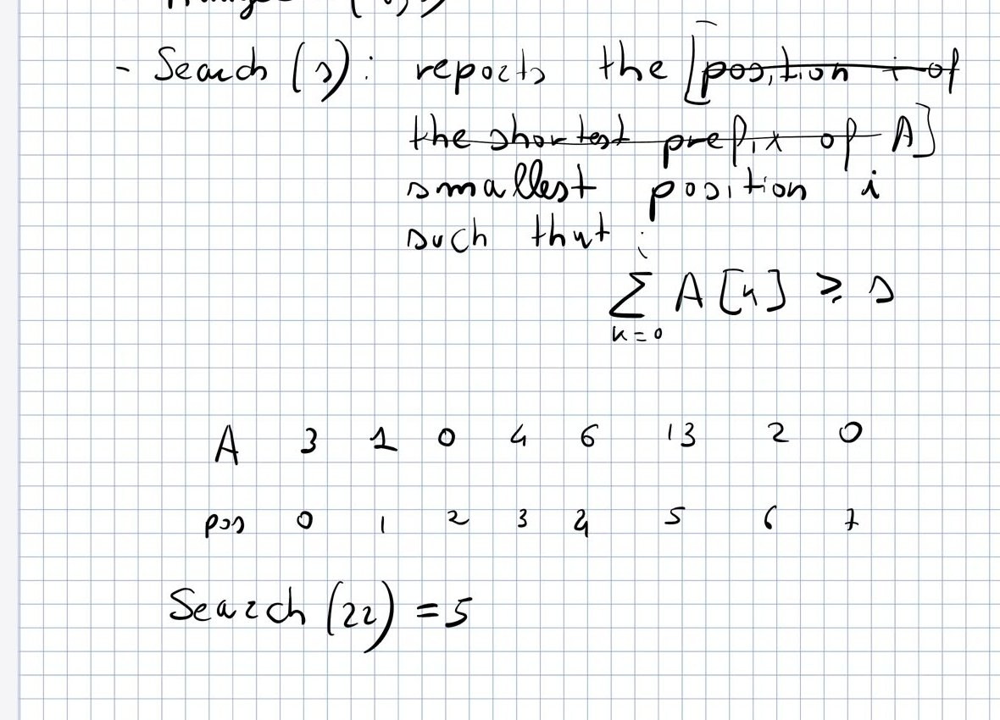  
*Board, 74:40: $A=[3,1,0,4,6,13,2,0]$, prefix sums $3,4,4,8,14,27,29,29$: $\textsf{Search}(22)=5$*

The tree of the previous problems cannot be used as it is: it has $-2$ (**negative**); the prof changes it to $0$ (root 29).

**Specialized solution** (77:20–83:30, suggested by a student). Start from the root; **compare $s$ with the left child’s sum**: if it is enough, the answer is in the left half; otherwise go right searching for **$s$ minus the left sum** (“we subtract something only when we go right”). Board: 22 vs 8 $\to$ right with $22-8=14$; at $[4,7]$: 14 vs 19 $\to$ left (search 14); leaf 6 $<14$ $\to$ right with $14-6=8$; leaf 13 $\ge 8$ $\to$ **position 5**. At a leaf two cases: its value is greater than what we are looking for, or equal (the prefix sum is exactly $s$); either way that is the answer.

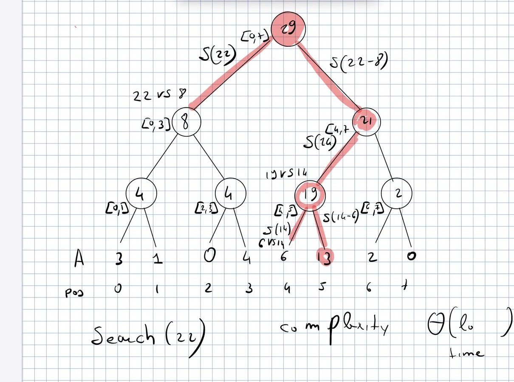  
*Board, 86:00: $\textsf{Search}(22)$*

Cost: we may go left and then come back and go right, but **when we go both ways the left step was cheap (one step)**: **$\Theta(\log n)$**. (The transcript around 79:00–80:30 is a bit confused about which node is compared with what; the board and the result are clear.)

**The checklist** (83:30–87:40). **“Segment tree must go directly in your checklist”** (item “use standard data structures”). The second item, **binary search for the answer**, also works: the prefix sums are monotone, so “is the prefix sum up to $i$ $\ge s$?” is a valid predicate; $\log n$ steps, each one a prefix sum in $\log n$: **$\Theta(\log^2 n)$, a log factor more**. It is **particularly inefficient**: every step restarts from the root and recomputes the same nodes, while the specialized solution sees immediately from a node which side to take. **The checklist gives you some help, but not always the final solution: look at the problem and find more appropriate solutions.** (Your notes: “but less space” for the binary search version \[your notes\] — not in the transcript.) *\[Prof.’s 2025 notes, Segment_tree_2025.pdf p. 7 and p. 8 — see the PDF\]* \[extra\] `l14::search::SearchTree::search` ($\Theta(\log n)$) and `search_binary` ($\Theta(\log^2 n)$), both against a linear scan.

# \#occs: occurrences of $x$ in a range (statement only)

**Problem** (88:00). $A[0,n-1]$ of integers; Add$(i,v)$ and **$\#\textsf{occs}(i,j,x)$: the number of occurrences of $x$ in $A[i..j]$**. Reporting the occurrences of the *minimum* is what we already saw; **what about an arbitrary $x$?**

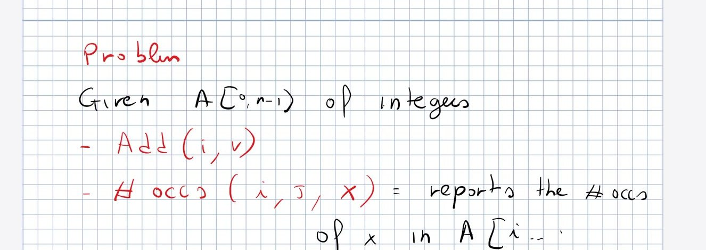  
*Board, 90:20*

> **Homework (spoken).** “You may try to find the solution if you have time.” Next lecture: **we conclude the segment tree presenting many other problems**, starting from this one, where **storing a number in each node is no longer enough: you need to store more**. The solution is in `Lessons/L15/L15.pdf` (from the prof’s 2026 notes) and in last year’s notes (p. 9): try before looking.

\[extra\] `l14::occs::OccsTree` implements last year’s solution (hash map per node).

# The prof’s 2026 notes on this lecture

On 14/11 the prof published *Segment Tree* (<https://pages.di.unipi.it/rossano/blog/2026/segmenttree/>), written “with the help of a trusted friend” (an AI): it covers L13–L15 in one text, with a different running example, $A=[5,1,3,1,4,7,2,1]$. The parts of this lecture are: *How many nodes do we visit?* (the analysis of §2), *Segment Tree in Rust*, *Beyond Sums*, *Dynamic Range Minimum Queries*, *Minimum with Number of Occurrences*, *Searching on a Segment Tree*. Same content as the lecture; the useful differences:

- The cost analysis names the three kinds of partial overlap: the query part inside one half; a **suffix or prefix crossing the middle** (one child total overlap); the **general partial overlap** $l<i\le m<j<r$. Its children get **anchored** query parts (a suffix of the left child, a prefix of the right child), and **an anchored part can never produce a general partial overlap**: so **at most one general partial overlap**, then two paths, at most 4 nodes per level. (This is the “special po” of the board.)

- Code: root = node 0, children $2u+1$, $2u+2$ (heap layout), vector of $4n$ nodes. **Why $4n$**: indexes are not contiguous when $n$ is not a power of 2 (for $n=6$ the leaf 4 is node 12); height $h=\lceil\log n\rceil$, indexes $<2^{h+1}$ and $2^h<2n$.

- Search returns `None` if the root does not reach $s$: **without this check the descent ends in the last leaf** and returns a wrong answer.

- The checklist remark of the lecture is not in the notes; *Beyond Sums* (associativity, neutral element, Fenwick vs segment tree) is summarized at the beginning of L15.pdf.

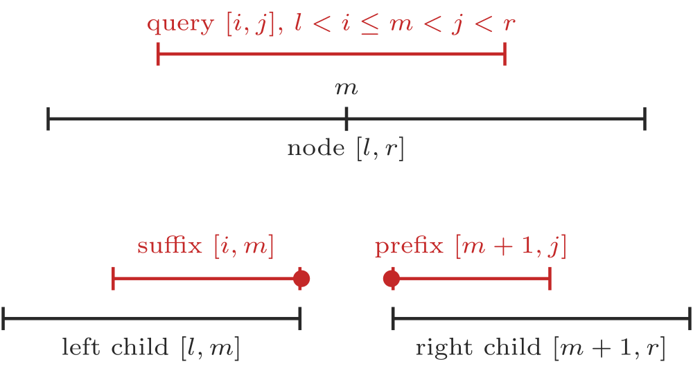  
*Prof.’s 2026 notes: the children of a general partial overlap get anchored query parts*

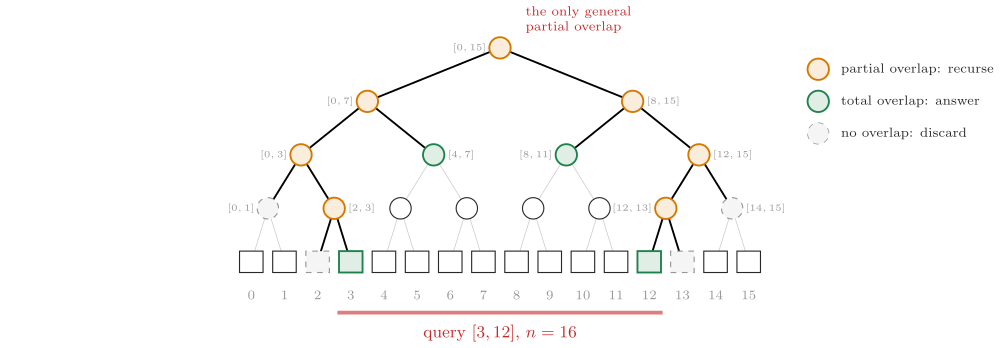  
*Prof.’s 2026 notes: query $[3,12]$ with $n=16$: one general partial overlap (the root), then two paths*

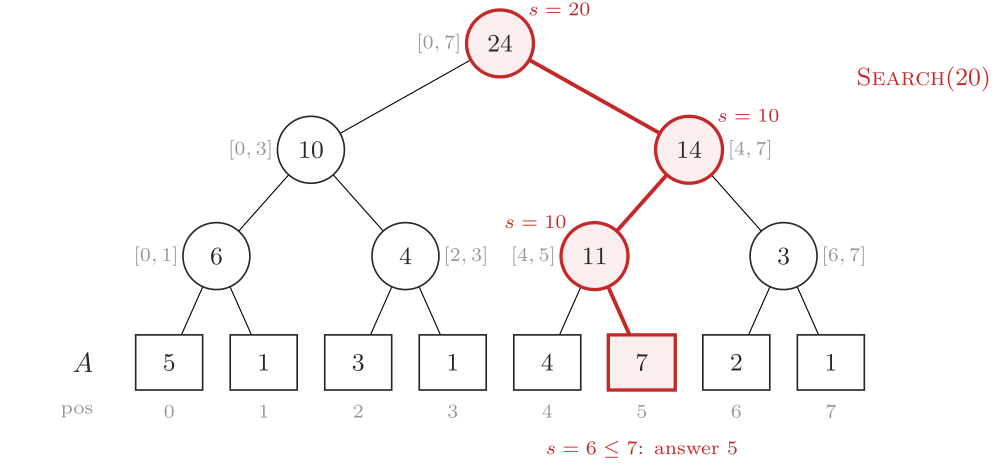  
*Prof.’s 2026 notes: $\textsf{search}(20)$ on the running example: answer 5*

\[extra\] `l14::prof_blog::SegmentTree` (the prof’s code, verbatim), tested on every number of the notes, on the board examples of L13/L14 and against a naive array; `l14::rmq`, `rmq_occ`, `search` also tested on the notes’ examples ($\textsf{rmq}(2,7)=3$; root $(1,3)$, after $\textsf{add}(1,-1)$: $(0,1)$; $\textsf{search}(20)=5$). All the numbers of the notes check out.

# Exercises and deadlines (course page)

> **Row of 02/11/2026** (“Segment Trees: Lazy Propagation”; the row is the prof’s plan — lazy propagation was *not* done today):
>
> - *Circular RMQ*, <http://codeforces.com/problemset/problem/52/C>: **optional** (not bold) in the row of 02/11/2026.
>
> **Still open, from earlier rows of this year’s table** (2026):
>
> - **Update the Array**, <http://www.spoj.com/problems/UPDATEIT/>: mandatory in the row of **19/10/2026** (explained in L13).
>
> - **Nested Segments**, <http://codeforces.com/problemset/problem/652/D>: mandatory in the row of **21/10/2026** (explained in L12); *solve Nested Segments with segment trees*: optional in the row of 26/10/2026.
>
> - *Pashmak and Parmida’s problem*, <http://codeforces.com/problemset/problem/459/D>: optional, row of 21/10/2026.
>
> - **Hands-On 2** (row of 04/11/2026), <https://pages.di.unipi.it/rossano/blog/2024/handson2>: **deadline 22/11/2026** (scaffold in `HandsOn/HO2`).

Practice (\[extra\], not assigned by the prof): `Lessons/L14/practice` E56 (dynamic RMQ), E57 (min with occurrences), E58 (Search: $\Theta(\log n)$ and $\Theta(\log^2 n)$).

# Next time

“See you on Wednesday” (04/11 = L15): end of the segment tree, “many other problems” starting from \#occs. **No lecture in the week of 09/11.** The prof also said he would give the hands-on by the end of that week, to work on it while he is away (Hands-On 2 is on the course page, row of 04/11). \[extra\] L15 has no recording: `Lessons/L15/L15.pdf` is written from the prof’s 2026 notes (#occs, successor, increasing triplets, lazy propagation, persistent segment tree).
