# **CPC — Lecture 15** — Segment tree, end (persistent) · Mo's algorithm (+ #occs, successor, triplets, lazy from the prof's notes)

Competitive Programming and Contests — recording L_15.MP4 (recorded Monday 16/11/2026) + the unrecorded lecture of 04/11

> **Two sources, two parts.** The prof released `L_15.MP4` (93 min) on 17/11; **its file metadata say it was recorded on Monday 16/11/2026**, and it contains **only the persistent segment tree and Mo’s algorithm** (it starts a few seconds into the definition of persistence). \#occs, successor, triplets and lazy propagation are **not in any recording**: they were probably done on 04/11 (unrecorded; you missed that lecture). As you asked, everything is filed as L15:
>
> - **Part I** (§1–5) — from the **prof’s 2026 notes** *Segment Tree* (blog, 14/11), marked \[notes 2026\]; **not in the recording** \[not in the recording\].
>
> - **Part II** (§6–7) — **from the recording** (transcript `L15_transcript.txt`, board `board/l15_*.jpg`), with the prof’s notes as a complement.

> **Sources.** Recording `L_15.MP4` and its automatic transcript (not revised); the prof’s board (iPad) and, for Mo’s algorithm, **pages made “by Claude starting from my handwritten notes”** (his words) that he fills in live; the prof’s notes *Segment Tree* (2026, <https://pages.di.unipi.it/rossano/blog/2026/segmenttree/>: text, figures in `figs_prof/`, code in `src/prof_blog.rs`) and *Mo’s Algorithm* (2023, <https://pages.di.unipi.it/rossano/blog/2023/mosalgorithm/>: code in `src/mo.rs`); course page (checked 17/11/2026). Everything marked \[extra\] is mine.
>
> Code: `Lessons/L15/src` (`cargo test -p l15`). Exercises: `Lessons/L15/practice`, E59–E62 (the exercises of the prof’s notes) and E63–E64 (Mo; E63 = the prof’s spoken homework) (`cargo test -p practice_l15`).
>
> **Highlights:** **general / to remember** **good: works, efficient, correct** **bad: pitfalls, wrong ideas, costs** **definitions and key results**

> **Where we are.** L14 (02/11) ended with the statement of \#occs and “next lecture we conclude the segment tree presenting many other problems”. Part I covers those problems from the notes. The recording (Part II) starts with **persistence** (0:00–39:00), then a recap of Fenwick vs segment tree (39:00–41:00) and the start of a new topic, **Mo’s algorithm** (41:00–93:00), for queries that **cannot be answered by combining subranges**. The prof also tries a new style: “not slides, something in between”.

# Part I — from the prof’s 2026 notes (not in the recording)

### Recap from the notes: what a segment tree needs \[not in the recording\]

\[notes 2026\] (section *Beyond Sums*, linked from the row of 28/10; in L14 the prof only said “more space than a Fenwick tree, but much more general”.) What did we use of the sum? **(1) the answer on a range is obtained by combining the answers on two subranges that partition it; (2) a neutral element**, returned on no overlap. **The combine must be associative** (a query groups the total overlaps differently from how the nodes were built); **commutativity is not needed, but then combine left first, right second**. So the segment tree works for **any associative operation with a neutral element**: sum, product, min, max, gcd, and/or/xor, matrix product… Only *what a node stores* and *the combine* change.

- **The Fenwick tree must subtract** prefix $[0,i-1]$ from prefix $[0,j]$: **the minimum cannot be undone this way**. (When even combining is impossible: Mo’s algorithm, offline and static.)

- **When both work**, the Fenwick tree is shorter, uses $n$ integers instead of $4n$ and is faster. **Segment tree for**: operations that cannot be undone (min, max, gcd), search on the tree, range updates on operations other than the sum, persistence.

### Nodes storing data structures: \#occs \[not in the recording\]

\[notes 2026\] “So far every node stores a constant number of values. **Nothing prevents us from storing a whole data structure in every node**. The total space grows, but we can answer more complex queries.”

**Problem (Range Occurrence Counting).** add$(i,v)$ and **$\textsf{occs}(i,j,x)$ = number of occurrences of $x$ in $A[i..j]$** (the homework of L14).

**Solution.** **Every node stores a hash map value $\to$ number of occurrences in its range**. The query visits the tree as range_sum; in every total-overlap node it looks up $x$ and **the counts are summed**. Example: $\textsf{occs}(1,7,1)$ visits $[1,1]$, $[2,3]$, $[4,7]$, counts $1,1,1$: answer 3. add$(i,v)$ changes $A[i]$: in the $\Theta(\log n)$ maps on the path, decrement the old value and increment the new one; **when a count drops to zero remove the key**, otherwise the maps keep growing with the updates.

- **space $\Theta(n\log n)$**: each position is in the maps of its $\Theta(\log n)$ ancestors;

- **both operations $O(\log n)$ expected** (hash maps);

- static version (no add): **more space-efficient solution, the Wavelet tree**.

\[extra\] `l15::occs::OccsTree`, tested on this example and against a scan.

### Successor queries in a range \[not in the recording\]

**Problem.** add$(i,v)$ and **$\textsf{successor}(i,j,x)$ = the smallest value in $A[i..j]$ that is at least $x$**, if any.

**Solution** \[notes 2026\]. **Every node stores the values of its range in a balanced BST**; **values repeat, so it must be a multiset**: in Rust a `BTreeMap` value $\to$ count. In every total-overlap node compute the successor of $x$ in its BST; **the answer is the minimum of these successors** (neutral element $+\infty$). Example: $\textsf{successor}(1,5,2)$: total overlaps $[1,1]$, $[2,3]$, $[4,5]$, successors $+\infty,3,4$: answer 3.

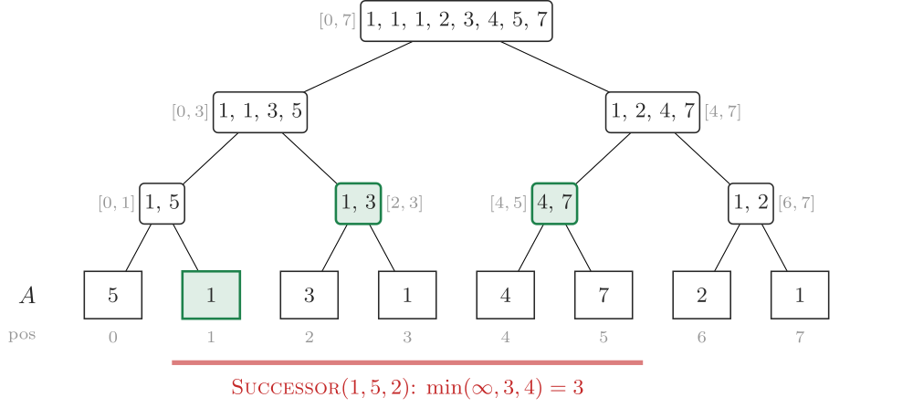  
*Prof.’s 2026 notes: the values stored in every node (sorted) and $\textsf{successor}(1,5,2)$*

- query: $O(\log n)$ BSTs, $O(\log n)$ each: **$O(\log^2 n)$**; add: remove the old value and insert the new one in $\Theta(\log n)$ BSTs, $O(\log^2 n)$; space $\Theta(n\log n)$.

- **No updates: a sorted array per node**, built in linear time by merging the children’s arrays as in merge sort: the **merge sort tree**, built in $\Theta(n\log n)$.

- **Query in $O(\log n)$ with fractional cascading**: all the searches look for the same $x$, so **the result of the search in a node can guide the search in its children**.

\[extra\] `l15::successor::SuccTree`, tested on this example and against a scan.

### An application: counting increasing triplets \[not in the recording\]

**Problem.** Count the triplets $0\le i<j<k<n$ with **$A[i]<A[j]<A[k]$**. The running example has 5: $(1,2,4)$, $(1,2,5)$, $(1,4,5)$, $(2,4,5)$, $(3,4,5)$; **$(1,3,4)$ is not one**, since $A[1]=A[3]$ and the inequalities are strict. **It uses only add and range_sum, so a Fenwick tree works as well: same idea as counting inversions (L12), a tree indexed by value filled during a scan.**

**From the middle element.** Checking all triplets: $\Theta(n^3)$. **Fix the middle position $j$**: a valid $i$ is to the left with a smaller value, a valid $k$ to the right with a larger value, and **the two choices are independent**. With **$L_j=\#\{i<j: A[i]<A[j]\}$ and $R_j=\#\{k>j: A[k]>A[j]\}$, exactly $L_j\cdot R_j$ triplets have middle $j$**; every triplet has exactly one middle, so summing over $j$ counts each once.

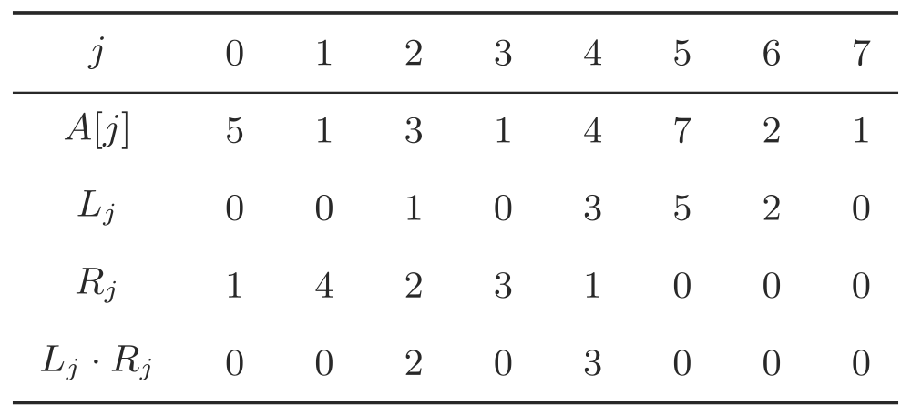  
*Prof.’s 2026 notes: $L_j$, $R_j$ and $L_j\cdot R_j$ on the running example: $2+3=5$*

Scanning for every $j$ costs $\Theta(n)$ each, $\Theta(n^2)$ overall.

**Two segment trees indexed by value.** **$L_j$ asks about the prefix $A[0..j-1]$, $R_j$ about the suffix $A[j+1..n-1]$**. Assume values in $[0,V-1]$, $V=O(n)$, and keep two segment trees on arrays of $V$ counters: **$P[x]$ = occurrences of $x$ in the prefix, $S[x]$ = occurrences in the suffix**. Then $L_j = P.\textsf{range\_sum}(0,A[j]-1)$ and $R_j = S.\textsf{range\_sum}(A[j]+1,V-1)$ (**empty ranges when $A[j]=0$ or $A[j]=V-1$: do not call range_sum, take 0**).

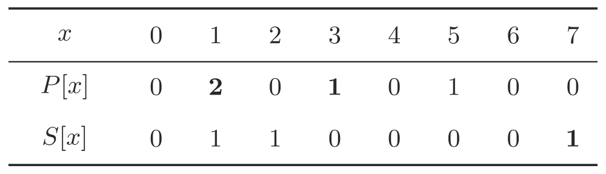  
*Prof.’s 2026 notes: $P$ and $S$ at $j=4$ ($A[4]=4$): $L_4=P[0..3]=3$, $R_4=S[5..7]=1$*

Scan from left to right; initially $P$ all zeros and $S$ = occurrences of every value in the whole array; at every $j$: (1) $S.\textsf{add}(A[j],-1)$ (it leaves the suffix); (2) compute $L_j$, $R_j$, add $L_j R_j$; (3) $P.\textsf{add}(A[j],1)$ (it enters the prefix). **$\Theta(n\log V)$ time, $\Theta(V)$ space**. **The result can be $\Theta(n^3)$ (sorted array): 64-bit integers for it and for the products.** **Large or negative values: replace every value with its rank** (sort a copy, remove duplicates, binary search): equal values get equal ranks, order preserved, so the triplets do not change; $V\le n$, total $\Theta(n\log n)$. Example: ranks $[4,0,2,0,3,5,1,0]$, $V=6$.

\[extra\] `l15::triplets::count_triplets_st` (this algorithm, with the prof’s `SegmentTree`), `count_triplets` (Fenwick trees), both tested against the $\Theta(n^3)$ brute force.

### Range updates with lazy propagation \[not in the recording\]

**Problem.** **$\textsf{range\_update}(i,j,v)$: add $v$ to every entry of $A[i..j]$**, and range_sum$(i,j)$. **The Fenwick tree solves it with two trees and an algebraic trick** (L13); the segment tree could copy the trick, **but it is specific to additions and sums**. **Lazy propagation** is more general: it works for many combinations of range updates and queries (assign a value to a range; add to a range and ask for the minimum…). **An add for each position costs $\Theta((j-i+1)\log n)$**.

**Idea: be lazy.** When a whole node is updated, **update the node and leave a note for its descendants**; do their work only when a later operation has to go below. Every node keeps its sum and a **lazy value = an addition still to be applied to all the elements below it**. **Invariant: the sum stored in a node is always correct; only nodes below a nonzero lazy value may be out of date.** range_update visits the tree as range_sum:

- **total overlap**: add $v\cdot(r-l+1)$ to its sum and $v$ to its lazy value, **and stop** (a leaf needs no lazy value);

- **no overlap**: nothing;

- **partial overlap**: **first push the node’s lazy value to its two children** (apply it to each as a total overlap, reset it to 0), then recurse on both and recompute the sum from the children.

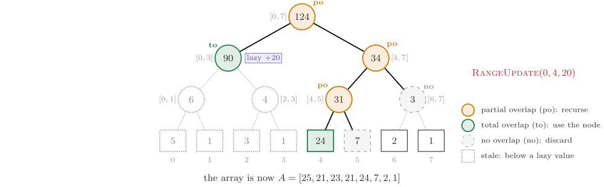  
*Prof.’s 2026 notes: $\textsf{range\_update}(0,4,20)$: $[0,3]$ becomes $10+4\cdot 20=90$ with lazy $+20$; the dotted nodes are stale*

range_sum works as before but **also pushes** the lazy value of every partial-overlap node before going down: **a query modifies the tree** (`&mut self` in Rust). $\textsf{range\_sum}(0,2)$: $[0,3]$ pushes $+20$: $[0,1]=6+40=46$, $[2,3]=4+40=44$, both with lazy $+20$; $[0,1]$ is a total overlap and returns 46 (keeping its lazy value); $[2,3]$ pushes to its leaves (23 and 21): answer $46+23=69$. The subtree of $[4,7]$ is not touched.

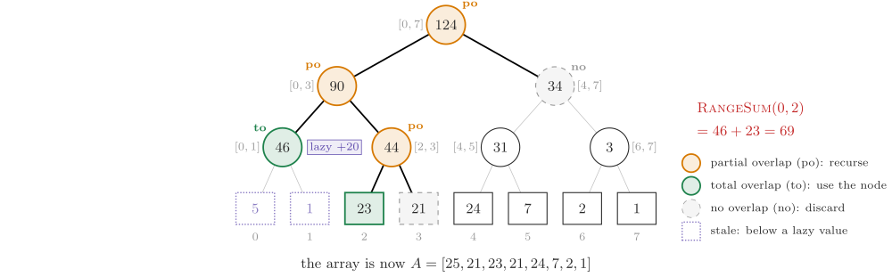  
*Prof.’s 2026 notes: $\textsf{range\_sum}(0,2)$ after the update*

**An update pushes too**: a later $\textsf{range\_update}(1,2,1)$ partially overlaps $[0,1]$, which pushes its $+20$ (leaves 25 and 21) before leaf 1 becomes 22. **Both operations visit the same nodes as a range_sum, constant work each: $O(\log n)$.**

**What lazy propagation needs.** **(1) apply a pending update to a node’s value without looking at its children; (2) compose two pending updates into one.** Add + sum: (1) “add $v(r-l+1)$”, (2) “add the two values”. **Add + minimum: (1) “add $v$ to the minimum”** (after $\textsf{range\_update}(0,4,20)$ the minimum of $[0,3]$ goes from 1 to 21 without touching the children). **Assignment: the composition of two pending updates is the later one, and an assignment pushed onto a pending addition replaces it: the order matters.**

**The prof’s code** \[notes 2026\] (`l15::prof_blog::LazySegmentTree`, verbatim; it reuses `SegmentTree::from_slice` of L13–L14): *\[code: src/prof_blog.rs lines 78–149 — see the PDF or the file\]* \[extra\] Test `lazy_notes_example`: every number above (90, lazy $+20$, root 124, 69, children 46 and 44, final array $[25,22,24,21,24,7,2,1]$). Also `l15::lazy` (mine, root at 1). Course page, row of 02/11/2026: optional *Circular RMQ* (CF 52C) = range add + range min with lazy propagation.

# Part II — from the recording

### Persistent segment tree

**Persistence** (0:00–1:40). The data structure has a **timestamp**: **operations that change it move the timestamp by 1**; **operations that query it can specify a timestamp** and get exactly the answer the structure would have given at that time. “Having this notion of time allows us to solve problems with the data structures we already know: **time acts as an extra dimension**.”

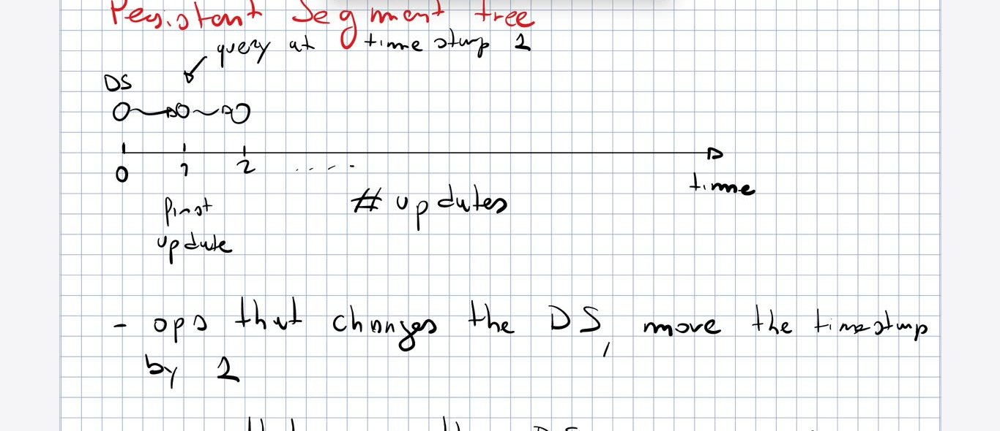  
*Board, 0:00*

**Problem (persistent range sum)**. $A[0,n-1]$; Add$(i,v)$ (changes the time); **$\textsf{RangeSum}(i,j,t)=\sum_{k=i}^{j}A[k]$ as it was at time $t$**. Board example: the L14 tree on $A=[3,1,-2,4,6,13,2,0]$, then $\textsf{Add}(3,10)$ at $t=1$ and $\textsf{Add}(7,20)$ at $t=2$.

**Attempt \#1** (2:30–5:10): **a copy of the segment tree after each update**. **Pro: RangeSum$(i,j,t)$ in $\Theta(\log n)$**, as before. **Cons: Add takes $\Theta(n)$; space $\Theta(t\cdot n)$ after $t$ updates.** “It exploits nothing: any data structure can be made persistent this way.”

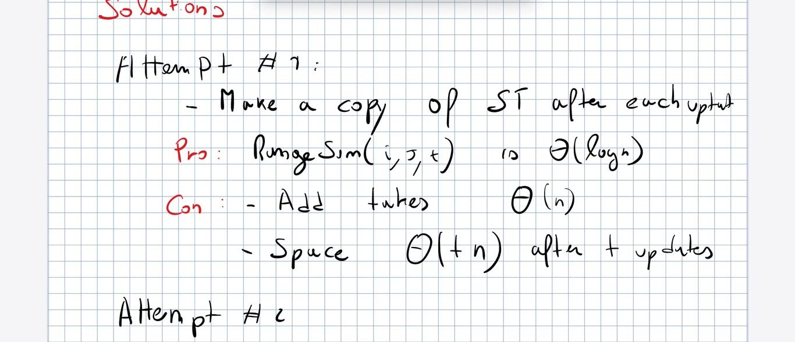  
*Board, 5:20*

**Attempt \#2** (5:10–23:00), built with the students. **Exploit: an Add changes only $\Theta(\log n)$ nodes**, the path from the leaf to the root. Every changed node remembers the change and its timestamp: $\textsf{Add}(3,10)$ at $t=1$: leaf 4$\to$<!-- -->14, $[2,3]$ 2$\to$<!-- -->12, $[0,3]$ 6$\to$<!-- -->16, root 27$\to$<!-- -->37; $\textsf{Add}(7,20)$ at $t=2$: leaf 0$\to$<!-- -->20, $[6,7]$ 2$\to$<!-- -->22, $[4,7]$ 21$\to$<!-- -->41, root 37$\to$<!-- -->57 (**the board says 2:47 at the root of this attempt**; the correct value is 57, fixed in attempt \#3 after a student’s remark).

- A student proposed **a hash map timestamp $\to$ value in each node**: **it does not work**, because a query at time $t$ needs the value valid at $t$, i.e. **the pair with the largest timestamp $\le t$**, and $t$ itself is usually not a key.

- So each node keeps **a list of (timestamp, value) pairs sorted by timestamp** (e.g. $[4,7]$: $0{:}21,\ 2{:}41$). **Keeping it sorted is free: timestamps only grow, so we just append.** The value at time $t$ = **predecessor search of $t$ = binary search on the list**.

- “**Binary search is a weapon, a binary search tree is a cannon**”: use a BST only when you need arbitrary insertions; when appending at the end keeps the order, a sorted array is enough.

**Space $\Theta(n+t\log n)$** (the initial tree, plus $\log n$ appended pairs per update), **Add $\Theta(\log n)$**, but **RangeSum$(i,j,t)$ in $\Theta(\log n\cdot\log t)$**: $O(\log n)$ total-overlap nodes, a binary search on a list of up to $t$ pairs in each. (The prof admits he first thought “$\log^2 n$” — “chain of thought”.)

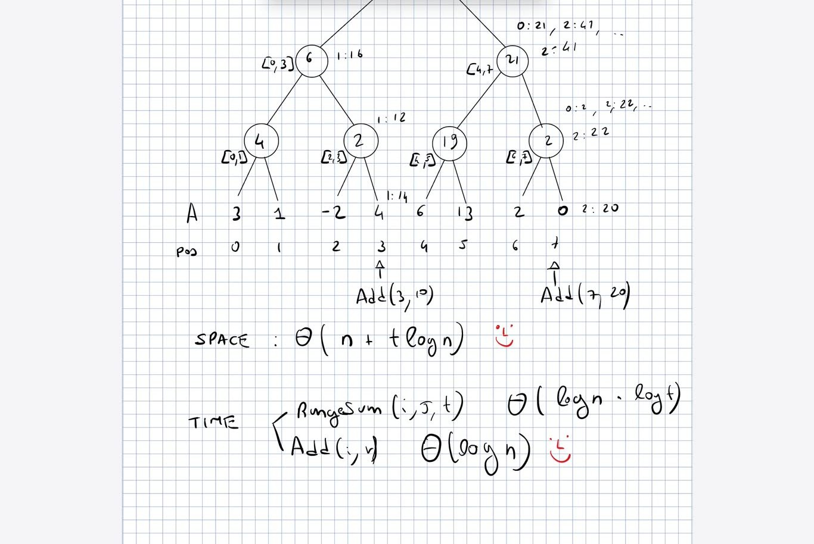  
*Board, 18:40: the lists $t{:}\,$value next to the nodes; space and time of attempt \#2*

**The lesson** (23:00–26:40): attempt \#2 **is more powerful than needed**: it would work even if an update changed $\log n$ *random* nodes. **“If a solution is more powerful than what you need, try to break it: design a structure that is less powerful, because being powerful has a cost.”** What we really have: **the $\Theta(\log n)$ changed nodes lie on one root-to-leaf path**.

**Attempt \#3: path copying** (26:40–39:00). **An array of roots, one per timestamp**; to query time $t$, start from `roots[t]`. Add: **copy every node of the path** (new value), **keep the other child as it is** (pointer to the old node), **connect the new node as the correct child** of the new parent; finally a new root goes in the array. **The update starts from the last root.** From `roots[0]` we see the original tree (the red nodes are not reachable), from `roots[1]` the tree after the first update, and so on. **It is no longer a tree** (nodes have several parents). Example: red copies 14, 12, 16, 37; green copies 20, 22, 41, 57, the green root pointing to the red 16 on the left.

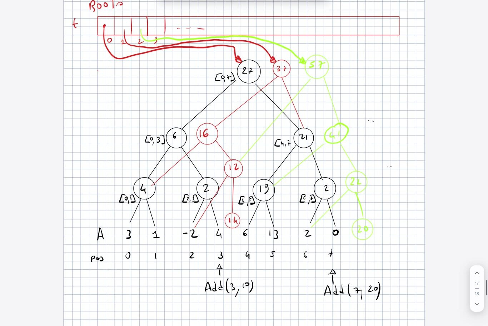  
*Board, 35:20: roots array and the red and green paths*

**Add $\Theta(\log n)$, RangeSum$(i,j,t)$ $\Theta(\log n)$, space $\Theta(n+t\log n)$** (one new node per level per update). “A pretty elegant solution for a problem that at the beginning seems to have only attempt \#1.”

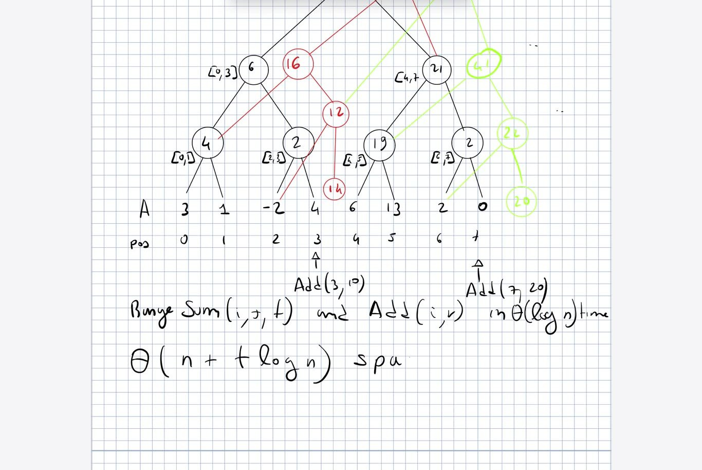  
*Board, 36:20*

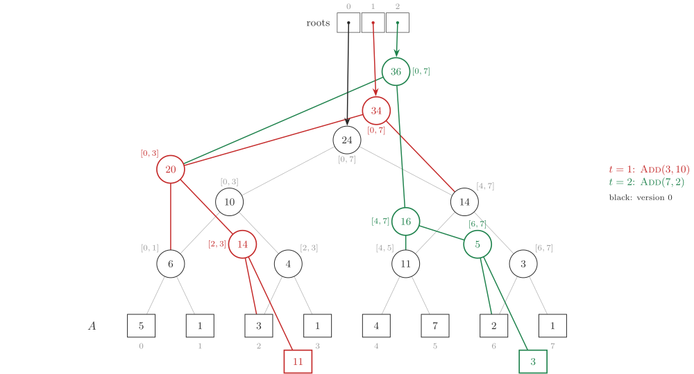  
*Prof.’s 2026 notes: the same construction on the notes’ example ($\textsf{add}(3,10)$, $\textsf{add}(7,2)$)*

**The prof’s code** \[notes 2026\] (`l15::prof_blog::PersistentSegmentTree`, verbatim; **the implicit layout $2u+1,2u+2$ cannot be used: a node may have several parents**): *\[code: src/prof_blog.rs lines 151–239 — see the PDF or the file\]* \[extra\] Tests: `persistent::lecture_board_example` (roots 27, 37, 57; 16, 12, 14 at $t=1$; 41, 22, 20 at $t=2$) and `prof_blog::persistent_notes_example`.

#### Why should we query the past? \[not in the recording\]

\[notes 2026\] (only in the notes; in the recording the prof only says “time acts as an extra dimension”.) **A typical use: turn a sweep into a data structure.** If version $t$ stores the first $t$ elements of a sequence, a query on version $t$ is a query on a prefix, and **the difference of two versions answers a query on a range**.

**Example:** many queries $\textsf{count}(i,j,x)$ = how many values of $A[i..j]$ are smaller than $x$. As for the triplets, **a segment tree indexed by value** on counters $C$; scan $A$ and do $\textsf{add}(A[t],1)$ at every position; $C_t[x]$ = occurrences of $x$ in $A[0..t-1]$. Then **$\textsf{count}(i,j,x) = \textsf{range\_sum}(0,x-1,j+1) - \textsf{range\_sum}(0,x-1,i)$**, two queries on two past versions, $O(\log V)$. Example: $\textsf{count}(2,6,4)$ ($A[2..6]=3,1,4,7,2$): versions 2 and 7, $(0+2+1+1)-(0+1+0+0)=3$.

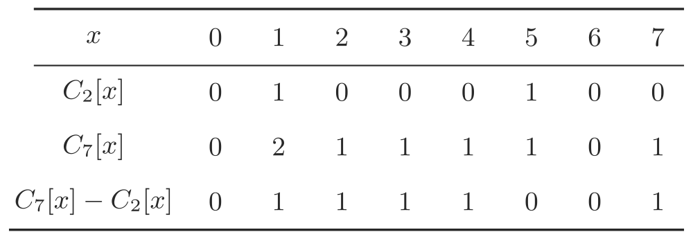  
*Prof.’s 2026 notes: the counters of versions 2 and 7 and their difference = the values of $A[2..6]$*

**Without persistence: keep all $n+1$ versions ($\Theta(nV)$ space), or answer offline, sorted by position, in one scan.** **With path copying all versions take $O(V+n\log V)$.** **Harder queries**: **the $k$-th smallest value in $A[i..j]$**: descend versions $j+1$ and $i$ together; at every node **the difference of the two left children’s counters** says how many values of $A[i..j]$ fall in the left half: if $\ge k$ go left, otherwise go right subtracting them from $k$ (as in Search). Example: 2nd smallest in $A[2..6]$ is 2.

\[extra\] `l15::past::PastCounts` (`count` and `kth`, my code following the notes), tested on these examples and against sorting.

### Mo’s algorithm

**Why** (39:00–42:30). Recap: the Fenwick tree answers range-sum queries; the segment tree does the same in similar space, but **it is easily modified to solve many other problems**: **every query that can be answered by splitting the range into subranges and combining their answers** (sum, min, max…). **Some queries cannot be combined this way.** For some of them there is **Mo’s algorithm**: **offline queries** (all given beforehand; we may **reorder** them and return the answers in the original order), **queries that only ask about the data, no updates**. “Nobody knows precisely who Mo is.”

**A difficult problem: Powerful Array** (46:30–54:40). $A[0,n-1]$ of positive integers, offline queries **$\textsf{power}(l,r)=\sum_{e\in D(l,r)} e\cdot K_e^2$**, $D(l,r)$ = distinct values of $A[l..r]$, $K_e$ = occurrences of $e$ in $A[l..r]$. Example $A=[2,1,3,2,2,2,1,4]$: $\textsf{power}(1,6) = 1\cdot2^2 + 3\cdot1^2 + 2\cdot3^2 = 4+3+18=25$. **With a segment tree: to combine two subranges you must merge their distinct values and frequencies, so a query costs the number of distinct elements: $\Theta(n\cdot q)$.** **Target: $\Theta((n+q)\sqrt n)$** — “where does $\sqrt n$ come from? We have no technique with $\sqrt n$”. “Problem impossible now; in half an hour, super easy.”

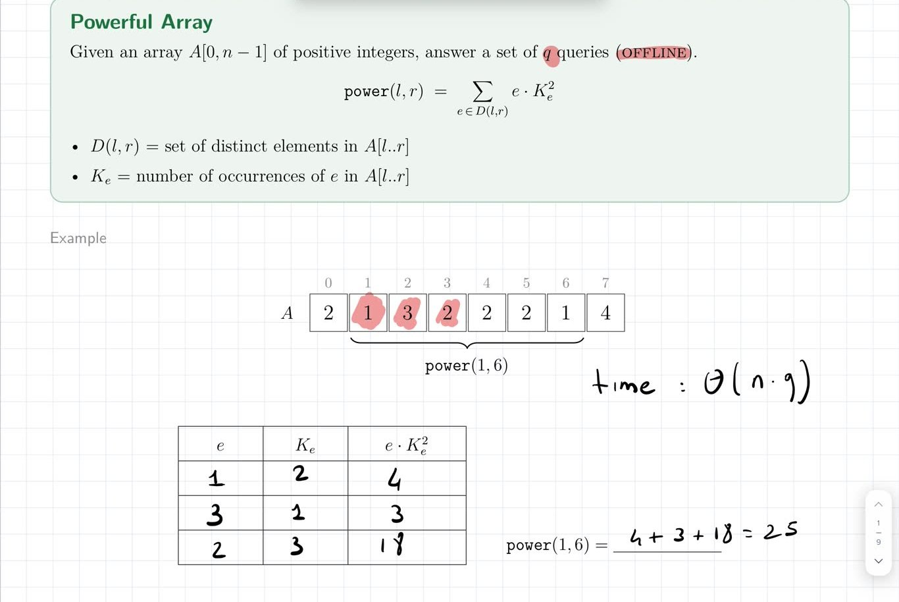  
*Board, 54:00*

**An easier problem: Three or More** (55:00–58:30). $A[0,n-1]$ of **colors** (values in $[0,n-1]$: “colors” is the algorithmic term for such values); offline queries **three_or_more$(i,j)$ = number of distinct colors occurring at least 3 times in $A[i..j]$**. Example $A=[3,1,3,0,3,1,1,0,3,1,0,0]$: $(0,5)\to1$, $(1,9)\to2$, $(6,10)\to0$ (**“three bug finders so far”**: the first answers on the board were wrong and the students fixed them). **Segment tree again fails: answers 2 and 2 of two halves do not give 4, the same color may be counted twice.**

**Trivial solution** (58:30–64:00): for each query, counters all 0, scan $A[i..j]$, `counters[A[k]] += 1`, **when a counter becomes exactly 3, answer += 1**. **$\Theta(q\cdot n)$**; bad input: $n$ queries $[0,n-1],[0,n-2],\ldots$: **$\Theta(n^2)$**.

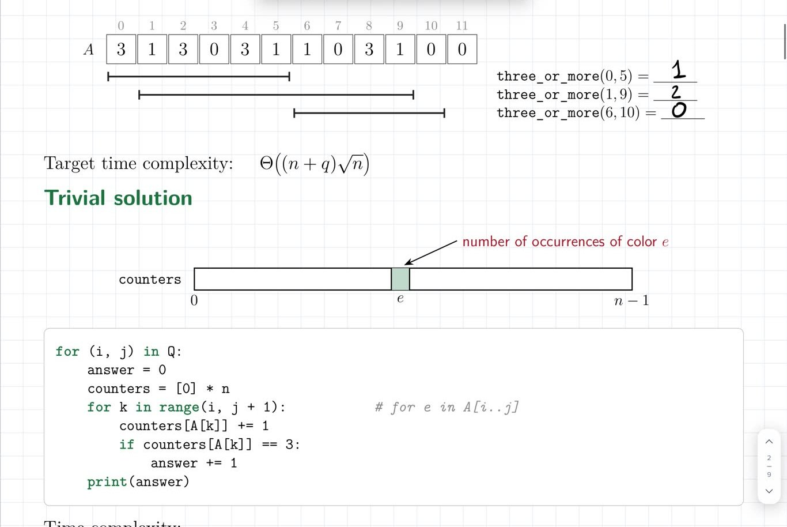  
*Board, 60:00*

**Do not start from scratch** (64:00–74:20). Same inefficiency, different implementation: **go from the window of the previous query to the window of the next one**, removing and adding elements one by one. **`add(k)`: counter$+1$, if it becomes 3, answer$+1$; `remove(k)`: counter$-1$, if it becomes 2, answer$-1$** — the opposite of add. Running example on $A=[1,3,1,2,1,3,3,0,2,1,2,2,3,1,0,3]$: from $(0,6)$ (answer 2: colors 1 and 3) to $(2,10)$ (remove 1, 3: answer 0; add 0, 2, 1, 2: answer 2).

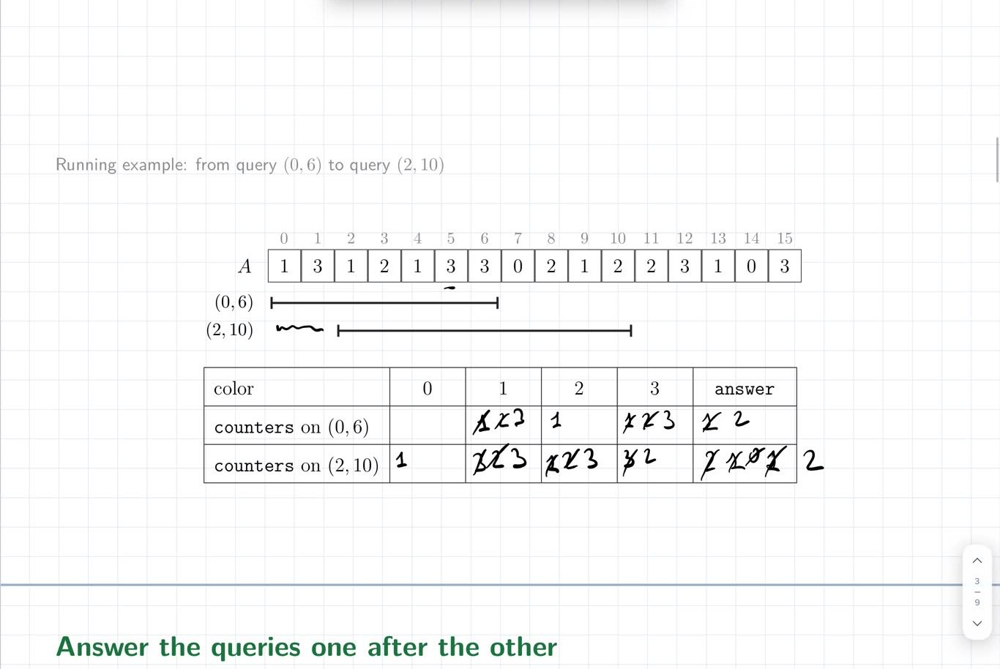  
*Board, 71:40: the counters from $(0,6)$ to $(2,10)$*

Pseudocode: window $A[\textit{cur\_i}..\textit{cur\_j}-1]$, initially empty; for each query **four loops**: extend left (add), extend right (add), shrink left (remove), shrink right (remove).

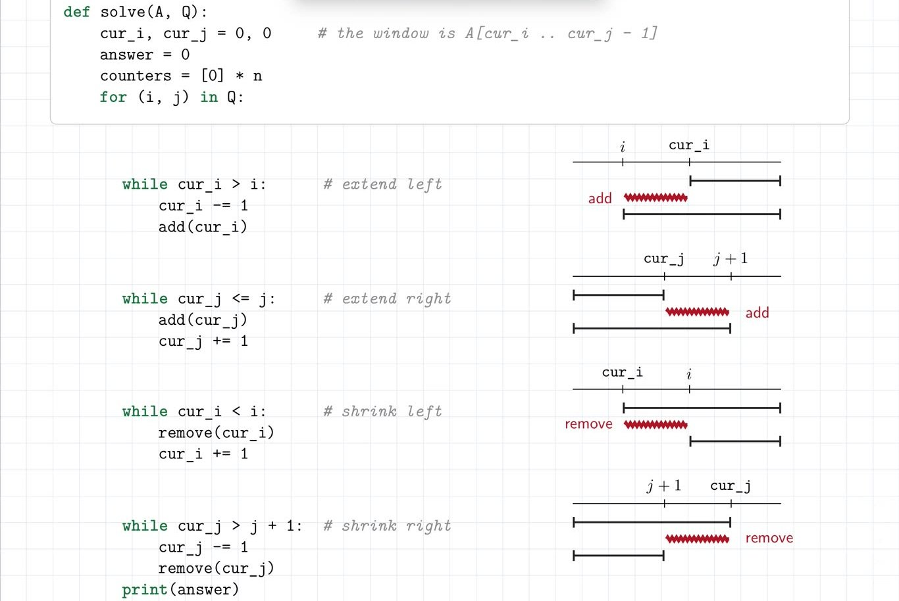  
*Board, 80:40*

**Cost** (74:20–80:40). On the bad input of before: $n+n$, **linear**! But **still $\Theta(n^2)$ in the worst case**: e.g. alternating disjoint ranges of length $n/2$, or (a student) the same nested prefixes **alternating first/last, long/short**: $n-1$, $n-2$, … removals. **Lesson: the trivial algorithm is always terrible; this one depends on the order of the queries.**

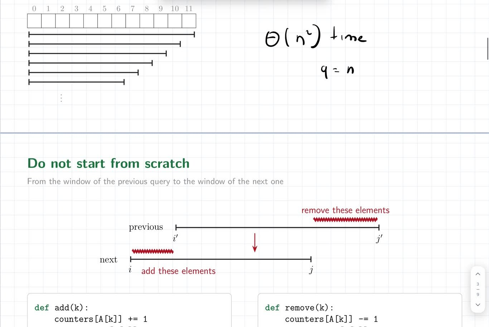  
*Board, 66:20*

**The ordering** (80:40–91:30). **If all the queries had the same beginning**, sorting them by end would make the total cost linear. So: **group the queries by starting position into $\sqrt n$ groups** ($(i,j)$ goes to group $\lfloor i/\sqrt n\rfloor$, each group = $\sqrt n$ consecutive starting points), **sort each group by ending position**, solve the groups in order.

- *cur_j*: within a group the ends increase, so it moves $\le n$ per group: **$\sqrt n\cdot n$** overall.

- *cur_i*: stays inside the group’s block, so it moves $\le\sqrt n$ *per query* (not per group): **$q\sqrt n$** overall.

**Total $\Theta((q+n)\sqrt n)$**. In Python: **`sorted(L, key=lambda (i, j): (i // sqrt(n), j))`**. **“The magic: take a super inefficient algorithm, prefix it with this sort, and it becomes efficient.”** (About the $\sqrt n$ grouping the prof says “this was something we already did, and Claude predicted that it was useful here”: **unclear in the recording what he refers to**.)

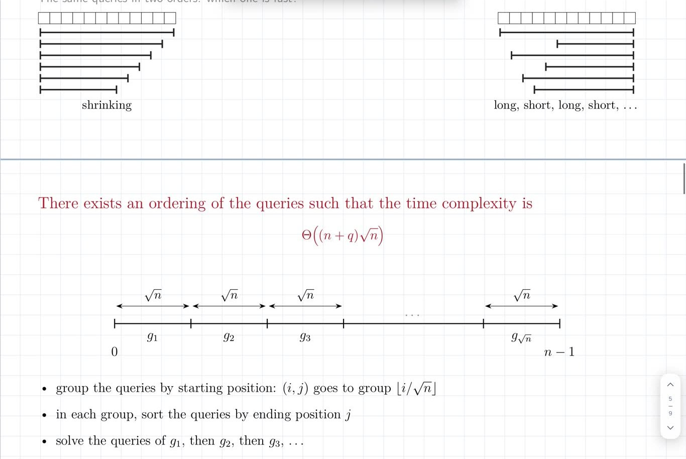  
*Board, 85:20*

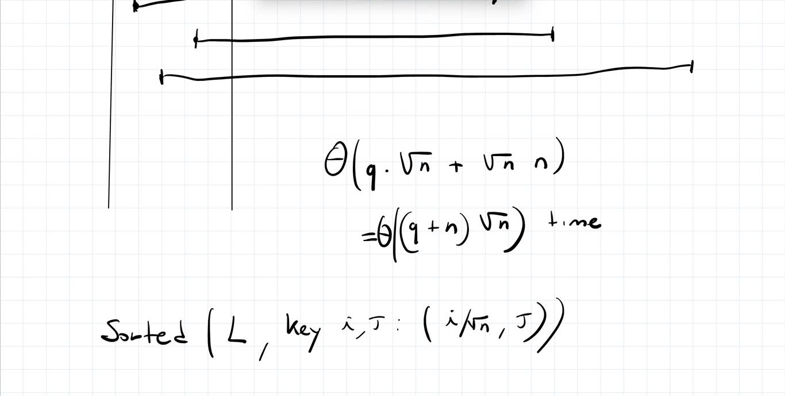  
*Board, 91:40*

The running example of the slides (input order vs Mo’s order, $n=16$, groups $[0,3],[4,7],[8,11],[12,15]$) was **not done for lack of time**.

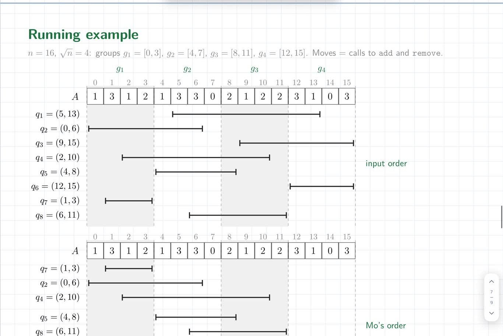  
*Board, 92:20*

> **Homework (spoken, 92:30).** “Before running out of this building, try to solve **Powerful Array** with the new technique: once you understand it, it becomes super easy.” $\to$ practice **E63**.

**The prof’s code** (notes *Mo’s Algorithm*, 2023; verbatim in `l15::mo`): `three_or_more` (the four loops; window $[\textit{cur\_l},\textit{cur\_r})$) and `mos` (sort by $(l/\sqrt n, r)$ and permute the answers back): *\[code: src/mo.rs lines 29–96 — see the PDF or the file\]* The notes add: **when $q=\Omega(n)$ each query costs $\Theta(\sqrt n)$ amortized**; **the hard part is often `add`/`remove`**: for RMQ they need a heap with lazy deletions or a BST, $\Theta(\sqrt n\log n)$ per query, **worse than the segment tree**; Mo also works on trees (exercise *Tree and Queries* in the notes). \[extra\] Tests (`l15::mo`): the examples of the slides (1, 2, 0; 2 and 2), the Mo order of the running example, the bad inputs (moves of the windows), and against the slow algorithm.

### Exercises and deadlines

> **Course page (checked 17/11/2026): no row for 16/11/2026** (the last rows are 04/11/2026 “Persistency” and Hands-On 2). **Hands-On 2**: **deadline 22/11/2026** (scaffold in `HandsOn/HO2`).
>
> **Spoken homework (16/11)**: **Powerful Array** with Mo’s algorithm (practice E63).
>
> **Still open, from earlier rows of this year’s table** (2026):
>
> - *Circular RMQ*, <http://codeforces.com/problemset/problem/52/C>: optional in the row of 02/11/2026.
>
> - *Solve Nested Segments with segment trees*: optional in the row of 26/10/2026.
>
> - **Update the Array** (SPOJ UPDATEIT): mandatory in the row of **19/10/2026**. **Nested Segments** (CF 652D): mandatory in the row of **21/10/2026**.
>
> - *Pashmak and Parmida’s problem* (CF 459D): optional, row of 21/10/2026.
>
> **Exercises at the end of the prof’s segment-tree notes** (not marked mandatory): generic segment tree, search$(p,s)$, range add + range min with lazy propagation, persistent “how many values $\le x$” online $\to$ practice E59–E62 (with the prof’s checks as tests).

### Next time

Not said in the recording. The slides had a running example (Mo’s order) not done for lack of time; the notes of Mo’s algorithm also cover Mo on trees.
