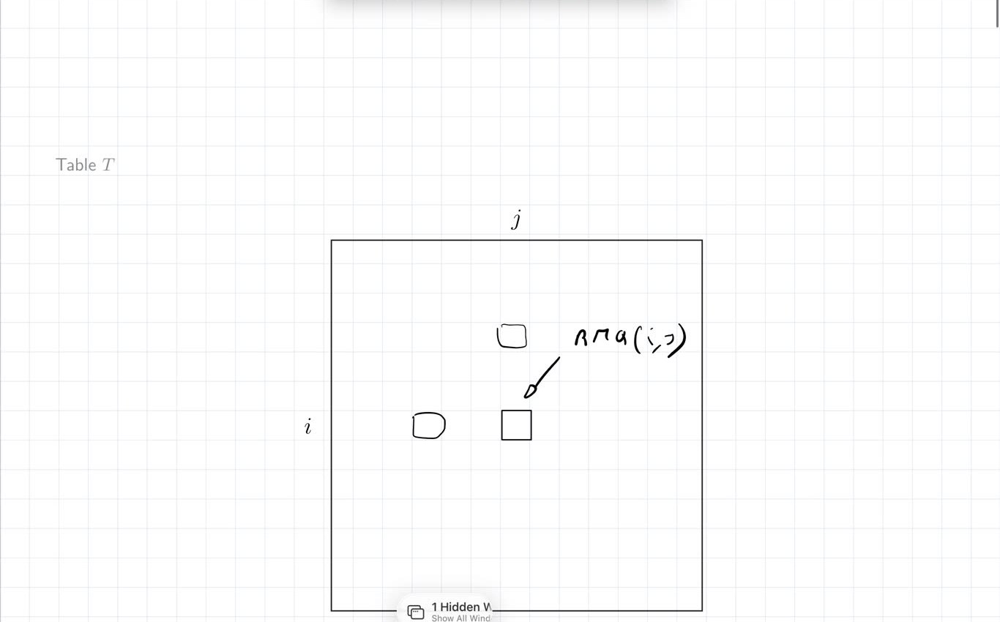
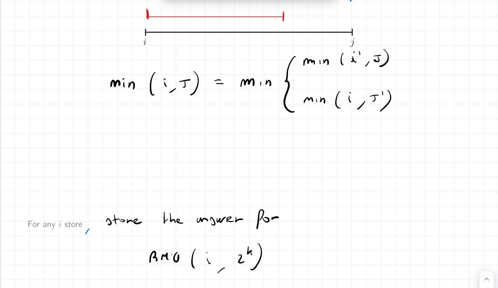
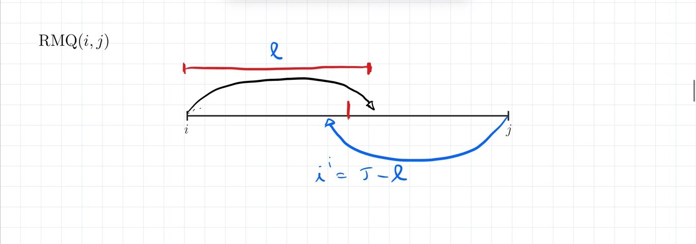
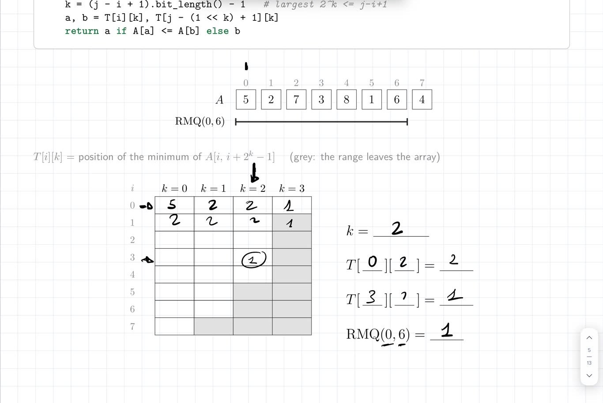
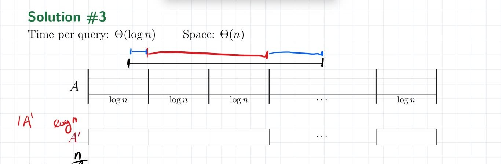
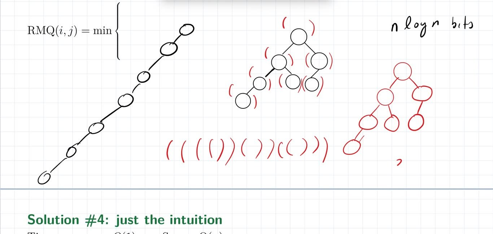

# CPC — Lecture 16 (Wednesday 18/11/2026) — Static RMQ

*Markdown version of `L16.pdf` (generated; the PDF is the reference: highlights and layout are only there).*

> **Sources.** Recording `L_16.MP4` (file metadata: recorded
> **18/11/2026**; 58 min) and its automatic transcript
> `L16_transcript.txt` (not revised); the prof’s board (iPad,
> `board/l16_*.jpg`): typed pages with headings and the code, filled in
> by hand during the lecture. **He says he is “interpreting also what
> Claude wrote”**: the pages were prepared with Claude. **There are no
> notes of the prof on RMQ on the blog** (checked 19/11/2026) and the
> course page has **no row for 16/11 or 18/11/2026**. You have no
> `notes.md` for this lecture. Everything marked \[extra\] is
> mine.
>
> Code: `Lessons/L16/prof/sparse_table.py` = **the prof’s code, verbatim
> from the board** (runnable: `python3 prof/sparse_table.py` checks the
> example and all ranges); `Lessons/L16/src` (`cargo test -p l16`): the
> four solutions in Rust. Exercises: `Lessons/L16/practice`, E65–E68
> (`cargo test -p practice_l16`).
>
> **Highlights:** **general / to remember** **good: works, efficient,
> correct** **bad: pitfalls, wrong ideas, costs** **definitions and key
> results**

> **Where we are.** L15 (recorded 16/11) ended with Mo’s algorithm. This
> lecture starts a new topic: **RMQ on a static array**. In L14 we
> solved the *dynamic* RMQ with a segment tree, $\Theta(\log n)$ per
> operation and $\Theta(n)$ space; now there are no updates and **the
> target is $O(1)$ time per query with $\Theta(n)$ space**. **The
> recording is short (58 min) and cut at both ends**: it starts with
> “Solution \#1” already on the screen (the statement of the problem is
> just above it, only “$\Theta(n)$ space” is visible) and it ends
> mid-sentence (“while you think about this, I…”, 58:19) in the
> digression on trees. **Solution \#4 ($O(1)$, $\Theta(n)$) is only
> started**: its last visible heading is “Cartesian tree”.

# The problem

Given a **static** array $A[0..n-1]$, answer queries
**$\textsf{RMQ}(i,j)$ = (the position of) the minimum of $A[i..j]$**,
both ends included. **Target: $O(1)$ time per query, $\Theta(n)$
space.**

The board pages fix the plan: four solutions, each with its time per
query and space.

|                  | time per query   | space             | idea                                     |
|:-----------------|:-----------------|:------------------|:-----------------------------------------|
| \#1              | $O(1)$           | **$\Theta(n^2)$** | tabulate all the answers                 |
| \#2 sparse table | $O(1)$           | $\Theta(n\log n)$ | only ranges of length $2^k$              |
| \#3              | $\Theta(\log n)$ | $\Theta(n)$       | blocks of $\log n$ + \#2 on their minima |
| \#4 (intuition)  | **$O(1)$**       | **$\Theta(n)$**   | \#3 + in-block queries (Cartesian tree)  |

# Solution \#1: tabulate everything — $O(1)$, $\Theta(n^2)$ (0:00–8:20)

“Go to your checklist”: **the first thing to measure when designing a
data structure is *how many distinct questions* there are**; if they are
few, **tabulate all the answers**. Here the questions are the ranges,
$\Theta(n^2)$: “not a small number, but it matches the space we allow”
in this first solution. Table $T[i][j]=\textsf{RMQ}(i,j)$.
 **How fast can we build it?** **“It
is impossible to use less time than space”**, so $\Theta(n^2)$ is the
minimum; but filling each cell by a scan costs linear time per cell:
**$\Theta(n^3)$**.

- A student: compute a cell from a neighbouring cell plus the next
  element. The prof: **work row-wise**: fix the start $i$ and move the
  end $j$ one step at a time, updating the answer:
  **$T[i][j]=\min(T[i][j-1],A[j])$, $\Theta(n^2)$ overall** — “the
  strategy that brought sliding window maxima from $n^3$ to $n^2$”.

- Another student proposed Mo’s algorithm: “maybe, but probably you
  reach the same solution… it’s too much”.

**The property to remember** (7:00). To compute the min of a range
(black) we can take *any* cell ending in $j$ and *any* cell starting in
$i$ that together cover it, **even if they overlap**:
**$\min(i,j)=\min\{\min(i',j),\ \min(i,j')\}$ for $i\le i'\le j'+1$,
$j'\le j$**. \[extra\] This works because **min is
idempotent** ($\min(x,x)=x$): **it fails for the sum**, where
overlapping parts would be counted twice. \[extra\]
`l16::full_table::FullTable` (row-wise build), tested against the brute
force.

# Solution \#2: the sparse table — $O(1)$, $\Theta(n\log n)$ (8:20–31:40)

“Space drops from $n^2$ to $n\log n$: still not linear, but a great
improvement.” **$n\log n$ space means: for every position we cannot
store $n$ answers, but we can store $\log n$ of them.** A student’s
idea, accepted: **for every $i$ store the answers of the ranges starting
in $i$ whose length is a power of two**, $1,2,4,8,\ldots$:

**$T[i][k]=\textsf{RMQ}(i,\ i+2^k-1)$**

“It is called *sparse table* because we take the big table of before and
we *sparsify* it by using powers of two only.”

## The query: two ranges of length $2^k$

Is it always possible to cover any range with two tabulated subranges?
**Let $\ell$ be the largest power of two $\le j-i+1$**, $\ell=2^k$. Then
**$\ell\ge$ half of the length** (“fix the point in the middle”: the
range $[i,i+\ell-1]$ ends exactly in the middle if the length is a power
of two, slightly after it otherwise). The second range has **the same
length, backwards from $j$**: it starts at $i'=j-\ell+1$ (the prof says
“$i'=j-\ell$” on the board; with both ends included it is $j-\ell+1$, as
in the code). **Both are tabulated, in the same column $k$**; the answer
is the min of the two. 

**$\textsf{RMQ}(i,j)=\min\{T[i][k],\ T[j-2^k+1][k]\}$,  $k=\lfloor\log_2(j-i+1)\rfloor$**

## The code and the example (16:40–26:30)

**The prof’s code** (verbatim from the board; it stores *positions*,
**ties go to the left element because of `<=`**):

    def build(A):
        n = len(A)
        T = [[i] for i in range(n)]          # T[i][0] = i
        k = 1
        while (1 << k) <= n:
            h = 1 << (k - 1)
            for i in range(n - (1 << k) + 1):
                a, b = T[i][k - 1], T[i + h][k - 1]
                T[i].append(a if A[a] <= A[b] else b)
            k += 1
        return T                             # T[i][k] = RMQ(i, i + 2^k - 1)

    def rmq(A, T, i, j):                     # both ends included
        k = (j - i + 1).bit_length() - 1     # largest 2^k <= j-i+1
        a, b = T[i][k], T[j - (1 << k) + 1][k]
        return a if A[a] <= A[b] else b

- `build`: column $k$ from column $k-1$: **$T[i][k]$ = the better of
  $T[i][k-1]$ and $T[i+2^{k-1}][k-1]$** (the two halves). Rows are
  ragged: **row $i$ stops when the range leaves the array** (the grey
  cells). **$\Theta(n\log n)$ time and space**.

- `rmq`: `bit_length()-1` = position of the most significant bit =
  $\lfloor\log_2\rfloor$.

**Example** $A=[5,2,7,3,8,1,6,4]$. **The table header says “position of
the minimum” but the prof filled it with the *values*** (“let’s use the
min, just not to become crazy”). Row 0: $5,2,2,1$; row 1: $2,2,2$ and a
$1$ in the grey cell: “you can either store it or not: if you skip the
cases where the end point is after the end of the array you save
essentially nothing”. **RMQ$(0,6)$**:
length 7, $\ell=4$, **$k=2$**; $T[0][2]=\min(5,2,7,3)=2$ and
$T[6-4+1][2]=T[3][2]=\min(3,8,1,6)=1$; **answer 1**. **On the board he
first wrote $T[0][3]$ and $T[3][6]$ (wrong indices), then corrected them
to $T[0][2]$, $T[3][2]$** after the class pointed it out.
 **“Doing this running example,
that I never did before, is explaining things to me: I explained this
solution for many years and I never realized that the column is always
the same.”** A student summarized: **$k$ is the power of two covering at
least half of the range and it dictates the column; the rows are the
left end $i$ and the left end of the range of length $2^k$ ending in
$j$**.

## Computing $k$ in $O(1)$ (26:40–29:40)

A student: “isn’t computing the logarithm logarithmic?” **No: the
position of the most significant bit is computed by the CPU in constant
time** (\[extra\] in Rust `leading_zeros`). Without that
instruction, **tabulate**: split the 32 bits in 4 bytes, a table with
the 256 answers for one byte, a loop of 4 iterations. He recommends the
**bit tricks in Knuth’s book** (“maybe volume 4, I don’t remember”) —
one of them, based on *de Bruijn sequences*, computes the most
significant bit. \[extra\] `l16::msb`: the three ways (CPU,
256-table, de Bruijn) tested against each other; practice E66.

## And updates? (29:50–31:30)

A student asked about changing a value. **Too many entries contain it:
“not all of them, but the vast majority”**; it cannot be done
efficiently. Another student: if the new value is not a minimum anywhere
you change nothing (e.g. increasing the 7); the prof: “maybe if you only
increase numbers you can amortize on something, I don’t know; if you
modify any number, probably linear — just a guess”. **The sparse table
is for static arrays**; for updates, the segment tree (L14).

\[extra\] `l16::sparse::SparseTable` is the prof’s code line
by line in Rust, tested on his table and against the brute force on all
ranges. **Rust pitfall: `j - (1 << k) + 1` on `usize` underflows when
$i=0$ and $j+1=2^k$** (Python does not care); write `j + 1 - (1 << k)`.
My first translation panicked on exactly this.

# Solution \#3: blocks of size $\log n$ — $\Theta(\log n)$, $\Theta(n)$ (31:40–39:00)

“Trade space for time: we improve space, but the query gets worse.”
**“Observe that this solution is essentially useless: the segment tree
already does as well”** (maybe faster in practice) — but it is the step
towards \#4.

- The hint: **we can cut the range in three parts in any way we want**,
  the answer is the min of the three. If the two border parts are
  guaranteed to be short (at most $\log n$) we can scan them, and the
  big middle part is answered in $O(1)$.

- **Split $A$ into groups of size $\log n$; for each group store its
  minimum: array $A'$ with $|A'|=n/\log n$**. Build the sparse table of
  \#2 on $A'$: **$\frac{n}{\log n}\cdot\log n=\Theta(n)$ space** — “the
  logs cancel out”.

- **The sparse table on $A'$ is correct only for ranges aligned to the
  blocks.** So: **middle part (whole blocks) in $O(1)$, prefix and
  suffix (inside the two border blocks) scanned in $O(\log n)$**.

 “Pretty easy to implement in practice,
almost trivial.” \[extra\] If $i$ and $j$ are in the same
block, or in adjacent blocks, there is no middle part: just scan (at
most $2\log n$ elements). \[extra\]
`l16::blocks::BlockRmqFast` (blocks of $\lfloor\log_2 n\rfloor+1$),
tested against the brute force and for space $\le 3n$ words; practice
E67.

# Solution \#4: just the intuition — $O(1)$, $\Theta(n)$ (39:00–58:19)

“Finally better than the segment tree.” **“The real solution is a little
bit more complicated, full of details we don’t care about”**, so only
the intuition; “it is interesting because it reveals something else,
very useful in anything”. The board says: **“Using the previous
solution, it is enough to solve”** \[the queries *inside a block*\] —
\#3 already does the middle part in $O(1)$, only the prefix and suffix
scans must become $O(1)$. The last heading on the board is **“Cartesian
tree”**, but before it the prof starts from something else: **how many
bits does the shape of a tree need?** **The recording ends inside this
digression**: the link with RMQ is not made.

## Storing the shape of a tree (40:00–47:30)

The tree is empty: **no values, just the structure**, and we want to be
able to get the tree back (for the moment, forget about navigating it).

- **With pointers** (or “homemade pointers”: an array where each node
  stores the indices of its children): **$n\log n$ bits**.

- A student: **children of $i$ at $2i$ and $2i+1$ (heap layout)**.
  **Works only if all levels are full but the last one**: “doubling and
  doubling plus one doesn’t work” for a generic shape. The prof’s
  example: a long chain next to a bushy tree with the same number of
  nodes. \[extra\] Completing a chain of $n$ nodes would need
  $2^n-1$ slots.

- Another student had an idea close to one of the real representations
  (“you use bits and you can represent any tree”); “there are at least
  three representations”.

## Balanced parentheses: $2n$ bits (47:30–55:00)

**Visit the tree from the root; emit “(” when you enter a node and “)”
when you leave it** (“pre-order and post-order: we do something when we
enter and when we leave”). For the tree on the board see the red
sequence in the image above (the transcript of the dictation is not
reliable enough to copy it). **2 bits per node: $2n$ bits.**

- **Decoding** (50:00): read left to right; **“(” = there is a (new)
  child, go down; “)” = go back up**.

- **Left and right are lost**: for a node with a single child “I don’t
  know if it is left or right” — **the code describes an ordered (not
  binary) tree**; to say left/right you need extra bits. (In the red
  reconstruction he drew the single child on the left: “just an
  assumption”.) \[extra\] `l16::bp` test
  `single_child_left_or_right_is_lost`.

- **Optimal** (52:40): the number of trees with $n$ nodes is about
  $2^{2n}$, so **about $2n$ bits are needed**. A student: not every
  sequence is balanced — true, “it reduces the number but not enough to
  matter from a compression point of view; the lower bound is something
  like $2n-\log n$”. \[extra\] Exactly: Catalan
  $C_n=\frac{1}{n+1}\binom{2n}{n}\approx 4^n/n^{3/2}$, so
  $\log_2 C_n=2n-\tfrac32\log_2 n+O(1)$ (checked in
  `bp::tests::catalan_lower_bound`).

- **With this binary representation you can still navigate the tree**:
  **with *rank* and *select* on the bit vector** (“and other tricks”)
  you can ask, for a node id, its children, its parent, the size of its
  subtree, even **the lowest common ancestor of two nodes, in constant
  time**, without decompressing. “Some of these operations are
  practical, some are not.” (Not explained.)

## Level by level, degrees in unary (56:40–58:19)

The representation the student had in mind: **visit the tree level by
level and write the number of children of every node in unary**; knowing
the degrees and that we go level by level, the tree can be rebuilt
(root: 2 children $\to$ two slots; then the degree of the first child,
of the second, … then the next level). The prof’s unary convention is
unclear in the recording (“two with two bits, zero, one”).

> **Question left by the prof (58:13):** “How many bits do we need in
> this degree-based representation?” — the recording ends here. $\to$
> practice **E68** (answer in `practice/soluzioni`; I do not write it
> here).

## Where this is going \[extra\]

**Not said in the recording** — the standard route, to check against the
next lecture. The *Cartesian tree* of $A$ has the (leftmost) minimum at
the root and, recursively, the Cartesian trees of the two sides as
subtrees: **$\textsf{RMQ}(i,j)=\textsf{LCA}(i,j)$**. The answers of all
in-block queries depend only on the *shape* of the block’s Cartesian
tree, and a shape fits in $2b$ bits (balanced parentheses): with blocks
of $b=\frac14\log n$ there are at most $4^b=\sqrt n$ shapes, so all
in-block answers can be tabulated in $o(n)$ space. \[extra\]
`l16::cartesian` builds the tree with a stack in $\Theta(n)$ and checks
RMQ $=$ LCA on random arrays.

# Exercises and deadlines

> **Course page (checked 19/11/2026): no row for 16/11/2026 nor for
> 18/11/2026**: nothing new assigned for this lecture. The last rows are
> 04/11/2026 (Persistency, Hands-On 2). **Hands-On 2**: deadline
> 22/11/2026 (you already delivered it on 14/11).
>
> **Spoken question (18/11)**: bits of the level-by-level unary
> representation $\to$ practice E68. Still open from L15 (spoken,
> 16/11): Powerful Array with Mo (practice E63).
>
> **Still open, from earlier rows of this year’s table** (2026):
> *Circular RMQ* (CF 52C), optional in the row of 02/11/2026; *Nested
> Segments with segment trees*, optional in the row of 26/10/2026;
> **Update the Array** (SPOJ UPDATEIT), mandatory in the row of
> **19/10/2026**; **Nested Segments** (CF 652D), mandatory in the row of
> **21/10/2026**; *Pashmak and Parmida’s problem* (CF 459D), optional in
> the row of 21/10/2026.
>
> **Practice L16**: E65 generic sparse table (min/max/gcd), E66 msb with
> the 256-table, E67 Solution \#3, E68 the prof’s question.

# Next time

Not said in the recording (it is cut). \[extra\] Expected:
the end of Solution \#4 — Cartesian tree, its shape in $2n$ bits, and
how they give $O(1)$ queries inside the blocks.
