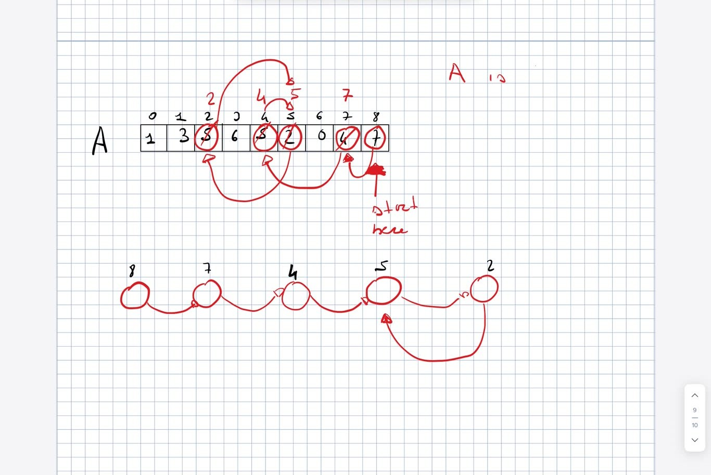
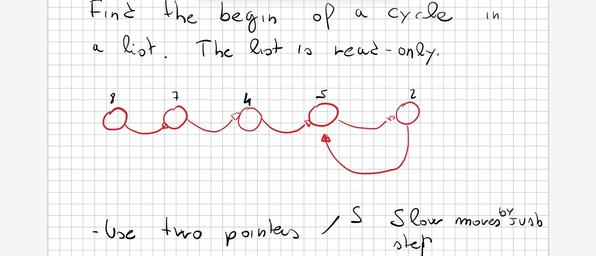
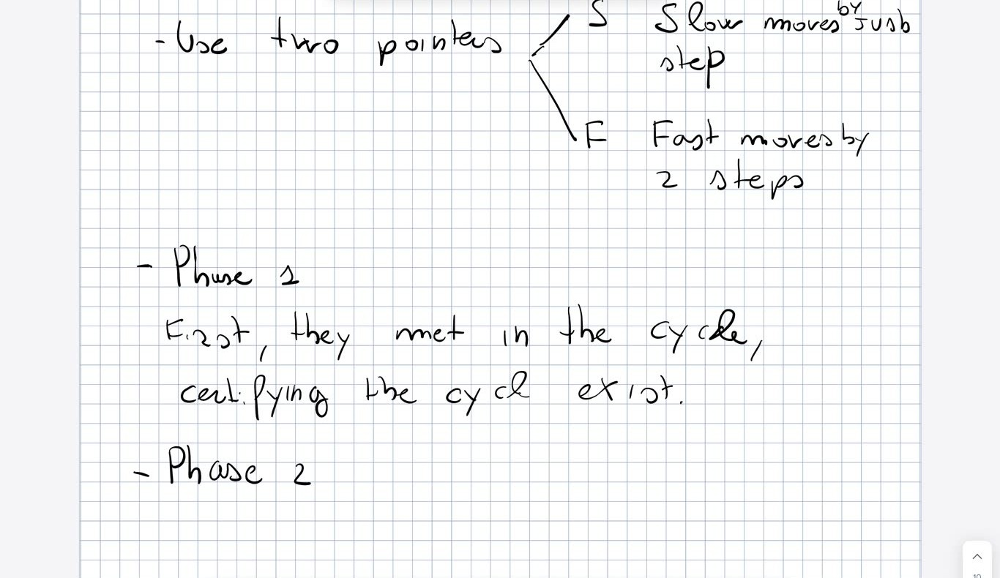
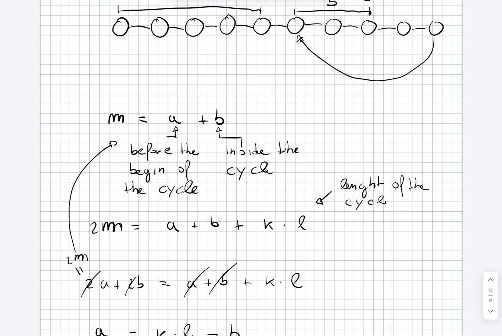
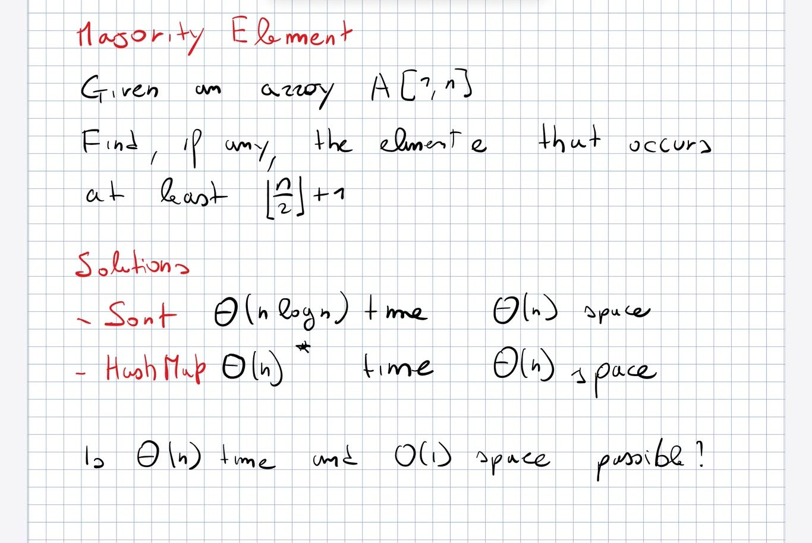
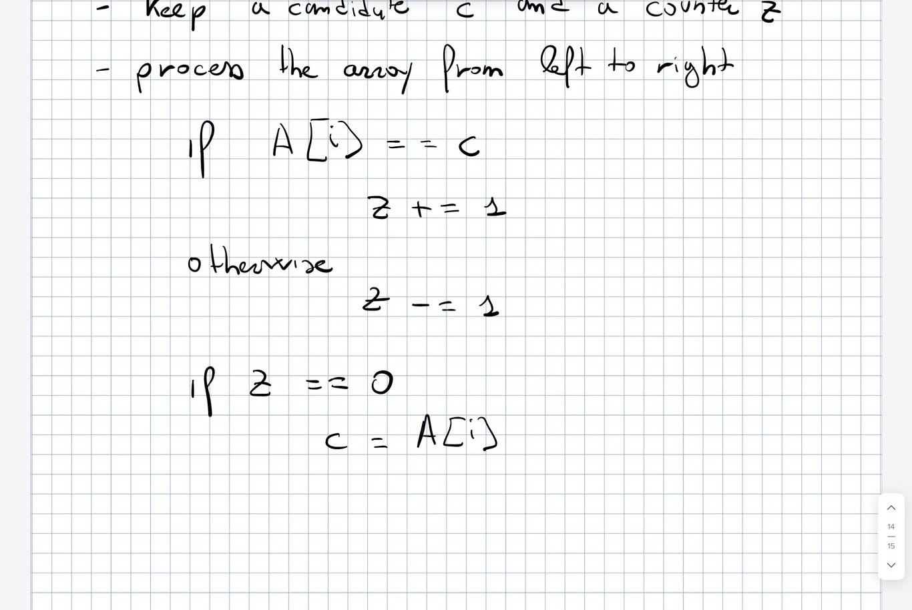
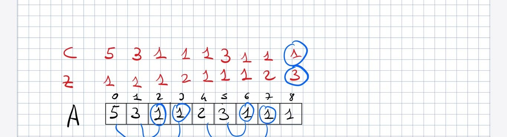

# CPC — Lecture 5

Versione markdown di `L5.pdf` (in VS Code: anteprima con Cmd+Shift+V). Esercizi: `practice/`.

> **Sources.** Recording `L_05.MP4` (1h20m): automatic transcript (`L5_transcript.txt`) + frames of the professor’s iPad notes (the handwritten images are *his* board). Last year’s notes `Pearls_2025.pdf` only for the parts marked \[extra\].

> **Where we are.** L5 starts from the homework of L4 and **ends with Boyer–Moore**: insertions are supported, deletions are left for the next lecture: `Lessons/L6/L6.pdf` (majority with deletions, Misra–Gries, the chessboard puzzle).

Code: `Lessons/L5/src/lib.rs` (`cargo test -p l5`). Exercises: `Lessons/L5/practice` (`cargo test -p practice_l5`).

# Duplicate element, continued: random access, destroying $A$

Reminder: $A[0..n]$ contains $n+1$ values in $\{0,\dots,n-1\}$; find any duplicate (example $A=[1,3,5,6,5,2,0,4,7]$, $e=5$).

## The L4 homework

The lecture starts by saying that the buggy solution of L4 (reuse the most significant bits as a bit vector) *can be fixed with the partitioning algorithm of Quicksort*; the details are not in the recording (they were probably given right before it started). \[extra\] A plausible reading: after pass 1, partition $A$ in place (like Quicksort’s partition, $\Theta(n)$, $O(1)$ space) so that the elements whose MSB equals the MSB of $e$ come first; then the single pass of the bit-vector trick scans only that prefix, so the elements to skip no longer have to be recognized from their (overwritten) bits.

## The professor’s solution: move every element to its cell

\ Presented “not because it is better, but because it can be improved” into linear time, constant space, *without* destroying $A$. Start from the **last position** $n$: read the element there and put it into the cell with its index, taking out what was there; continue with the element just taken out. On the example: $A[8]=7$ goes to cell $7$ (out comes $4$), $4$ goes to cell $4$ (out $5$), $5$ to cell $5$ (out $2$), $2$ to cell $2$ (out $5$), $5$ to cell $5$: **cell 5 already contains 5** $\Rightarrow$ $5$ is the duplicate. $\Theta(n)$ time, $O(1)$ extra space, but $A$ is destroyed.

#### The implicit graph.

Interpret positions as nodes and values as pointers (like drawers and numbers in the 100 prisoners puzzle): from position $n$ we walk $8\to7\to4\to5\to2\to5\to\dots$: a **path** followed by a **loop**, and **the duplicate is the beginning of the loop** (two different cells point to it). The graph is never materialized: it is implicitly stored in $A$, we just follow the numbers.

#### Why there is always such a loop (question in class).

The crucial point is starting from the last position: *nobody points to $n$* (values are $<n$), so the walk can never come back to it. There are more positions than possible values, so the walk must eventually reach a node with two incoming arrows, i.e. a duplicate. With several duplicates (e.g. $2$ and $5$) we reach one of them, which is enough.

#### Without destroying $A$?

Following the numbers is easy ($7,4,5,2,5,2,5,\dots$), but two problems arise: (1) understand *when we are inside the loop*; (2) find *the beginning* of the loop. “Remembering the last two positions” works on the example but not in general (e.g. a loop covering almost all the elements). Marking visited nodes with a bit solves both, but it is the trivial bit-vector solution again: finding the beginning of a cycle and finding a duplicate are essentially the same problem.

# Floyd’s cycle finding

\ **Problem**: find the beginning of a cycle in a list; the list is **read-only** (no marks).

#### Intuition (Monza).

Two cars start together, one twice as fast as the other. If they are on a highway (A1 from north to south), the fast one never meets the slow one again; if they are on a circuit, sooner or later the fast one laps the slow one. When they meet, you know you are in the circuit.

\

- two pointers from the start: **S**low moves by 1 step, **F**ast moves by 2 steps;

- **Phase 1**: they meet inside the cycle, certifying that a cycle exists. (The same algorithm tells whether a list has a cycle at all: without a cycle F reaches the end of the list.)

- **Phase 2**: move F back to the beginning and set its speed to 1; “the magic part”: they meet again **at the beginning of the cycle**.

The prof warned that he often gets the hand-run example wrong (off-by-one details are tricky); what matters is the idea and the proof.

#### Proof.

\ Say they meet after $m$ iterations: S moved $m$ steps, F $2m$. They meet inside the cycle (F is already in the loop, and S cannot complete a lap before F catches it). Decompose $m=a+b$: $a$ = steps before the beginning of the cycle, $b$ = steps done by S inside the cycle (not the length of the cycle). F did $a$ steps, then $k$ full laps of length $\ell$, then $b$ more steps: $2m=a+b+k\ell$. Hence $2a+2b=a+b+k\ell$, i.e. $$a = k\ell - b.$$ In phase 2 both move at speed 1. After $a$ steps F, restarted from the beginning, is at the beginning of the cycle. S started from the meeting point, $b$ steps after the beginning of the cycle; $a=k\ell-b$ steps bring it around $k$ times minus $b$ steps, i.e. exactly back to the beginning. They meet there.

> Duplicate element with $A$ read-only: follow the links from position $n$ with Floyd. $\Theta(n)$ time, $O(1)$ extra space, $A$ untouched. More generally: detect a cycle in a list and find its beginning without extra space.

# Majority element

\ Given $A[1,n]$, find, if any, the element $e$ that occurs at least $\lfloor n/2\rfloor+1$ times (“the one who wins the election at the first round”). The prof noted it is becoming popular in interviews, like the missing number of L1.

- **Sort**, then scan the runs of equal elements looking for one of length $\ge n/2+1$: $\Theta(n\log n)$ time, $\Theta(n)$ extra space (copy, or destroy $A$). “If you don’t know what to do, sort — like k-means in data mining.”

- **Hash map** element $\to$ frequency (the Python dictionary solution): $\Theta(n)$ time w.h.p., $\Theta(n)$ extra space.

- $\Theta(n)$ time and $O(1)$ space, for general elements (even very long strings)? It looks impossible: both solutions compute the frequencies of all the elements, and in constant space we cannot remember more than a few of them.

## Boyer–Moore majority vote

(Boyer and Moore are also famous for a pattern matching algorithm, typical of bioinformatics courses.) **Checking** whether a given element is the majority is easy: one scan counting it. **Finding** it is the hard part. The algorithm finds a *candidate*: if a majority element exists it is the candidate, otherwise the candidate is any element. Then a second scan checks it. \ Keep a candidate $c$ and a counter $z$ (not the frequency of $c$: it measures how much we *trust* $c$). Initially $c=A[1]$, $z=1$. For each next element: if $A[i]=c$, $z\mathrel{+}=1$; otherwise $z\mathrel{-}=1$, and if $z=0$ we stop trusting $c$: $c=A[i]$, $z=1$. \ Example $A=[5,3,1,1,2,3,1,1,1]$: candidates $5,3,1,1,1,3,1,1,1$, counters $1,1,1,2,1,1,1,2,3$ (at the $3$ in position 5 we “wrongly change our mind”). The final candidate is $1$, correct; the final counter $3$ is *not* the number of occurrences of $1$ ($5$): it is always $\le$ it.

#### Why it is correct.

Every element different from the majority element can “kill” at most one increment of a candidate (an increment is either $z\mathrel{+}=1$ or setting a new candidate with $z=1$). Associate each other element with one occurrence of the majority element: since the majority element occurs more than $n/2$ times, at least one occurrence remains unmatched, so it cannot be killed and it is the final candidate. Sometimes the array helps (other elements kill each other), but even in the worst ordering, e.g. $5,1,3,1,2,1,3,1,1$ (each other element kills the current candidate), $1$ survives.

#### In practice.

Two or three lines of Python, two sequential scans, one counter: scan-based code with no jumps in memory is much faster than a linear-time algorithm that jumps around the array.

## Supporting insertions and deletions?

- **Insertions**: yes. The order does not matter, so inserting is appending: keep $c$ and $z$ and process the new element as the algorithm would. (Keep inserting $3$’s and at some point $3$ becomes the candidate, and the majority.)

- **Deletions**: with operations insert$(x)$, delete$(x)$ (only of an element currently present) and “report the candidate”, Boyer–Moore does not work: it would have to be rerun. **Next lecture** (Monday): a strategy supporting both, *without storing the array*. The lecture ended here.

# Next: L6

Majority with insertions *and* deletions, Misra–Gries heavy hitters and the chessboard puzzle are in `Lessons/L6/L6.pdf`.
