# CPC — Lecture 7 (07/10/2026): binary search for the answer (end), parity puzzle, two pointers, sweep line

> Markdown version of the PDF (generated by Claude). In the PDF: **bold** = colored highlights.

Rewritten from the recording (`L_07.MP4`, 88 min; transcript in `L7_transcript.txt`); the images are frames of the board. *[extra]* marks my additions (not said in the lecture). Code: `Lessons/L7/src/lib.rs` (`cargo test -p l7`). Exercises: `Lessons/L7/practice`, E28, E29, E31–E34 (`cargo test -p practice_l7`).

> **What changed with respect to the provisional version.** The course page announced *“Two pointers trick and BST”* with Longest $k$-good segment and Frogs and Mosquitoes. In the lecture the prof did the two pointers (Longest $k$-good segment) and then **started the Sweep Line** (maximum number of overlapping intervals). **Frogs and Mosquitoes was not explained**: at the end he announces for the next lecture (L8, Monday 12/10) *closest pair of points* (sweep line) and *“a problem that needs a lot of binary search trees”* — most likely Frogs and Mosquitoes. It was not done in L8 either: my reconstruction from the 2025 notes is now in `Lessons/L9` (provisional L9.pdf, crate `l9`, exercise E39).

> **Hands-On 1 is out** (<https://pages.di.unipi.it/rossano/blog/2024/handson12425/>): BST check and Maximum Path Sum on a binary tree in Rust; scaffold in `CPC/HandsOn/HO1`. **Rust challenges**: the prof mentions on the web page “a couple of Rust challenges”, small problems where the goal is **the shortest possible Rust program** (chains of `map`/`filter`/`count`…).

**Highlights:** **general / to remember** **good: works, efficient, correct** **bad: pitfalls, wrong ideas, costs** **definitions and key results**

# Binary search for the answer: end of L6

## Social distancing: running time

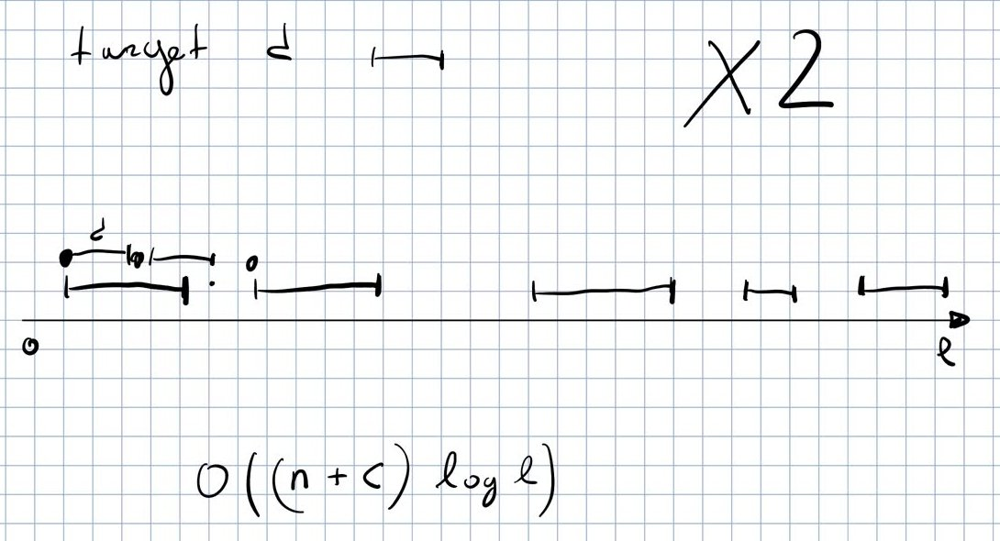

*Greedy check for a target distance $d$; total cost.*

Recap of the predicate (L6): start from the first available point, place a person; jump $d$ forward; if the point is inside an interval place the next person there, otherwise place it at the first point of the next interval. **Greedy, left to right, $\Theta(n+c)$** ($n$ intervals, $c$ people). At the end, if all $c$ people were placed the answer is yes, otherwise no; **every step removes half of the remaining candidate distances.**

> **Time $O((n+c)\log\ell)$**: $\log\ell$ steps of binary search over the distances in $[0,\ell]$, each one evaluates the predicate in $\Theta(n+c)$.

- **This assumes $d$ is an integer.** If $d$ is a real number the bound no longer holds: the number of steps depends on **how many decimal digits we want**.

- **Better range: $d^*\le \ell/c$** (student’s answer): with $c$ people on a line of length $\ell$ the minimum distance cannot exceed $\ell/c$, so we binary search on $[0,\ell/c]$, which helps when $c$ is large.

## The car and the fuel, reconsidered

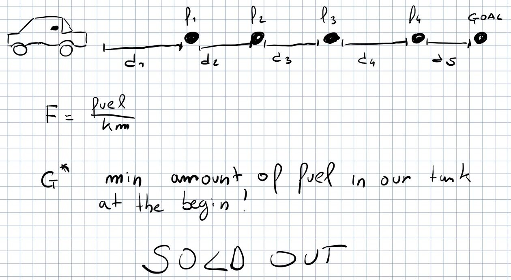

*The problem left open in L6 (“SOLD OUT” is written on the board, not part of the problem).*

A car starts with $G$ liters, consumes $F$ liters per km; it meets points at distances $d_1,d_2,\dots$ from the previous one, and at point $i$ it refuels $f_i$ liters. **$G^*$ = minimum amount of fuel in the tank at the beginning** to reach the goal. In L6 it “seemed very hard”; **now the pattern is clear: we are asked for an answer** ($G^*$).

- **Strategy: keep a checklist of techniques** — so far *standard data structures* + *binary search for the answer* — and go through it.

- **Monotonicity**: with less fuel than $G^*$ we fail, with more we arrive. **Predicate “can we reach the end with $G$?” = simulate the trip**: at each segment subtract $F\cdot d_i$ (if it goes negative: false), at each point add $f_i$. **$\Theta(n)$ per check**, $\Theta(n\log(F\sum d_i))$ in total.

> **General techniques give a solution, not necessarily the optimal one**: they are *standard*, you apply them “almost brainless” and get something much better than brute force — **usually what an interviewer asks for**, and often enough in contests. An ad hoc solution exploiting properties of the problem can be better (same for dynamic programming later). *[extra]* Here: $G^* = \max_i \big(F\sum_{h\le i} d_h - \sum_{h<i} f_h\big)$ (largest deficit over the prefixes, or $0$) in $\Theta(n)$; `l7::min_initial_fuel` and the test compare the two.

# Puzzle: the mutilated chessboard

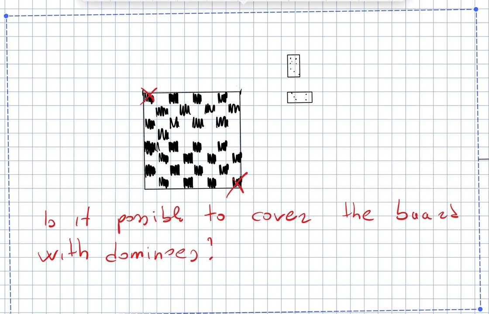

*Top-left and bottom-right cells removed: can we cover the board with $2\times1$ dominoes?*

**Answer: no.** **Parity argument** (“another good technique to know”): the two removed corners have the **same colour**. **Every domino, horizontal or vertical, covers one white and one black cell.** We start with different numbers of white and black cells; each domino lowers both counts by one, so they can never both reach $0$. **The argument is general**: not only $8\times 8$, any board with a different number of black and white cells.

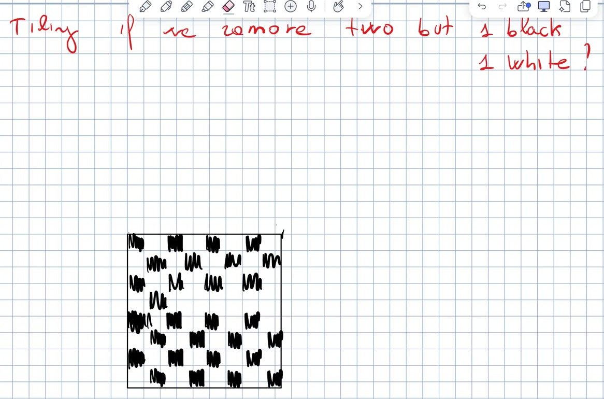

*Follow-up: remove two cells of different colour.*

**Follow-up (homework, discussed on Monday).** Remove *any* two cells, **one black and one white**. Is a tiling always possible? If yes, **give an (efficient) algorithm** that places the dominoes. In class a student tried an argument based on the even/odd lengths of rows and columns; the prof was “not fully convinced”: **puzzles are easy to state, look impossible, and the solution is short and elegant**. Think about it before L8.

# The two pointers trick

## Longest $k$-good segment

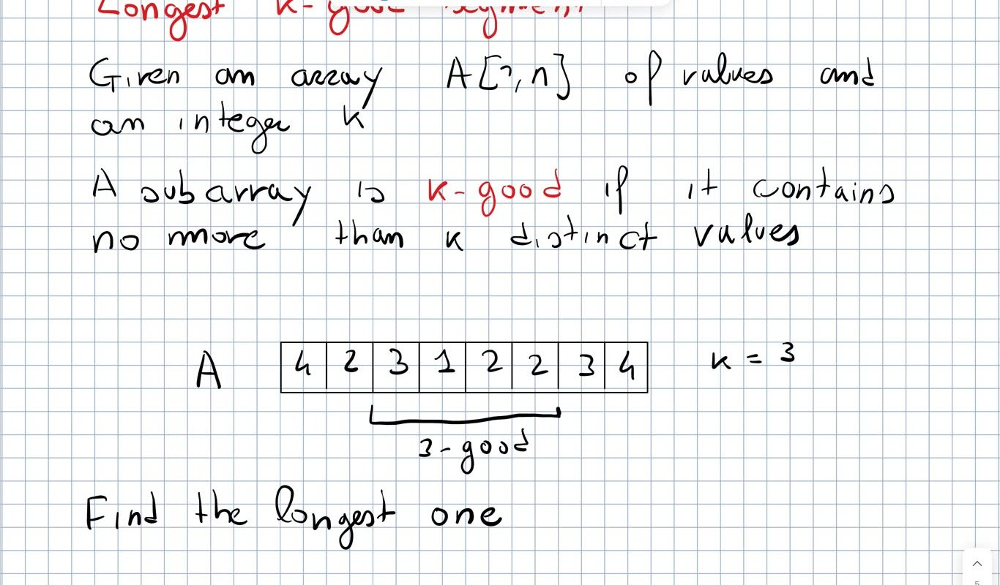

*Statement on the board.*

**Problem** (Codeforces 616D, **mandatory**). Given $A[1,n]$ and $k$, **a subarray is $k$-good if it contains no more than $k$ distinct values**. Find the longest one. Example ($k=3$): in $4\,\underline{2\,3\,1\,2\,2\,3}\,4$ the underlined subarray is $3$-good (and **it is not maximal**: it can be extended by one position on both sides).

#### Trivial solutions.

- **Try all the $\Theta(n^2)$ subarrays and scan each one** to count the distinct values: cubic.

- Like the first lecture’s maximum subarray (Kadane’s trivial versions): for each start $i$ extend $j$ one position at a time, exploiting that the next segment contains one more element. **To count distinct values we need a multiset** (set + number of occurrences per value). **Still $\Theta(n^2)$.**

#### Two pointers (found by a student).

Pointers $L$ and $R$ start at the beginning; the set (with frequencies) contains $A[L..R]$.

- Move $R$ one position right: if $A[R]$ is already in the set increment its frequency, otherwise insert it.

- If now the set has $k+1$ distinct values, move $L$ right, decrementing frequencies and **removing a value when its frequency reaches $0$**, until the distinct values are $k$ again (we may have to skip a whole run of equal values).

- **Keep track of the maximum $R-L+1$ seen so far** and report it at the end.

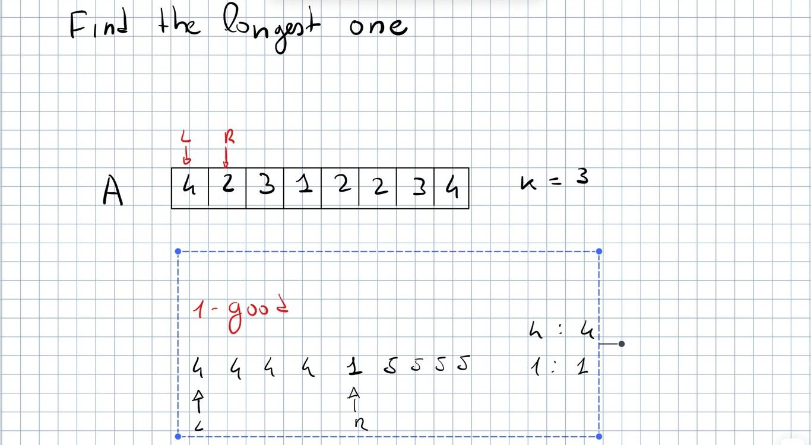

*A student’s question: $1$-good on $4\,4\,4\,4\,1\,5\,5\,5$. The pointers end on a short window: you need the running maximum.*

- **The pointers do not stop on the optimal window**: on $4\,4\,4\,4\,1\,5\,5\,5\,5$ with $k=1$, at $1$ the window shrinks, and when the pointers are on the $4$’s you cannot know how many $5$’s will follow. **Remember the best so far.**

- **Correctness**: $L$ is the beginning of a candidate subarray and $R$ extends it as much as possible; when $R$ introduces a new distinct value that breaks the property, **no subarray starting at $L$ can be $k$-good any more**, so $L$ can be discarded. **Implicitly we try all the possible $L$.**

- **Running time $\Theta(n)$**: **at every iteration one of the two pointers moves right by one**, both only move right, so there are at most $n+n$ iterations, each with $O(1)$ work on the set (expected, with a hash map). (`l7::longest_k_good`)

## Another example: palindromes

A string is a palindrome if it reads the same reversed (with odd length the middle symbol is free). **Check: one pointer at the beginning, one at the end, compare and move inwards**; if they meet before a mismatch, it is a palindrome. (`l7::is_palindrome`)

> **Not a sophisticated technique, but always keep in mind that two pointers can solve the problem.** **Checklist so far: standard data structures, binary search for the answer, two pointers trick.**

## Alternative: binary search for the answer

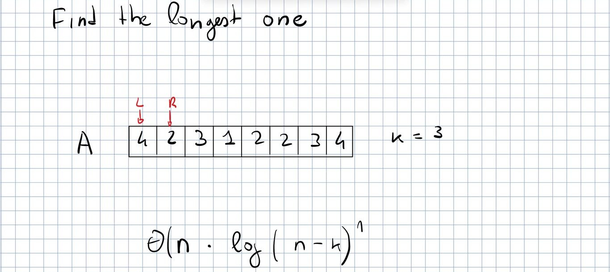

*The cost of the binary search solution, discussed in class.*

A student’s idea: **“find the longest one” hides an answer, the length**. Once we know the length $L$, a *sliding window* of size $L$ (constant time to remove the leftmost element and add the new one) finds a $k$-good subarray of that length.

- **Monotone predicate**: if a $k$-good subarray of length $L$ exists, shorter ones exist too; longer than the optimum: no.

- Predicate in $\Theta(n)$ with the sliding window; **total $\Theta(n\log n)$** (range $[0,n]$); more precisely $\Theta(n\log(n-k))$, since the answer is at least $k$ **(sublinear range if $k$ is large)**.

- **Slower than the two pointers $\Theta(n)$**: again, applying a technique does not guarantee the best solution. **In a real implementation use early exit** (stop at the first $k$-good window). (`l7::longest_k_good_len_bs`)

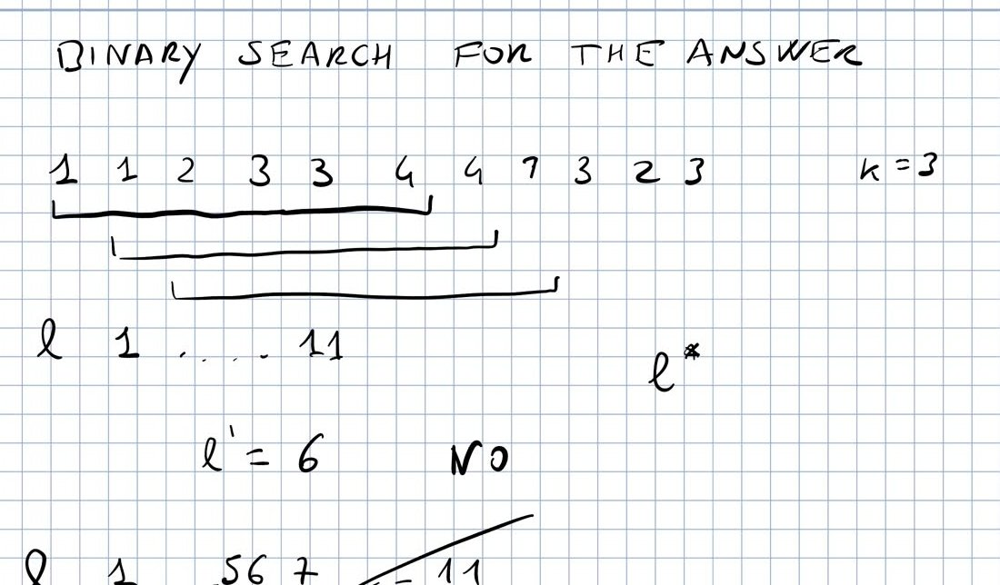

*Running example: $A=1\,1\,2\,3\,3\,4\,4\,7\,3\,2\,3$, $k=3$, $L\in[1,11]$.*

#### Running example of the lecture.

$L^*\in[1,11]$ (at least $1$ if $k\ge1$). Try $L'=6$: the prof checks the windows and says that each has $4$ distinct values, **no**; then $L'=3$ yes, $L'=4$ yes, $L'=5$ yes: answer $5$. At the end he doubts it himself (“maybe I was wrong, but the running example was good enough”).

> *[extra]* **The final answer of the example is wrong.** The window $3\,3\,4\,4\,7\,3$ (positions $4..9$, 1-based) has only $3$ distinct values, so $L'=6$ is **yes**; all windows of length $7$ have $4$ distinct values: **$L^*=6$**. The error is only in the first check (it sent the search to the left part); the method is correct. The test `k_good_binary_search_for_the_answer` checks it.

# Sweep line

**A very popular technique: conceptually simple, sometimes simple to apply, sometimes it is hard to see why it works.** The prof presents it through a problem.

## Maximum number of overlapping intervals

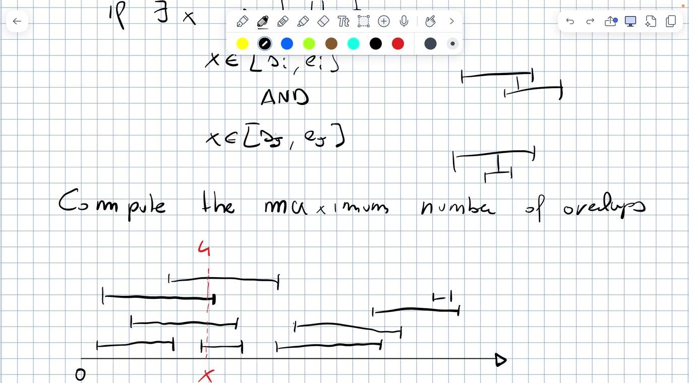

*Definition of overlap and an example with $4$ intervals overlapping at $x$.*

**Problem.** Given $n$ intervals (ranges, segments) $[s_i,e_i]$ with $s_i,e_i\in\mathbb{N}$, **two intervals overlap if $\exists x$ with $x\in[s_i,e_i]$ and $x\in[s_j,e_j]$**. **Compute the maximum number of intervals that overlap all together in some point.** In the example the answer is $4$.

#### Array of counters.

Proposed in class: if the coordinates are in $[0,\ell]$ with $\ell$ small (say $\ell=\Theta(n)$), keep one counter per position and increment it for every interval containing it.

- **Filling the counters costs the sum of the lengths of the intervals: quadratic** even if $\ell=\Theta(n)$ — it is enough to have many long intervals.

- **Scanning $0..\ell$ and checking every interval for every point** is quadratic as well.

- **With prefix sums** (a student’s remark) the increments can be done in constant time offline: **a later lecture**, where this approach is “rediscovered”.

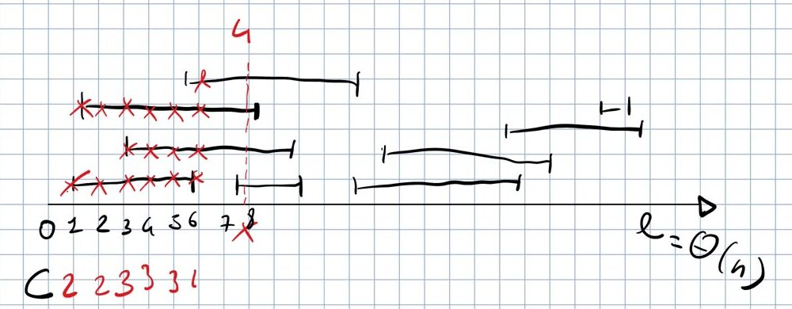

*Counters computed position by position: $C=2,2,3,3,3,\dots$*

#### Towards the solution.

Sort the intervals by start, insert them when the scan reaches their start and keep only the active ones: for each position we increment the counter once per active interval. **But most positions are useless**: their counter is the same as the previous position. **The counter changes only where a new segment starts or an old segment ends.**

> **Sweep line algorithm.** Replace each interval with two events $(s_i,\text{start})$ and $(e_i,\text{end})$; **sort them and process them in order**: start $\Rightarrow$ counter $+1$, end $\Rightarrow$ counter $-1$; the answer is the maximum value of the counter. Conceptually, **a vertical line sweeps the axis and the counter says how many intervals intersect it**; we only stop at the important points (the endpoints). **Time $\Theta(n\log n)$, dominated by the sorting of the endpoints.**

**Ties**: the intervals are closed, so at the same coordinate **starts must come before ends** ($[1,3]$ and $[3,5]$ overlap in $3$). With `(coord, 0 = start / 1 = end)` tuples the default sort does it. (`l7::max_overlaps`, tested against the counters `l7::max_overlaps_counters`)

## The same thing as balanced parentheses

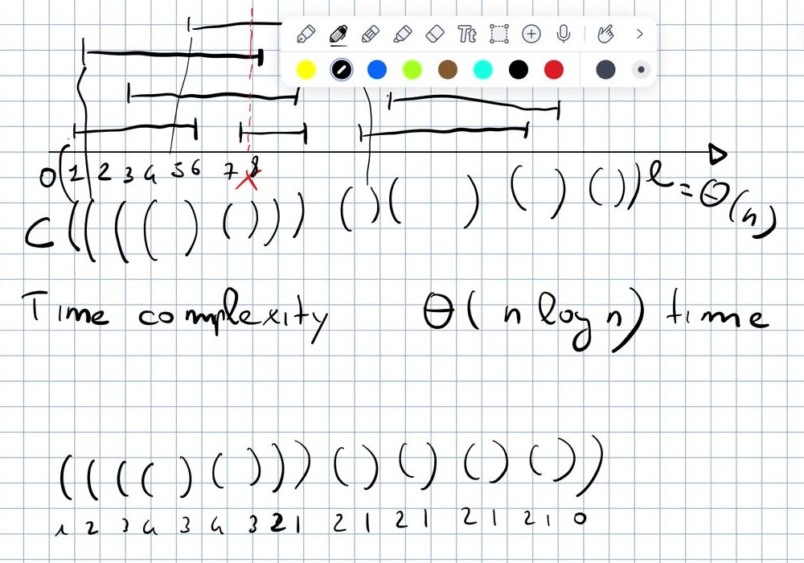

*Open a parenthesis at each start, close it at each end; under the sequence the depth: maximum $4$.*

Process the endpoints in order and emit `(` for every start and `)` for every end: we get a **balanced sequence of parentheses**. **The answer is its maximum depth** (maximum number of open, not yet closed, parentheses). **No surprise**: it is exactly the counter ($+1$ = open, $-1$ = close). **There are many interesting problems on balanced parentheses, and one of them is equivalent to this problem on segments**: last year the class went the other way around, from the parentheses problem to the intervals. (`l7::max_depth_parentheses`)

#### Next lecture (L8, 12/10).

Closest pair of points (another sweep line application, notes p. 6–9 of `Binary_search_2025.pdf`) and a problem needing many BSTs (Frogs and Mosquitoes, moved to L9); mandatory problem on the course page: *Check if All the Integers in a Range Are Covered*. Solution of the tiling puzzle.
