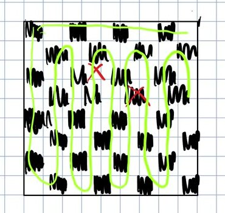
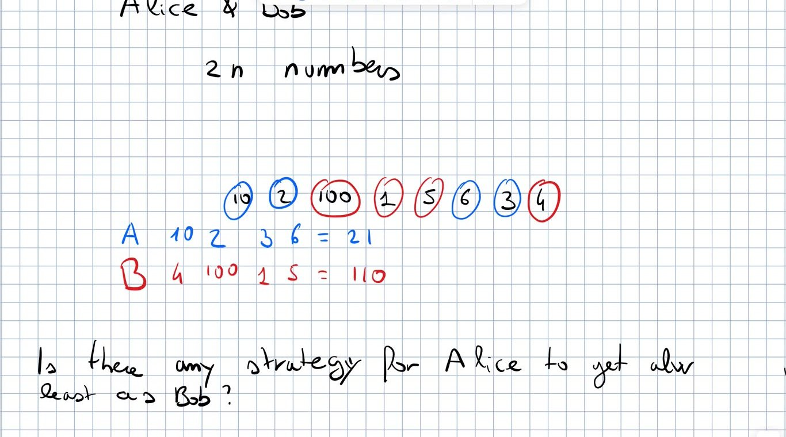
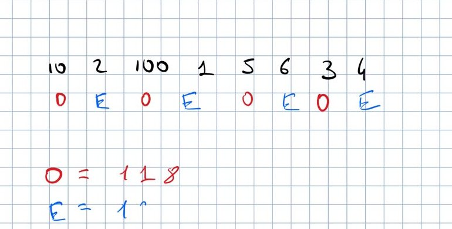
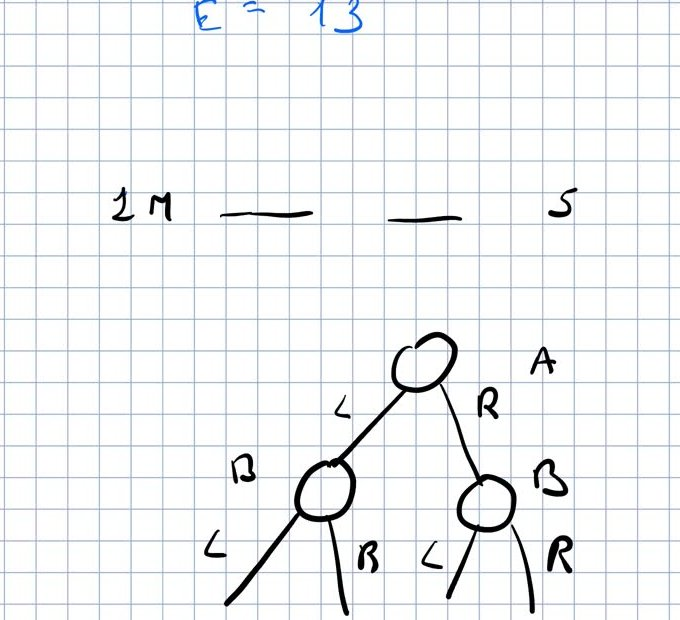
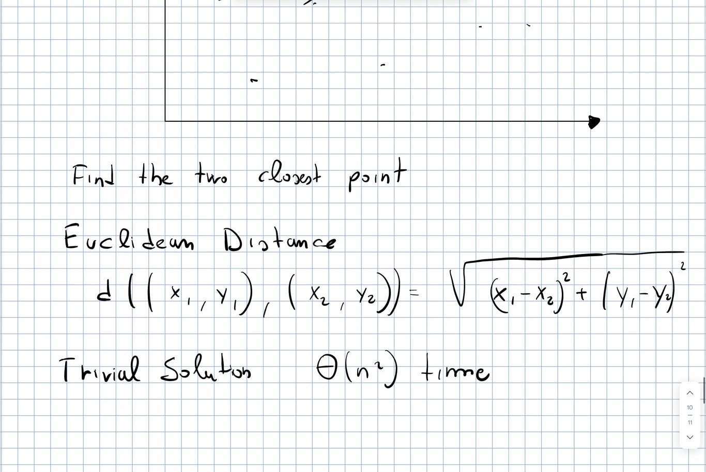
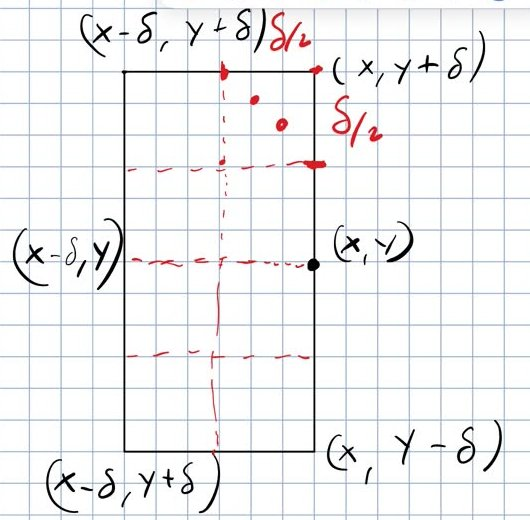
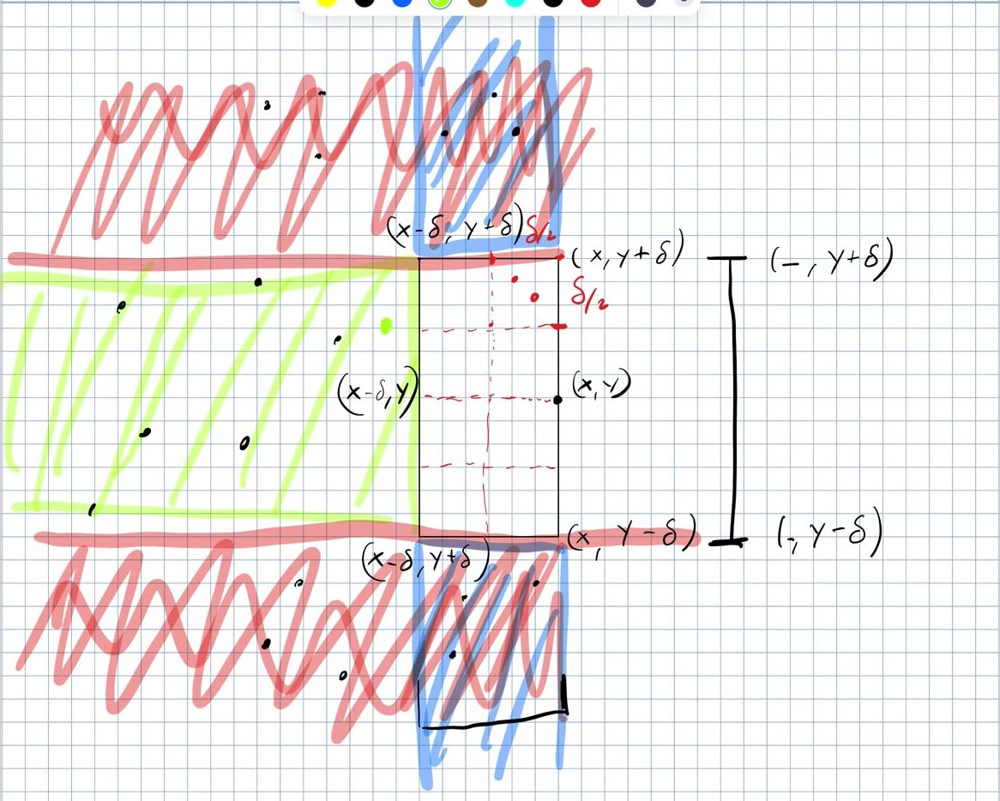

# CPC — Lecture 8 (12/10/2026): tiling and Alice & Bob puzzles, closest pair of points

> Markdown version of the PDF (generated by Claude). In the PDF: **bold** = colored highlights.

Written from the recording (`L_08.MP4`, 87 min; transcript in `L8_transcript.txt`); the images are frames of the board. *[extra]* marks my additions (not said in the lecture). Code: `Lessons/L8/src/lib.rs` (`cargo test -p l8`). Exercises: `Lessons/L8/practice`, E35–E38 (`cargo test -p practice_l8`).

> **Not in this lecture: Frogs and Mosquitoes.** Announced at the end of L7, but the whole lecture went on the two puzzles and on closest pair; at the end the prof says **“we are about one hour behind the expected programme”**. The reconstruction (with your notes on it) is now in `Lessons/L9`: provisional L9.pdf, crate `l9`, exercise E39.

> **Material from the prof.** On his web page there are **detailed notes in English (with code) for this problem and the previous ones on binary search**, and there will be notes for the next topics (Fenwick tree, …) and for dynamic programming: **use them as the reference**. He also shares last year’s handwritten notes. **Oral exam**: **in the Italian system it goes in depth**: for every topic you must know everything behind the introduction, not only the introduction (if it is your first exam here, he offers to talk about it).

**Highlights:** **general / to remember** **good: works, efficient, correct** **bad: pitfalls, wrong ideas, costs** **definitions and key results**

# Solution of the tiling puzzle (from L7)

*The chain (in green) through all the cells; the two red crosses are the removed cells.*

**Question** (L7): remove any two cells *of different colour* from the chessboard; can the rest always be tiled with dominoes, and how?

- **Solving it by cases (“what if the cells are here, what if there…”) is possible but worthless** — the prof also failed this way the first time.

- **Elegant idea: draw one chain (a closed loop) through all the cells of the board**, regardless of which cells are missing (each step goes to an adjacent cell).

- Removing two cells breaks the loop into **two sub-chains, each starting and ending with different colours** (because the removed cells have different colours). A chain that starts and ends with different colours has an even number of cells: **cover it with dominoes on consecutive cells**. Same for the other sub-chain.

- **No cases, no sub-cases**: works for any pair of removed cells of different colour.

This is *Gomory’s theorem*. `l8::board_cycle` builds the loop of the board (row 0, a snake over the other columns, back up column 0; it needs an even number of columns) and `l8::domino_tiling` returns the tiling; the test checks all pairs of cells on $8\times8$, $4\times6$, $3\times4$.

# Puzzle: Alice and Bob

*A game on $10\,2\,100\,1\,5\,6\,3\,4$: Alice (blue) gets $21$, Bob (red) $110$.*

**Game.** A sequence of $2n$ numbers (values of coins, even length). **Alice starts, then they alternate; at each turn a player takes one of the two coins at the ends.** Both have **full knowledge of the sequence**. Whoever collects more money wins. With an even length, Alice starts and Bob ends. **Question: is there a strategy for Alice to always get at least as much as Bob**, for any sequence and no matter how clever Bob is? Her only advantage is moving first.

- **Taking the largest end is not enough**: it ignores the inside of the sequence (e.g. $10\;1\;1\text{M}\;5$ with a “super coin” of one million). (If they could see only the ends that would be the only option; if they could take any coin, sort and alternate: both trivial.)

- **Super coin** (a coin larger than the sum of all the others): **Alice never takes a coin adjacent to it**. The “kernel” (super coin + its two neighbours) has odd length, and odd lengths are Bob’s turns: Bob is eventually forced to free it and Alice takes it.

*Odd (O) and even (E) positions: $O=118$, $E=13$.*

> **Strategy (found by a student): label coins in odd and even positions, compute the two sums, take the class with the larger sum.** Alice can always take *all* the coins of her class: **at the start the two ends have different parity**; she takes the one of her class; now Bob sees only coins of the other class at both ends; whatever he takes uncovers a coin of Alice’s class, and so on. In the example: odd $=10+100+5+3=118$, even $=2+1+6+4=13$. **In the worst case the two sums are equal: Alice does not win but gets as much as Bob.**

*Game tree: Alice (A) chooses L or R, then Bob (B), …*

#### Best possible gain.

**The odd/even strategy guarantees not losing, not the best gain.** To compute the best gain, explore the game tree: Alice takes left or right, then the problem is “what is the best gain for Bob on the remaining sequence”, and so on.

- **The tree has $2^{2n}$ leaves**: exponential.

- **But every node is a sub-problem on a contiguous subsequence, and there are only $\Theta(n^2)$ distinct subsequences**: the same one appears in many nodes. **Remember the solution of the subsequences already solved** $\Rightarrow$ **dynamic programming**, a topic coming soon (“quite a hard DP problem”). Bob plays only on odd lengths, Alice on even ones; e.g. maximize (my gain $-$ opponent’s gain), assuming the opponent plays optimally.

`l8::best_difference` (memoized, $\Theta(n^2)$) and the tests: Alice with the odd/even strategy never loses against a random Bob or an optimal Bob. **Why these puzzles**: they raise questions strongly related to the next topics (here: advanced dynamic programming).

# Closest pair of points

*Statement, Euclidean distance, trivial solution.*

**Problem** (“super classic”). Given $n$ points in the plane, **find the two closest ones** w.r.t. the Euclidean distance $d((x_1,y_1),(x_2,y_2))=\sqrt{(x_1-x_2)^2+(y_1-y_2)^2}$.

- **Trivial solution: all pairs, $\Theta(n^2)$ time.** **Target: $\Theta(n\log n)$.**

- There is a $\Theta(n\log n)$ **divide and conquer** solution (split the points in two halves, solve each, deal explicitly with the “dangerous” points near the cut): **worth reading**, not done in class.

- Here: **sweep line** (as in L7): conceptually a vertical line sweeps the plane; in practice **sort by $x$ and process the points in that order**.

## The algorithm with an oracle

Sort the points by $x$ ($\Theta(n\log n)$) and process them left to right, keeping **$\delta$ = smallest distance among the points processed so far** (only among them). When we reach $(x,y)$: **comparing it with all the previous points is quadratic again**; we want to compare it only with the points that *may* be at distance $<\delta$.

*The rectangle $[x-\delta,x]\times[y-\delta,y+\delta]$ split into $8$ squares of side $\delta/2$.*

- **Candidates: the points in the rectangle $[x-\delta,x]\times[y-\delta,y+\delta]$** (only on the left: the points on the right are compared with $(x,y)$ when they are processed). Any point outside it is at distance $>\delta$ already in one coordinate.

- Suppose an *oracle* gives the points in the rectangle: compute their distances from $(x,y)$, update $\delta$, move on.

- **Few points in the rectangle**: **two points inside it are at distance $\ge\delta$**, otherwise $\delta$ would already be smaller (both were processed before). **At most $8$**: split the rectangle in $8$ squares of side $\delta/2$; two points in the same square would be at distance $\le\delta/\sqrt2<\delta$ *[extra]*, so at most one per square. (A more involved proof gives $6$.) **So, with the oracle, linear time after sorting.**

**On the board the bottom-left corner is labelled $(x-\delta,y+\delta)$: it is $(x-\delta,y-\delta)$.**

## Implementing the oracle

*Blue: what an $x$-sorted range returns. Green: what a $y$-sorted range returns besides the rectangle.*

- **BST sorted by $x$** (range $x' \ge x-\delta$): it excludes only the points on the far left; it returns the vertical strip above and below the rectangle (**blue**): **potentially most of the points** (adversarial input: wide in $y$, narrow in $x$).

- **BST sorted by $y$** with the points processed so far: find the first point with $y'\ge y-\delta$ (successor, $O(\log n)$), then move to the next one in $O(1)$ until $y' > y+\delta$. It returns the rectangle plus the horizontal band on its left (**green**): still potentially many points. **So what is the difference?**

- **Crucial difference: a green point ($x'<x-\delta$) is useless forever**: the next points have larger $x$ and $\delta$ only decreases, so its distance from any future point is $>\delta$ already in $x$. A blue point instead may be needed later (it may be close to a future point on the right). **So every green point we touch is deleted from the BST immediately.**

> **Algorithm.** Sort by $x$. For each point $(x,y)$: range query on the BST sorted by $y$ for $[y-\delta,y+\delta]$; for each point found, if $x'<x-\delta$ delete it, otherwise compute the distance and update $\delta$; then insert $(x,y)$ in the BST. **Cost**: range search $O(\log n)$ per point; at most $8$ (6) points in the rectangle per point; **every point is inserted once and deleted at most once**, so the green points cost $O(n\log n)$ overall. **Total $\Theta(n\log n)$.**

- **The BST must be built step by step**, inserting each point when it is processed: if all the points were inserted at the beginning, the range would also return points on the right of the rectangle, which are not restricted by $x$.

- **The bound on the points in the rectangle is needed**: they are not deleted, so if there could be many of them (e.g. $\Theta(n)$) the algorithm would be quadratic.

`l8::closest_pair` works with squared integer distances (no square roots) using `BTreeSet<(y, x, index)>` and `range`; it is tested against brute force and on $2000$ points with the same $x$ (the adversarial case of the lecture).

#### Next.

Frogs and Mosquitoes (the BST problem announced in L7, provisional notes in `Lessons/L9`), then Fenwick tree and the rest of the programme; **Hands-On 1** is open (`CPC/HandsOn/HO1`).
