# CPC — Lecture 9 — Frogs and Mosquitoes (dynamic 1D point location) · Static prefix sums · Ilya and Queries

_Markdown version of L9.pdf (generated automatically from L9.tex; the PDF is the reference)._

**Sources.** Recording `Lessons/L9/L09.MP4` (97 min) and its automatic transcript `L9_transcript.txt` (not revised); the prof’s handwritten board (frames of the recording, `board/l9_*.jpg`); the prof’s 2025 notes on Frogs and Mosquitoes (`Lessons/L6/Binary_search_2025.pdf` p. 10–13); the prof’s blog post *The Power of Prefix Sums* (<https://pages.di.unipi.it/rossano/blog/2023/prefixsums>, code copied verbatim); your notes `Lessons/L9/notes.md`. Everything marked **\[extra\]** was *not* said or written in the lecture (my explanations, examples, code).

Code: `Lessons/L9/src` (`cargo test -p l9`). Exercises: `Lessons/L9/practice`, E39–E42 (`cargo test -p practice_l9`).

**Highlights:** general / to remember good: works, efficient, correct bad: pitfalls, wrong ideas, costs **definitions and key results**

**Where we are.** L7–L8 ended the sweep line (max overlapping intervals, closest pair). This lecture finally does **Frogs and Mosquitoes** (announced in L7, mandatory), with a new format: the prof states the problem, stops, and the class builds the solution by discussion (*“this year I changed my mind, I let you participate more and me present less”*). Then it opens a new block of lectures, **range queries / prefix sums** (*“at least two weeks or more”*): static prefix sums today, dynamic prefix sums next lecture (“a super, super elegant solution”), and later a more general but less elegant data structure.

# Frogs and Mosquitoes (Codeforces 609F, mandatory)

## The problem

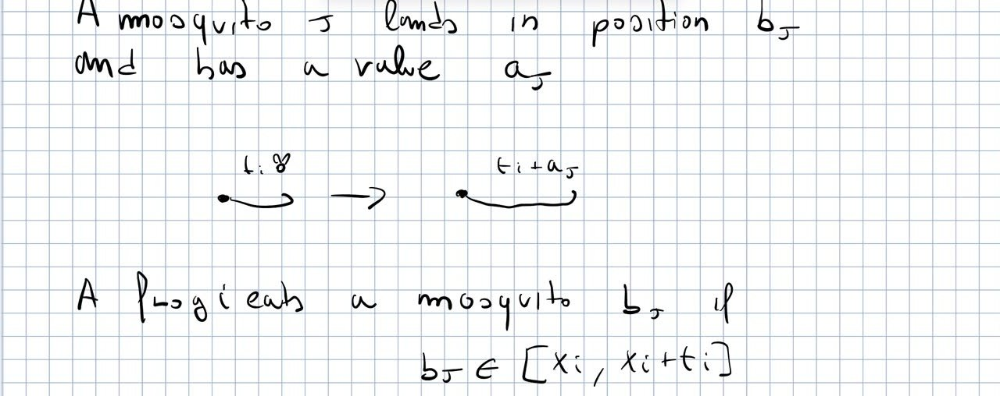 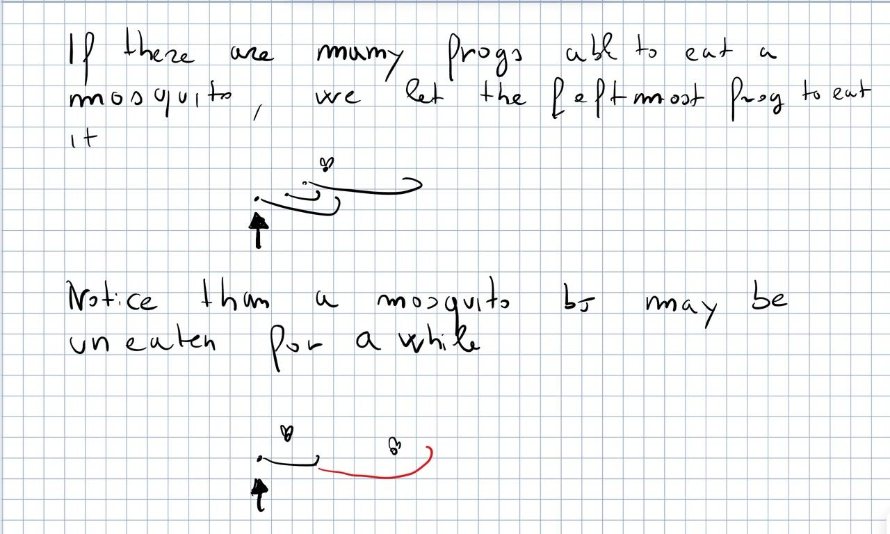

- $n$ frogs on the $x$-axis. Frog $i$ is a point $x_i$ with a value $t_i$, the length of its tongue: it covers the interval $[x_i,x_i+t_i]$.

- $m$ mosquitoes land on the axis one after the other; mosquito $j$ has a position $b_j$ and a value (size) $a_j$.

- **Frog $i$ eats mosquito $j$ if $b_j\in[x_i,x_i+t_i]$**; then its tongue grows: $t_i\gets t_i+a_j$.

- If many frogs can eat the mosquito (a “cluster” of overlapping frogs), **the leftmost one eats it**.

- If the mosquito lands “in the middle of nothing”, it stays there, possibly for a while: a tongue that grows later may reach it, and then it is eaten (which makes that tongue grow again, and so on). There may be several waiting mosquitoes, and where the next mosquito lands decides which frog grows and therefore which waiting mosquitoes get eaten.

- Output: the final situation (for every frog the number of eaten mosquitoes and the final tongue length, in the Codeforces version).

**Q&A in class.** *Can we process the mosquitoes in any order, e.g. as if they were all already on the axis?* No: the order changes the result (a frog that eats one mosquito first may grow enough to steal the next one from another frog). **The order of arrival is part of the input**; with the order fixed there is no ambiguity. (Simultaneous arrivals would be “full of ambiguities”.)

**Target:** **$\Theta((n+m)\log(n+m))$ time.**

## A serious problem in disguise: dynamic 1D point location

- **Point location**: we have objects; given a point, find which object contains it. *1D* = the objects are intervals (2D: regions/rectangles in the plane, then 3D, 4D, …). It belongs to the class of *geometric algorithms*.

- Frogs are intervals and mosquitoes are query points. With fixed intervals this is **1D point location**; with intervals that change it is **dynamic 1D point location**.

- The hardness grows very rapidly with the number of dimensions, and a dynamic problem is usually harder than the static one.

- Here we have a special, slightly easier instance: the intervals are dynamic but they only grow, and only to the right.

“Apart from talking about frogs and mosquitoes, this is a serious problem.” The question could also be phrased differently (size of the final set of intervals, longest tongue, …): what matters is to be able to say something about the final intervals.

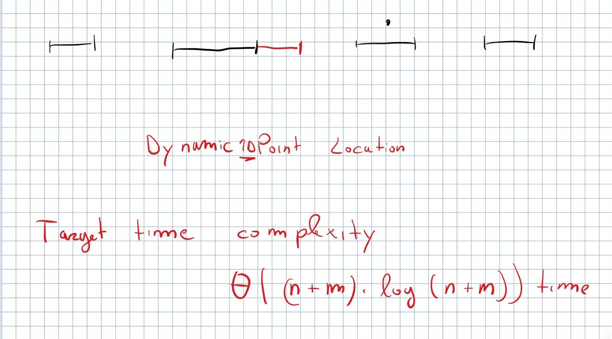

## First idea: predecessor (no overlaps)

Proposed by a student: sort the frogs by $x$. Forget for a moment about overlaps (no two frogs interfere). For mosquito $b_j$:

- **the candidate frog is the predecessor of $b_j$**: the largest $x_i\le b_j$ (*predecessor* = given a number and a set of positions, the greatest position smaller than or equal to it);

- no condition on the right extreme is needed for the search: once we have $x_i$, either $b_j\le x_i+t_i$ and frog $i$ eats it, or nobody eats it (for the moment);

- predecessor on a sorted array = binary search, $O(\log n)$ per mosquito.

## Issue \#1: overlapping frogs

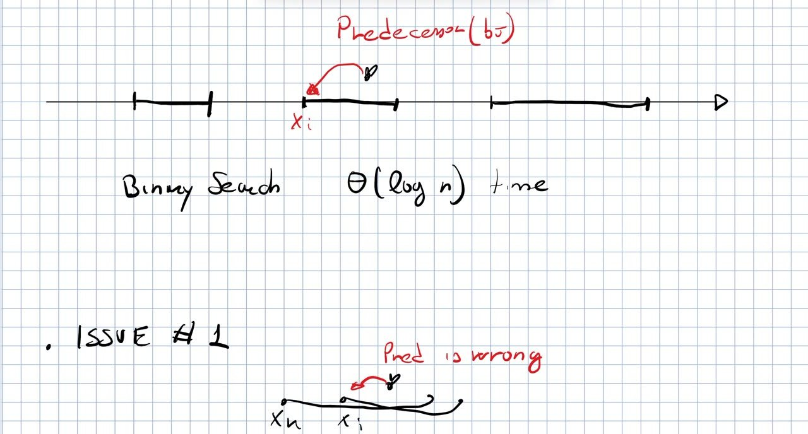 If two tongues overlap ($x_k<x_i$ and $x_k+t_k\ge x_i$) and the mosquito lands in the common part, the predecessor is no longer the right answer. Concrete example from the board, frogs as intervals: $[1,10]$, $[3,14]$, $[4,13]$, $[6,18]$, later also $[0,20]$.

- Position $8\to[1,10]$; position $11\to[3,14]$. But the predecessor of $11$ among the starts is $6$: wrong, a frog with a smaller start contains $11$ and we want the leftmost.

- “Go back one frog at a time” is linear: it is not even clear when to stop (add $[0,20]$ and query $19$: you must go back to the very beginning).

- Binary search does not work either: it needs a *monotone* predicate (yes yes yes no no no). Here “does this frog contain the point?” can alternate yes/no along the frogs, depending on the query (e.g. for $19$: no, no, no, yes, and adding more frogs we can alternate).

- Scanning all frogs from left to right and stopping at the first that contains the point works, but it is linear. *Can we do it in logarithmic time?*

**Solution (from the class).** Two cases:

1.  **An interval fully contained in another one**: the contained frog will never eat anything (the bigger one is on its left and eats everything there) $\Rightarrow$ kill the frog.

2.  **Partial overlap**: move the left extreme of the right frog to just after the end of the left one, i.e. cut the overlapped piece (“I don’t know which of the two is worse for the frog”).

Preprocessing: sort by $x$, scan from left to right remembering how far the current tongue reaches; every frog that starts before the current end is either reduced or killed. $O(n\log n)$. After it, **the intervals are disjoint and the predecessor is the right frog** again.

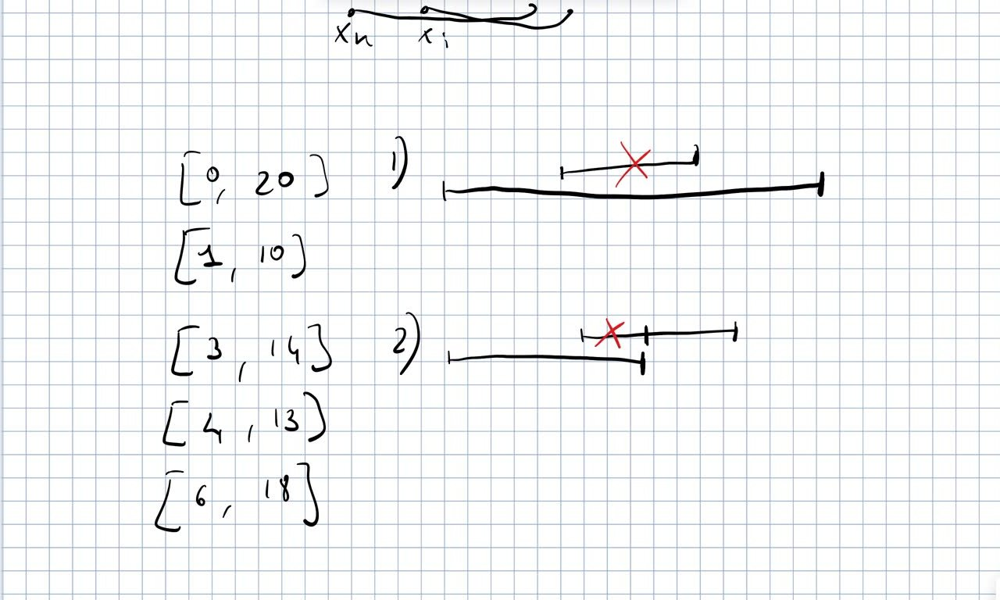

#### The interval of a frog after the cut.

**\[extra\]** Careful: what we cut is only the *start* used for the search; the frog still eats with its real tongue, its right end stays $x_i+t_i$. Storing (start, end) per frog, with start $\ge x_i$, is enough.

## Issue \#2: tongues grow

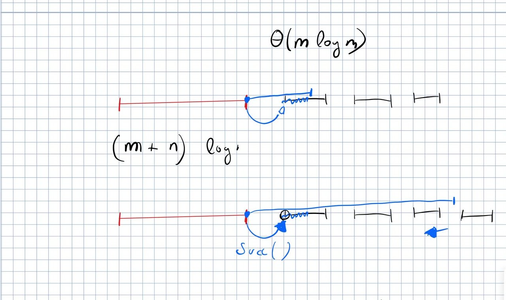 When a frog eats, its interval becomes longer and may overlap the next frogs again, fully or partially. We must make the intervals disjoint again.

- Find the first frog after the one that grew: the successor of its start (the predecessor of the new end would also work, “it’s the same, but it changes what we have to do next”). $O(\log n)$.

- Repeat: if the next frog is **fully covered**, remove it and move to the next one; if it is **partially covered**, move its start just after the new end and **stop**; if it does **not overlap**, **stop**.

- How many frogs do we touch? Possibly many (a very big mosquito), so one step costs $O(\log n)$ + the number of modified frogs. But if we visit more than one frog, all of them except the last are killed, and every frog is killed at most once: overall $O(n\log n)$. (*“How many times have we seen this argument so far? Almost every time.”*)

**Data structure:** **the frogs are stored in a BST sorted by (current) starting point**, with the tongue length as satellite information (not indexed). Why a BST and not a sorted array? Because we remove frogs and change their starting point (change of start = remove the frog and insert it again). Successor vs predecessor: asymptotically the same; in practice the successor is better, because after finding the first frog we just move to the next node of the in-order visit of the BST.

## Issue \#3: mosquitoes not eaten (yet)

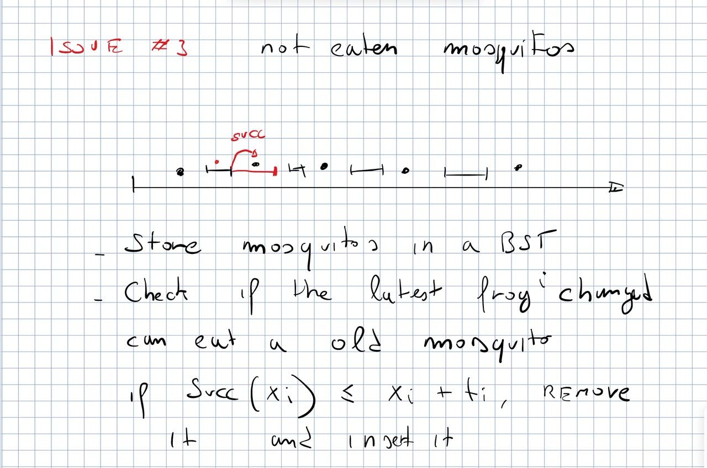 *“Imagine my garden: a lot of mosquitoes ready to eat me, and some frogs here and there.”* How do we get *triggered* when a waiting mosquito becomes eatable?

- **Store the uneaten mosquitoes in a BST sorted by position.**

- A waiting mosquito can become eatable only when a tongue gets longer. So, every time frog $i$ grows: look for the successor of $x_i$ in the mosquito BST; if it is $\le x_i+t_i$, remove it from the BST and treat it as a mosquito that has just arrived (we already know the frog that eats it), or directly increase the tongue of that frog. Then check again.

- If nothing is found, do nothing: there is nothing to trigger explicitly, we just look in the BST after each change.

**Implementation suggested by the prof**: two procedures calling each other. (1) *insert a mosquito*: go down the frog BST, check if it is eaten; if yes, increase the tongue, kill/cut the following frogs, then call (2) on that frog. (2) *given a frog*: search the successor in the BST of uneaten mosquitoes; if the tongue does not reach it, stop; otherwise give that mosquito to (1). The one point to keep: a mosquito taken from the BST must be one that the frog really eats, otherwise the complexity may grow.

**Q&A.** A student proposed to do it in one sweep (when the frog eats the first waiting mosquito and grows, it is necessarily the right frog for the next ones: keep going “next, next, next”). Prof: yes, it can be faster in practice (no ping-pong between the two functions); the two-procedure version is probably not the fastest, but it is easier to implement.

## Complexity

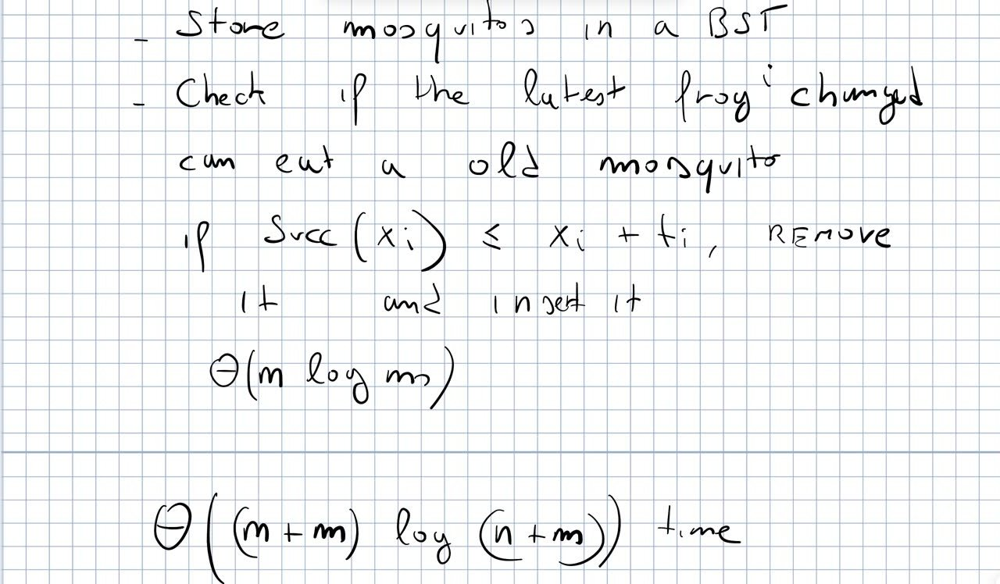

- Remove the initial overlaps: sort + scan, $O(n\log n)$.

- Each mosquito: one predecessor search, $O(\log n)$ $\Rightarrow$ $O(m\log n)$; plus fixing the following frogs, $O(n\log n)$ overall (each frog is killed once).

- Waiting mosquitoes: each one is inserted and removed once, a successor search each time, $O(m\log m)$.

**Total $O(n\log n+m\log n+m\log m)=O((n+m)\log(n+m))$**, with two BSTs. **Why $n+m$?** We write $n+m$ when we do not know which of the two is larger ($m$ small: $n$ dominates, or the opposite). It is the same as $\max(n,m)$ in asymptotic analysis, just easier to write.

#### **\[extra\]** Codeforces sample, step by step.

Frogs $(x,t)$: $(10,2),(15,0),(6,1),(0,1)$; mosquitoes $(b,a)$ in order: $(110,10),(1,1),(6,0),(15,10),(14,100),(12,2)$. $(110,10)$: nobody, it waits. $(1,1)$: frog at $0$ eats it, tongue $2$. $(6,0)$: frog at $6$. $(15,10)$: frog at $15$ (tongue $0$ reaches exactly $15$), tongue $10$. $(14,100)$: nobody ($14$ is after $10+2$ and before $15$), waits. $(12,2)$: frog at $10$ eats it, tongue $4$, now reaches $14$: eats $(14,100)$, tongue $104$, reaches $110$: eats $(110,10)$, tongue $114$ (and the frog at $15$ is now fully covered: it is killed, but keeps its results). **Output: $(3,114),(1,10),(1,1),(1,2)$.**

**\[extra\]** `l9::frogs_and_mosquitoes` implements the three points with `BTreeMap` (predecessor = `range(..=b).next_back()`, successor = `range(x..).next()`); it passes the sample and is tested against an $O(nm)$ brute force on random inputs.

# Range queries and static prefix sums

Many, many problems can be solved by asking questions about a range (a subarray) of a bigger array. The problem can be **static** or **dynamic**; the query can be a sum (*prefix sums*), a minimum, a maximum, and many other operations. Plan: sums first, static today, dynamic next lecture. “Prefix sums are surprisingly popular”: in many problems that apparently do not need them, sooner or later prefix sums show up.

## The problem

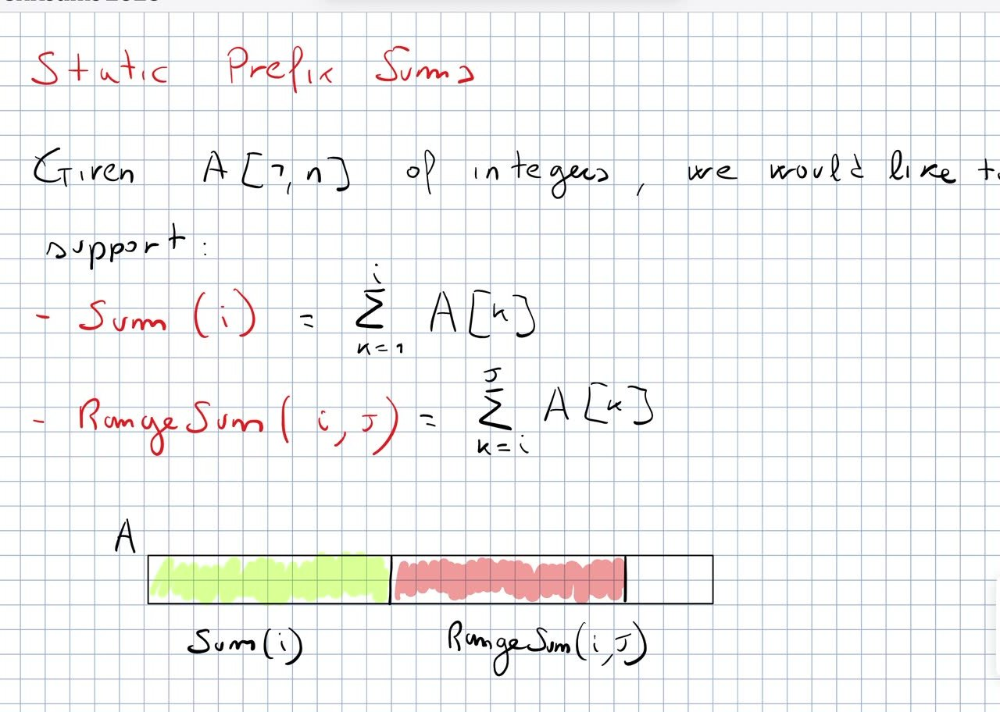 Given an array $A[1,n]$ of integers, support $$\textsf{Sum}(i)=\sum_{k=1}^{i}A[k] \qquad\qquad \textsf{RangeSum}(i,j)=\sum_{k=i}^{j}A[k].$$ **It is enough to support Sum**: **$\textsf{RangeSum}(i,j)=\textsf{Sum}(j)-\textsf{Sum}(i-1)$**.

## A new entry in the checklist: how many distinct queries?

The checklist so far: binary search (for the answer), two pointers, sweep line. New entry: **When you are asked for a data structure that answers queries, ask yourself: how many distinct queries are there?** If they are few, precompute and store all the answers; the space is proportional to the number of answers to remember.

- A student’s example: if only three specific ranges are ever asked (and the array is static), just compute and store these three answers.

- RangeSum: $\Theta(n^2)$ distinct queries. But Sum: only $n$, and RangeSum follows from two Sums. So store the $n$ answers: $$P[i]=\textsf{Sum}(i) \qquad\Rightarrow\qquad \textsf{Sum}(i)\ \text{in}\ O(1).$$

- We can even discard $A$: $A$ is recovered as the difference of consecutive elements of $P$, so the data structure is **implicit** (no more space than the original array).

- Precomputing is usually easy only for static problems: in the dynamic case the real problem is updating the precomputed answers.

- Often the difficulty is computing the answers efficiently: computing every $P[i]$ from scratch, “following the definition”, is a stupid $\Theta(n^2)$. Here it is obvious: accumulate the sum from left to right, $P$ is built in linear time. With other data structures this step may need a clever idea.

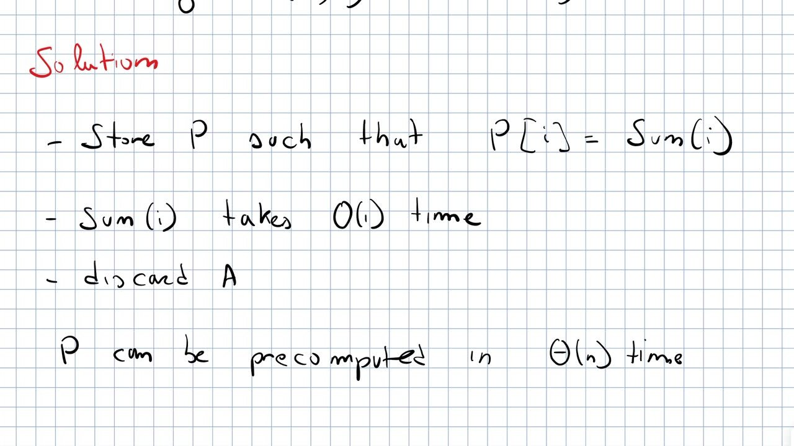 **Prof’s code** (blog, verbatim): prefix sums with `scan`.

    let a = vec![2, 4, 1, 7, 3, 0, 4, 2];

    let psums = a
        .iter()
        .scan(0, |sum, e| {
            *sum += e;
            Some(*sum)
        })
        .collect::<Vec<_>>();

    assert!(psums.eq(&vec![2, 6, 7, 14, 17, 17, 21, 23]));

**\[extra\]** In `l9::prefix_sums` I also keep a version with a leading $0$ ($p[0]=0$, length $n+1$): then the sum of the half-open range `a[l..r]` is `p[r] - p[l]`, with no special case for $l=0$.

## Ilya and Queries (Codeforces 313B)

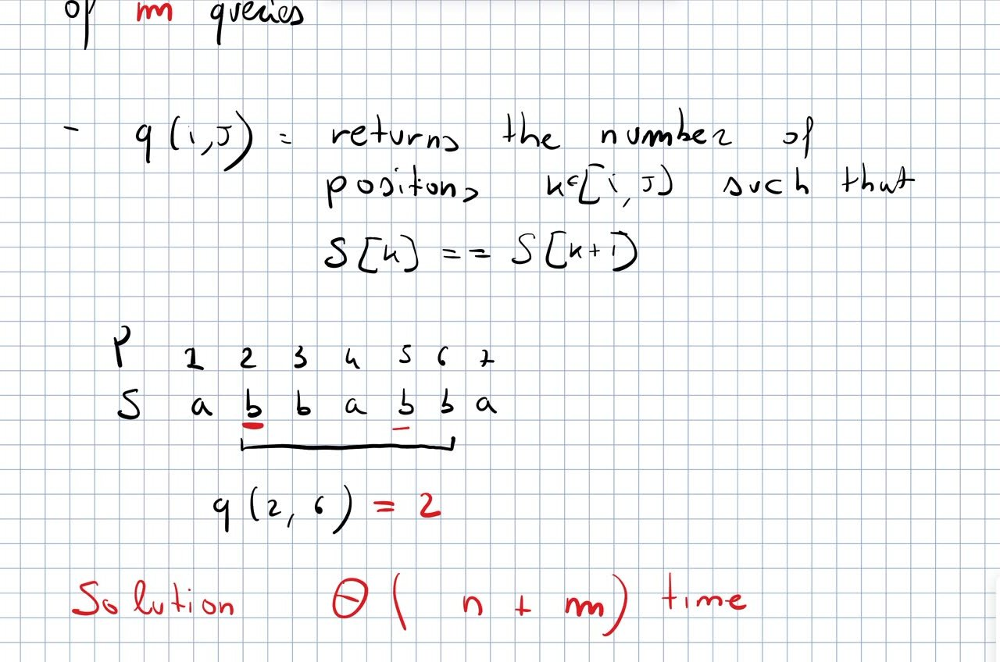 **Problem.** A string $S[1,n]$ over two symbols (`a`, `b` in the lecture) and $m$ queries. $Q(i,j)$ returns **the number of positions $k$ with $i\le k<j$ such that $S[k]=S[k+1]$**.

**Example.** $S=\texttt{a b b a b b a}$ (positions $1..7$), $Q(2,6)$ looks at `b b a b b`: pairs $(2,3)$ equal, $(3,4)$, $(4,5)$ different, $(5,6)$ equal $\Rightarrow$ **2**.

**Target:** **$O(n+m)$ time** ($n$ for the preprocessing, $m$ for the queries). Such a bound could in principle be amortized (first query expensive, the others cheap), but here we get constant time for every query.

#### Offline vs online queries.

- **Offline**: all the queries are given at the beginning, the answers are expected at the end. **Online**: the queries arrive one at a time and each answer is wanted before the next query.

- Online is usually harder: every online solution is also offline, not vice versa. In the course we will see algorithms that work only offline (by rearranging the queries) and data structures that are efficient online.

- How does a judge force the online version? If there are updates (insertions/deletions) the queries must be processed in order; without updates, make the input of a query depend on the output of the previous one (e.g. $j$ depends on the previous answer).

- The same trick is useful when benchmarking: the compiler is clever and may reorganize a batch of independent queries; making them dependent forces them to run one by one.

- For Ilya and Queries it does not matter: the online solution already reaches the target.

#### Solution (from the class).

Build the binary vector $B[k]=1$ iff $S[k]=S[k+1]$, then prefix sums on $B$. The answer to $Q(i,j)$ is the number of ones in $B[i..j-1]$, i.e. a range sum: subtract two prefix sums, $O(1)$ per query, $O(n)$ preprocessing. For the example: $B=\texttt{0 1 0 0 1 0}$ (length $n-1$). Prefix sums of a binary vector count the ones in any range. A student’s implementation note: $B$ has length $n-1$ (one entry per adjacent pair), so use $j-1$ as right end, “so we don’t overshoot”.

**Prof’s code** (blog, verbatim):

    #[derive(Debug)]
    struct Ilya {
        psums: Vec<usize>,
    }

    impl Ilya {
        pub fn new(s: &str) -> Self {
            let psums = s
                .as_bytes()
                .windows(2)
                .map(|w| if w[0] == w[1] { 1usize } else { 0usize })
                .scan(0, |sum, e| {
                    *sum += e;
                    Some(*sum)
                })
                .collect::<Vec<_>>();

            Self { psums }
        }

        // Queries use 0-based indexing
        pub fn q(&self, i: usize, j: usize) -> usize {
            assert!(i < j);
            assert!(j <= self.psums.len());

            self.psums[j - 1] - if i != 0 { self.psums[i - 1] } else { 0 }
        }
    }

**\[extra\]** With 0-based indices the lecture’s $Q(2,6)$ is `q(1, 5)`: it returns `psums[4] - psums[0]` $=2-0=2$. Tested in `l9::prefix_sums` on the example and against a brute force.

# Next time

- The lecture ended here (“it’s already 3:35, we can solve only the first one”): the other prefix-sum problems will be solved next time (Monday 19/10). In the blog post they are *Number of Ways* (Codeforces 466C) and *Little Girl and Maximum Sum* (Codeforces 276C); then dynamic prefix sums (“a super, super, super elegant solution”); **\[extra\]** in last year’s course this was the Fenwick tree (your notes of today confirm it).

- No homework was assigned in this lecture. Frogs and Mosquitoes is **mandatory** on the course page (row of 07/10).
