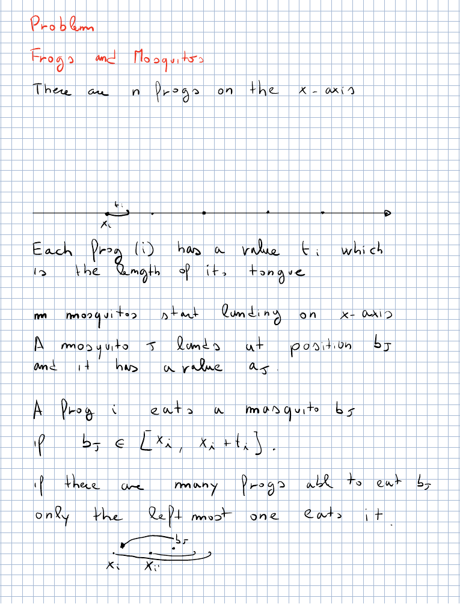
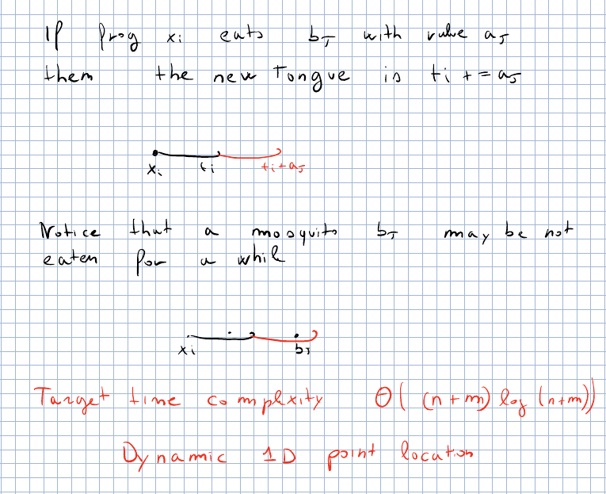
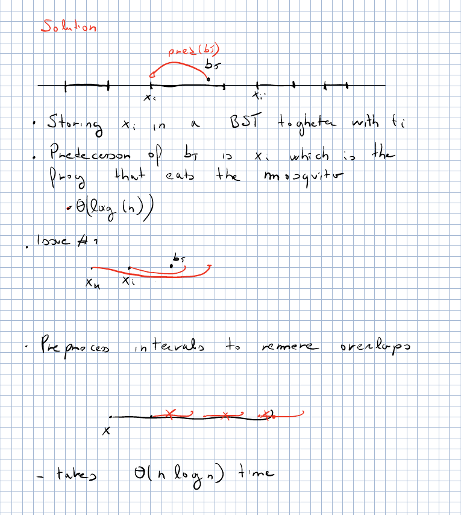
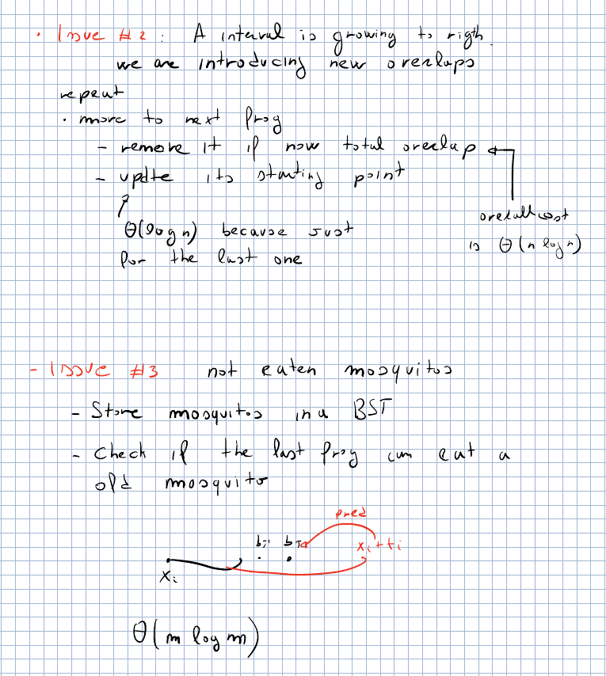

# CPC — Lecture 9 (provisional): Frogs and Mosquitoes

> Markdown version of the PDF (generated by Claude). In the PDF: **bold** = colored highlights.

> **PROVISIONAL — reconstructed, not from a lecture.** Frogs and Mosquitoes (Codeforces 609F, **mandatory**) was announced at the end of L7 (*“a problem that needs a lot of binary search trees”*) but not explained in L7 nor in L8 (the prof is about one hour behind the programme). Source: the prof’s 2025 notes (`Lessons/L6/Binary_search_2025.pdf` p. 10–13); the explanations, the worked example and the code are mine (*[extra]*). Check everything against the lecture when it is done.

Code: `Lessons/L9/src/lib.rs` (`cargo test -p l9`). Exercise: `Lessons/L9/practice`, E39 (`cargo test -p practice_l9`).

**Highlights:** **general / to remember** **good: works, efficient, correct** **bad: pitfalls, wrong ideas, costs** **definitions and key results**

# Frogs and Mosquitoes

*Prof.’s notes of last year, Binary_search_2025.pdf p. 10*

**Problem** (Codeforces 609F, **mandatory**). $n$ frogs on the $x$-axis: frog $i$ is at $x_i$ and has a tongue of length $t_i$. $m$ mosquitoes land one at a time: mosquito $j$ lands at $b_j$ and has value (size) $a_j$. **Frog $i$ can eat mosquito $j$ if $b_j\in[x_i,x_i+t_i]$**; **if many frogs can, only the leftmost one eats it.** **When frog $i$ eats a mosquito of value $a_j$, its tongue grows: $t_i \gets t_i + a_j$.** Output, for each frog, how many mosquitoes it ate and its final tongue length.

*Prof.’s notes of last year, Binary_search_2025.pdf p. 11*

**Notice**: **a mosquito may be not eaten for a while**: nobody reaches it when it lands, but later a tongue grows enough to reach it, and then it is eaten (possibly causing another growth, and so on).

> **Target time complexity $\Theta((n+m)\log(n+m))$.** In the notes the problem is classified as **dynamic 1D point location**: a set of intervals that changes over time, and queries “which interval contains this point?”.

## Solution

*Prof.’s notes of last year, Binary_search_2025.pdf p. 12*

- **Store the $x_i$ in a BST together with $t_i$.** **The candidate frog for $b_j$ is the predecessor of $b_j$** (largest $x_i\le b_j$): it eats the mosquito if $b_j\le x_i+t_i$. $\Theta(\log n)$.

- **Issue \#1: overlapping intervals.** **The predecessor is not necessarily the right frog**: a frog $x_h$ further left with a long tongue may also reach $b_j$, and it has priority. **Preprocess the intervals to remove overlaps**: scanning the frogs by $x$, frog $i$ keeps only the part of $[x_i,x_i+t_i]$ not covered by the frogs on its left (its start moves after their end; if it is covered entirely it is removed: it will never eat). **Now the intervals are disjoint and the predecessor is the right one.** Sorting: $\Theta(n\log n)$.

*Prof.’s notes of last year, Binary_search_2025.pdf p. 13*

- **Issue \#2: an interval grows to the right**, **introducing new overlaps**. Repeat: move to the next frog; remove it if it is now totally overlapped, otherwise update its starting point (just after the new end) and stop. Each single step is $\Theta(\log n)$; **a frog is removed at most once, so the overall cost is $\Theta(n\log n)$** (amortized: only the last frog visited is not removed).

- **Issue \#3: not eaten mosquitoes.** **Store them in a BST by position.** After frog $i$ grows, check whether it can eat an old mosquito: the first waiting mosquito at position $\ge$ the start of its interval and $\le x_i+t_i$ (a successor query); eat it, grow, and check again. **Each mosquito is inserted and removed once: $\Theta(m\log m)$.**

> **Total: $\Theta((n+m)\log(n+m))$ time with two BSTs** (frogs by start of their disjoint intervals, waiting mosquitoes by position).

`l9::frogs_and_mosquitoes` implements exactly these three points with `BTreeMap` (predecessor = `range(..=b).next_back()`); it passes the Codeforces sample and is tested against an $O(nm)$ brute force on random inputs.

#### *[extra]* Codeforces sample.

Frogs $(x,t)$: $(10,2),(15,0),(6,1),(0,1)$; mosquitoes $(b,a)$ in order: $(110,10),(1,1),(6,0),(15,10),(14,100),(12,2)$. $(110,10)$: nobody, it waits. $(1,1)$: frog at $0$ eats it, tongue $2$. $(6,0)$: frog at $6$. $(15,10)$: frog at $15$ (tongue $0$ reaches exactly $15$), tongue $10$. $(14,100)$: nobody ($14$ is after $10+2$ and before $15$), waits. $(12,2)$: frog at $10$ eats it, tongue $4$, now reaches $14$: eats $(14,100)$, tongue $104$, reaches $110$: eats $(110,10)$, tongue $114$. **Output: $(3,114),(1,10),(1,1),(1,2)$.**
